# Sinfín y rueda (add-in de Fusion 360)

Genera un tornillo sin fin y su rueda dentada, paramétricos y pensados para imprimir sin soportes.

Está en **SÓLIDO > CREAR > Sinfín y rueda** (diseños de pieza e híbridos) y en **ENSAMBLAJE > CREAR** (diseños de ensamblaje).

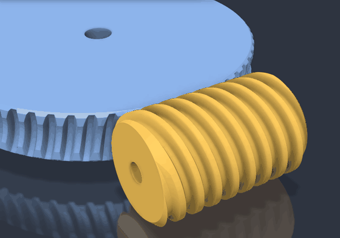

Las imágenes son de un juego generado con el add-in: módulo 1.5, 60 dientes, sinfín de 3 entradas (relación 20:1) y flanco de 30°. En la animación, una vuelta del sinfín hace girar la rueda 3 dientes.

| Conjunto | Dientes de la rueda (lisos, de la solevación) |
|---|---|
| 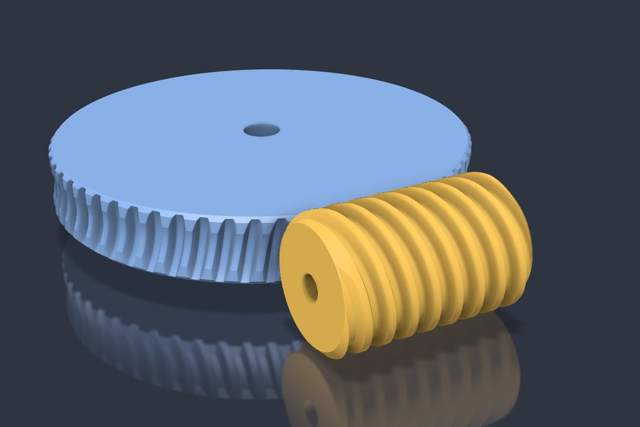 | 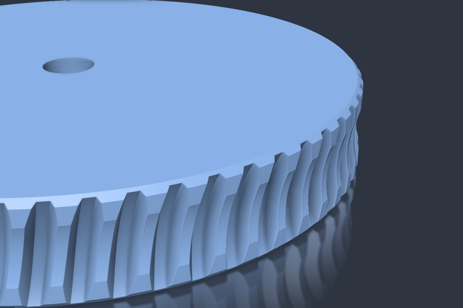 |

## Instalación

### Sin el repo (zip)

1. Descarga `WormGear-<versión>.zip` de las [Releases](https://github.com/buho29/smart-sentry/releases) y descomprímelo entero.
2. Haz doble clic en `instalar.bat`. Copia la carpeta `WormGear` en la carpeta de complementos de Fusion y no pide permisos de administrador.
3. En Fusion: **Utilidades > Complementos** (Mayús+S) > *WormGear* > **Ejecutar**, y marca *Al iniciar*.

Para actualizar, ejecuta el `instalar.bat` de la versión nueva: se conservan los últimos valores del diálogo. Para quitarlo, usa `desinstalar.bat`. Ninguno de los dos toca una instalación de desarrollo hecha con `install.ps1` (un enlace).

En Mac, copia a mano la carpeta `WormGear` del zip a `~/Library/Application Support/Autodesk/Autodesk Fusion 360/API/AddIns/`.

**Para sacar una versión nueva:**
1. Sube `version` en `WormGear.manifest`.
2. Ejecuta `powershell -ExecutionPolicy Bypass -File installer\make_release.ps1`. Deja el zip en `dist/`, que no va en git.
3. Sube el zip a una Release de GitHub.

### Con el repo (desarrollo)

```powershell
powershell -ExecutionPolicy Bypass -File 3D\fusion-addins\WormGear\install.ps1
```

El script crea un enlace (junction) desde `%APPDATA%\Autodesk\Autodesk Fusion 360\API\AddIns\WormGear` hasta esta carpeta. Fusion carga directamente lo que hay en el repo.

Después, en Fusion: **Utilidades > Complementos** (Mayús+S) > *WormGear* > **Ejecutar**. Marca *Al iniciar* para que arranque siempre.

Si cambias el código, para el complemento y vuelve a ejecutarlo.

## Parámetros

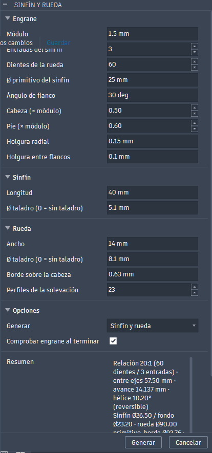

| Grupo | Parámetro | Por defecto |
|---|---|---|
| Engrane | Módulo | 1.5 mm |
| | Entradas del sinfín | 1 |
| | Dientes de la rueda | 30 |
| | Ø primitivo del sinfín | 16 mm |
| | Ángulo de flanco (axial) | 45° (sin voladizos de más de 45° con el sinfín de pie) |
| | Cabeza / pie | 0.5 / 0.6 × módulo (diente bajo: con 45° uno normal acaba en punta) |
| | Holgura radial | 0.15 mm |
| | Holgura entre flancos | 0.1 mm |
| Sinfín | Longitud, Ø taladro | 30 mm, 5.1 mm |
| Rueda | Ancho, Ø taladro | 10 mm, 8.1 mm |
| | Borde sobre la cabeza | 0.63 mm |
| | Perfiles de la solevación | 23 |

El cuadro *Resumen* del diálogo se actualiza mientras se teclea. Muestra:
- la relación de transmisión;
- la distancia entre ejes;
- el ángulo de hélice, y si el sinfín se autobloquea;
- los diámetros;
- los avisos: cresta del sinfín muy fina, garganta de más de 45°, voladizos, socavado, dientes en punta y poco cubo.

Con un error no deja generar.

Los últimos valores se guardan en `settings.json`, que no va en git.

## Qué crea

- **En un diseño de ensamblaje o híbrido:** tres componentes:
  - "Sinfín …" y "Rueda …";
  - "Ejes …", fijo, con las líneas de los dos ejes.

  Cada pieza tiene una junta de giro sobre su eje, y las dos van unidas por un *enlace de movimiento* con la relación: arrastras el sinfín y gira la rueda.
- **En un diseño de pieza:** dos cuerpos, sin juntas.

Todo queda en un grupo de la línea de tiempo y se deshace con un solo Ctrl+Z.

**Cómo imprimirlo:** el sinfín de pie y la rueda tumbada.

## Cómo se calcula la rueda

La rueda no se dibuja a ojo, ni se mecaniza con cientos de restas, que dejarían cientos de caras por diente. Se calcula así.

Los diagramas son del juego por defecto (m1.5, 30 dientes, 1 entrada, flanco de 45°) y salen de la misma matemática del add-in: `python img/diagramas.py`.

**1. Se corta con planos.** Para cada plano z = c paralelo al plano medio de la rueda, se corta con ese plano el "cortador": el sinfín con cada flanco engordado media holgura y la cabeza un poco más alta.

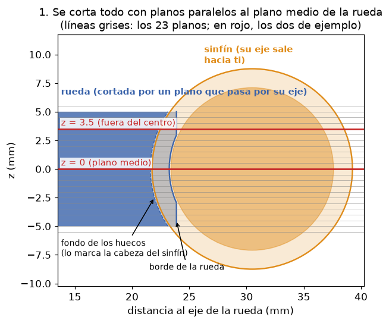

**2. En cada plano, el sinfín es una cremallera.** Al girar, el filete del sinfín, que es un helicoide, solo se desplaza a lo largo de su eje sin salir del plano. La rueda gira alrededor de Z, así que el plano tampoco se mueve. Por eso lo que pasa en cada plano es un engrane 2D de cremallera y piñón, y su envolvente es la del engrane 3D real, también lejos del centro.

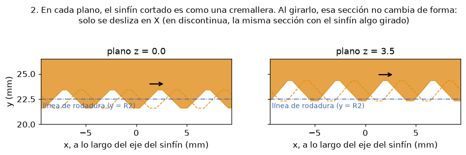

**3. El hueco del diente es lo que barre el sinfín.** Si miras desde la rueda, como si estuviera quieta, el sinfín pasa rodando por delante. El hueco del diente es la envolvente de todas sus posiciones: la forma justa para que el filete entre sin tocar.

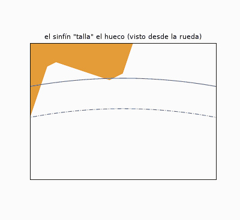

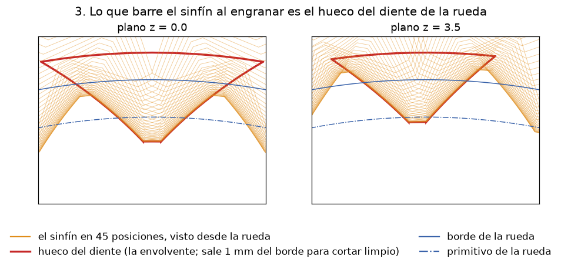

**4. La envolvente se calcula sin simular.** No hace falta probar posiciones. Para cada punto del flanco del sinfín, hay un único giro de la rueda en el que ese punto es el de contacto: aquel en el que la normal al flanco pasa por el punto primitivo P. Despejando sale una fórmula cerrada (`wormgear/geometry.py`), y con ella cada punto del flanco da un punto del hueco.

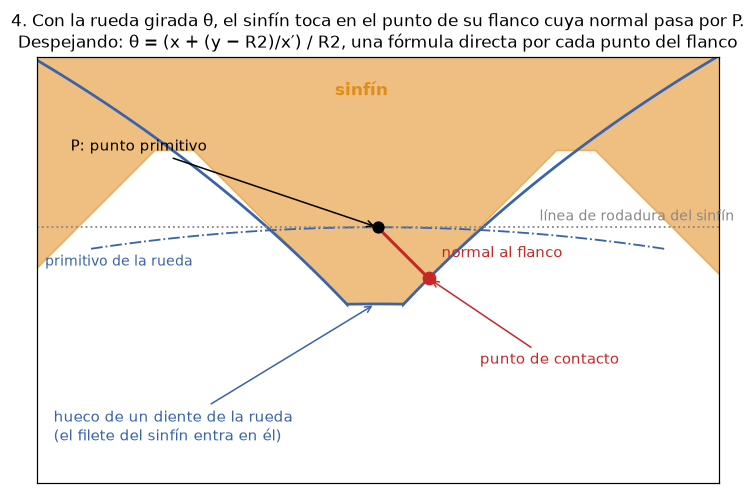

**5. Solevación, patrón y corte.** Cada plano da el perfil cerrado del hueco de un diente: dos splines, el arco de fondo y el arco exterior. Una **solevación** une los perfiles en un sólido. Después se hace un patrón circular y se corta el disco en bruto, que lleva la garganta toroidal.

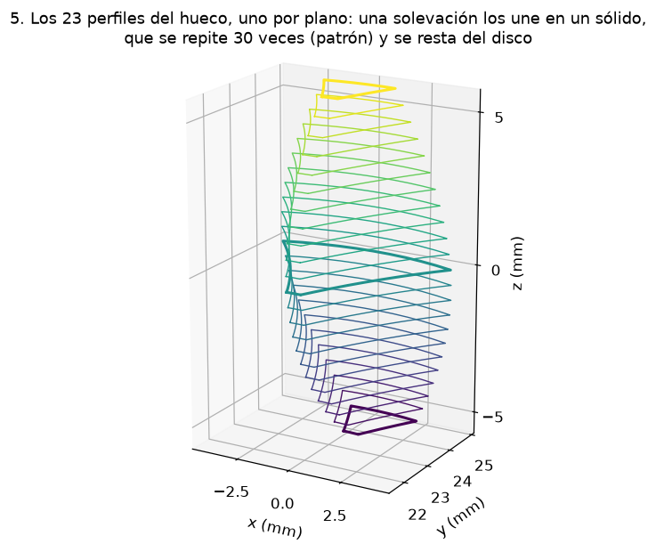

Cerca de las caras, el sinfín llega cada vez menos y los dientes salen bajos y débiles. Por eso el disco lleva un **chaflán de 45° en las dos caras**:
- empieza donde el diente baja de la mitad de su altura del centro;
- no se pone si quitaría menos de 0.3 mm;
- con la rueda tumbada, se imprime sin soportes.

El resultado es de unas 6 caras por diente.

La casilla **Comprobar engrane** usa cuerpos temporales:
- mide el volumen común entre sinfín y rueda en 8 posiciones de un paso de diente;
- mide cuánto gira el sinfín, con la rueda quieta, hasta tocar por cada lado (el juego).

Con los valores por defecto da 0 mm³ y ±3.8°, que son 0.100 mm axiales. Es justo la holgura pedida.

Al terminar, el resultado sale en un mensaje. Este es el del juego de las imágenes:

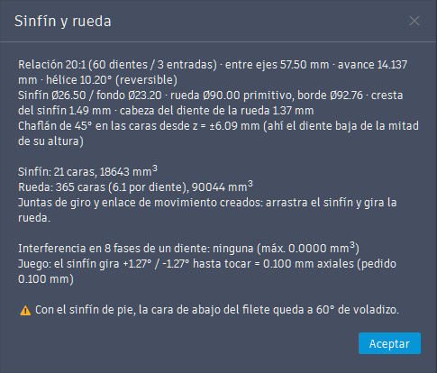

## Archivos

- `WormGear.py`: el add-in (botón, diálogo y eventos).
- `wormgear/geometry.py`: la matemática. No depende de Fusion: `python -X utf8 wormgear/geometry.py` imprime un resumen de prueba.
- `wormgear/build.py`: crea la geometría en el diseño activo.
- `wormgear/check.py`: comprueba interferencias y juego.
- `resources/`: los iconos.
- `img/`: las imágenes de este README. `img/diagramas.py` dibuja los diagramas del cálculo con matplotlib. El GIF se hizo desde el MCP de Fusion: los cuerpos se copian como gráficos personalizados, se giran con la relación y se guarda un fotograma por posición.
- `install.ps1`: crea el enlace en la carpeta AddIns.
- `installer/`: `instalar.bat`, `desinstalar.bat` y `LEEME.txt`, que van en el zip, y `make_release.ps1`, que lo genera.
