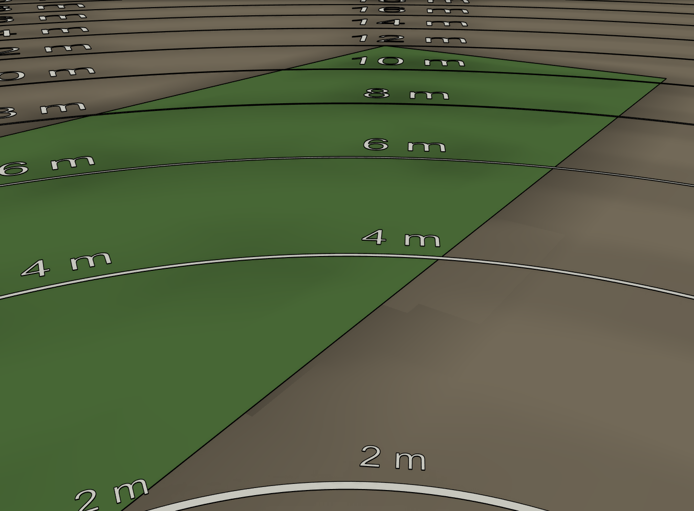
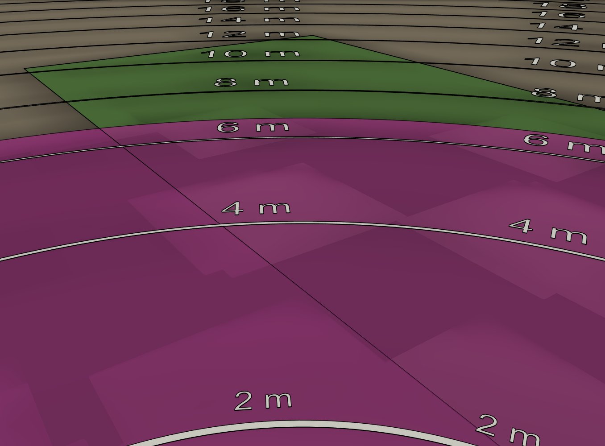

# water tower — prototipo "farola"

Diseño de Fusion **`water tower prototipo`**, en el proyecto *water tower* (junto a las piezas que usa: `torreta placas`, `sema`, 3 × `DM996 diymore`, `Electric Water Spray Kit 02`, rodamientos y tornillería).

| | |
| --- | --- |
|  |  |
|  |  |

## Dónde va

La huerta (`3D/huerta.STEP`) mide 20,5 × 4,6–5,6 m. El poste va en medio del lado largo recto, retirado **2 m** hacia fuera, con la cámara a 2 m de alto. Desde ahí la huerta abarca 157° y el punto más lejano está a 12,7 m.

## Cómo está montado

Es una columna de Ø116 × 217 mm colgada del brazo: arriba el **cuerpo** con la electrónica y debajo el **tambor** con la pistola, del mismo diámetro. El cuerpo hace de techo de la pistola.

- **Soporte fijo (farola):**
  - Poste Ø48 y brazo de tubo cuadrado de 30.
  - Un *sombrero* Ø128 con faldón tapa los engranajes del pan.
- **Cuerpo (pan del conjunto):** Ø116 × 118 mm.
  - Dentro, delante, va la torreta de placas en vertical.
  - La `sema` va **delante de la torreta**, inclinada `cam_inclinacion` (27°), y asoma 39 mm fuera del cilindro dentro de un *morro*. El morro tiene la ventana de la lente y del PIR en la cara de delante. Así la electrónica y la cámara quedan juntas delante y luego se puede cerrar todo en un recinto.
  - La faja de la cámara va del conector de la Freenove a la `sema`: en línea recta son 33 mm, y la faja mide 75.
  - El DM996 del pan va detrás de la torreta, colgado de la tapa. Su piñón (z20) rueda alrededor del engranaje fijo (z30) del sombrero. Con 180° de servo da ±60°, y para que la cámara vea toda la huerta hacen falta ±55° (ver [Qué ve la cámara](#qué-ve-la-cámara-a-2-m)).
  - Como el servo gira con el cuerpo, no hace falta anillo rozante.
  - Por debajo del suelo, la pared del cuerpo baja 8 mm más como faldón y tapa los engranajes del pan de la pistola.
- **Tambor de la pistola (pan de la pistola):** Ø116 × 90 mm, abierto por abajo.
  - Cuelga del suelo del cuerpo por un M8 y gira sobre el mismo eje que el conjunto.
  - El DM996 del pan de la pistola va en el cuerpo, boca abajo sobre el suelo, y saca el eje por una ventana del suelo. Su piñón (z21) mueve el engranaje z48 que el tambor lleva sobre su plato. Da ±39°.
  - Delante tiene una ranura por la que asoma la boquilla y que deja subir y bajar la pistola.
  - Hay un pasacables en arco en el plato (±48°) para la manguera y los cables.
- **Pistola (tilt):**
  - Va en una cuna que gira en dos 17-6-6 en los brazos del tambor. Está desplazada 15 mm hacia −Y (`pist_y`) para que quepa el servo de tilt.
  - El DM996 de tilt va encima del eje, atornillado al brazo +Y, y mueve un engranaje z45 de la cuna con un piñón z15 (3:1). Da 60° de recorrido: de 15° hacia arriba a 45° hacia abajo.
  - El eje de tilt pasa por el bloque del motor, así la parte de atrás apenas sube al bajar la boquilla.

Los engranajes son cilindros con el **diámetro primitivo** (m·z), de modo que los de cada pareja se tocan justo en la línea de engrane.

### Rodamientos de los dos pan

Los dos ejes de pan son el de smart-sentry puesto boca abajo:

- El M8-40 gira con la pieza que cuelga: con el cuerpo en el pan del conjunto y con el tambor en el de la pistola.
- La pieza fija (el sombrero, o el suelo del cuerpo) lleva el 22-8-7 en la cara de abajo. Un casquillo Ø12 de la pieza que cuelga empuja solo su aro interior.
- El axial va en la cara de arriba de la pieza fija, con la tuerca encima.

En smart-sentry el axial está entre la base y la parte que gira porque el peso aprieta hacia abajo. Aquí todo cuelga, así que el axial va arriba, bajo la tuerca, y es el que aguanta el peso. El 22-8-7 centra el eje y frena los empujones hacia arriba.

| Pan | Cabeza del M8 | 22-8-7 | Axial y tuerca |
| --- | --- | --- | --- |
| Conjunto | Bajo la tapa, dentro del cuerpo | En el sombrero, abierto hacia abajo | Encima del sombrero, dentro del brazo (tiene un agujero arriba para la llave) |
| Pistola | Bajo el plato del tambor, en un buje Ø20 | En un buje Ø28 bajo el suelo del cuerpo, abierto hacia abajo | Encima del suelo, dentro del cuerpo |

### Reducciones

| Eje | Dientes | Relación | Recorrido con 180° de servo |
| --- | --- | --- | --- |
| Pan del conjunto | 30 / 20 | 1,5:1 | ±60° |
| Pan de la pistola | 48 / 21 | 2,29:1 | ±39° |
| Tilt de la pistola | 45 / 15 | 3:1 | 60° (−15° / +45°) |

La pistola apunta a la suma de los dos pan: ±99° respecto al brazo. La huerta queda entre −80° y +80°, así que el giro sobra. Lo que limita es el alcance del chorro (ver [Hasta dónde llega la pistola](#hasta-dónde-llega-la-pistola)).

## Cambiar cosas

Todo está en *Modificar → Cambiar parámetros*:

| Parámetro | Valor | Qué mueve |
| --- | --- | --- |
| `modulo` | 1 mm | Diámetro de todos los engranajes y distancias entre ejes |
| `z_fijo`, `z_pinon` | 30, 20 | Pan del conjunto (`a_pan` se recalcula sola) |
| `z_eng_pist`, `z_pin_pist` | 48, 21 | Pan de la pistola (`a_pist`) |
| `z_eng_tilt`, `z_pin_tilt` | 45, 15 | Tilt de la pistola (`a_tilt`) |
| `casquillo_d`, `buje_rod_d` | 12, 28 mm | Casquillos de los 22-8-7 y buje del 22-8-7 bajo el suelo |
| `plato_esp` | 8 mm | Grosor del plato del tambor |
| `pist_caida` | 68 mm | Del plato del tambor al eje de tilt |
| `pist_y` | −15 mm | Desplazamiento de la pistola hacia un lado |
| `pist_mejilla`, `pist_brazo_esp` | 13.5, 8 mm | Anchura de la cuna y grosor de los brazos |
| `sombrero_d`, `sombrero_esp` | cuerpo_d + 12, 10 mm | Sombrero (su grosor aloja el 22-8-7) |
| `brazo_largo`, `poste_d` | 200, 48 mm | Farola |

Hay cosas que no siguen a los parámetros:

- **Piezas insertadas:** los servos, la pistola, las placas y la cámara. Si cambias los dientes, hay que mover a mano el servo correspondiente para que su eje caiga en el centro del piñón.
- **Lo que depende de la torreta, la `sema` y los servos:** su posición, `cuerpo_d`, `caja_fondo`, el morro y la ventana. Se calcularon al generar el modelo, así que cambiar `cam_inclinacion` o los dientes no basta: hay que volver a generarlo.

Las tres articulaciones (`Pan conjunto` ±60°, `Pan pistola` ±39°, `Tilt pistola` −15°/+45°, positivo hacia abajo) se pueden arrastrar para comprobar los barridos.

Se comprobaron las colisiones en el centro, en los dos extremos y en dos poses cruzadas, sin la Freenove. Solo se solapan los ejes de los servos con sus piñones (es lo esperado) y los cables del DM996 de pan con la pared: en el modelo salen rectos 15 mm y en la realidad se doblan.

Lo que más se acerca a la pared del cuerpo o del tambor (radio interior 55 mm): la torreta a 54 mm, el DM996 del pan de la pistola a 53,4, la cola de la pistola a 52,2 y el DM996 de tilt a 49,9.

El componente oculto **Campo de visión cámara** dibuja los rayos de la cámara hacia el suelo.

## Qué ve la cámara a 2 m

El componente fijo **Huerta** pone en el suelo (2 m bajo la lente) tres cosas:

- **Huerta** (verde): el contorno de `3D/huerta.STEP` con el poste en su sitio.
- **Barrido cámara (pan ±60)** (azul): todo lo que llega a ver la cámara moviendo el pan del conjunto de un extremo a otro.
- **Vista cámara (pan 0)** (naranja): lo que entra en una sola imagen mirando al frente.

| | |
| --- | --- |
|  |  |

Con una lente de 66° (55° × 42°) inclinada 27°:

- Una imagen mirando al frente va de **1,9 m** a **19 m** en el centro, y llega a 21 m en las esquinas de arriba. Por la izquierda y la derecha se sale de la huerta. Ve el 24 % de la huerta.
- Al barrer con el pan del conjunto, la huerta queda dentro casi entera:

  | Pan | Huerta vista | Lo que queda fuera |
  | --- | --- | --- |
  | ±40° | 86 % | 14 m² en las dos esquinas de cerca |
  | ±50° | 98,7 % | 1,3 m² en las dos esquinas de cerca |
  | ±55° y ±60° | 99,9 % | Una franja de 10 cm justo delante del poste, a 1,8 m |

  Con los ±60° del servo sobra margen.

Las huellas se calculan con `cam_inclinacion`, `cam_fov_h` y `cam_fov_v`, pero no siguen a los parámetros: si se cambian, hay que volver a generarlas.

### La imagen de la cámara

Estas vistas salen desde la lente, con la misma inclinación (27°) y el mismo campo (55° × 42°) que la cámara. El componente oculto **Referencias vista cámara** pone el suelo alrededor de la huerta y un anillo cada 2 m medido desde el eje del poste, para poder leer las distancias.

| Pan −55° | Pan 0 | Pan +55° |
| --- | --- | --- |
|  |  |  |

- **Abajo** la imagen empieza a 1,9 m, justo donde empieza la huerta.
- **Arriba** llega a unos 19 m: el horizonte no entra en la imagen.
- **Mirando al frente**, el borde de lejos de la huerta (6,9 m) queda a un cuarto de la imagen desde arriba. Lo de encima es suelo de fuera. Ese margen hace falta a ±55°, donde las esquinas de lejos de la huerta están a 12,5 m y quedan cerca del borde de arriba.
- **La pistola no sale en la imagen**: la boquilla queda 76° por debajo de la horizontal vista desde la lente, y el borde de abajo de la imagen está a 48°.

## Hasta dónde llega la pistola

El componente fijo **Alcance pistola** tiene dos cosas:

- **Alcance pistola** (morado): la zona del suelo donde puede caer el agua, con los dos pan (±99°) y todo el tilt (−15° a +45°).
- **Chorro tilt …**: las trayectorias del agua mirando al frente, cada 15° de tilt.

En las vistas de esta sección están apagadas las capas de la cámara.

| | |
| --- | --- |
|  |  |

**Cómo se ha calculado:**

- El chorro se trata como un tiro parabólico sin rozamiento.
- La ficha del kit da un alcance de 7–8 m. Se ha tomado 7,5 m como el alcance máximo de la pistola en la mano, a 1,2 m de alto y con el mejor ángulo. Eso da una velocidad de salida de unos 7,9 m/s.
- La boquilla está a 1,86 m del suelo y 113 mm por delante del eje de tilt.

Es una estimación: el rozamiento del aire acorta los tiros largos. **Mide cuánto llega de verdad** la pistola en horizontal desde una altura conocida y se recalcula con ese dato.

| Tilt | Cae a | Altura máxima del chorro |
| --- | --- | --- |
| −15° (arriba) | 6,7 m | 2,1 m |
| 0° | 5,0 m | 1,86 m |
| +15° | 3,5 m | 1,83 m |
| +30° | 2,3 m | 1,80 m |
| +45° (abajo) | 1,5 m | 1,78 m |

El chorro alcanza de **1,5 a 6,7 m** del eje en todo el giro. La huerta empieza a 1,78 m, así que por cerca llega con margen. Por lejos no: **la pistola cubre el 45 % de la huerta**, y quedan fuera unos 57 m² en los dos extremos, que están hasta a 12,5 m del poste.

Subir más la pistola ayuda poco:

| Tilt hacia arriba | Alcance | Huerta cubierta |
| --- | --- | --- |
| −15° (el de ahora) | 6,7 m | 45 % |
| −25° | 7,7 m | 59 % |
| −35° a −40° (el mejor ángulo) | 8,2 m | 66 % |

Con este alcance, desde un solo poste no se llega a los extremos de la huerta.

Vista desde la cámara, la zona de tiro (morado) tapa la huerta hasta el anillo de 6 m. Lo que queda verde por encima está a la vista pero el agua no llega:

| Pan 0 | Pan +55° |
| --- | --- |
|  |  |

## Pendiente

- Medir el alcance real del chorro y recalcular la zona de tiro. Con el alcance estimado, la pistola solo cubre el 45 % de la huerta; para llegar a los extremos haría falta más presión, otro poste o mover este.
- Sujeción de la pistola en la cuna: va apoyada en el fondo y entre las mejillas; falta una brida o un tornillo.
- Recinto cerrado para la torreta y la `sema`: el morro ya envuelve la `sema`, pero ni su ventana ni el cuerpo son estancos.
- Manguera y cables:
  - Entran por el pasacables de la tapa, bajan por el del suelo y pasan al tambor por el arco del plato.
  - Fuera del sombrero necesitan un bucle de holgura, porque el conjunto gira ±60°. Entre el suelo y el plato no hace falta: el arco del plato abarca ±48° y el tambor gira ±39°.
  - La pistola no aspira 2 m, así que el depósito tiene que ir arriba, junto al brazo.
- Engranajes de módulo 1 con DM996: con el servo bloqueado, el par puede romper los dientes impresos del piñón de tilt (z15). En uso normal la carga es pequeña.
- El casquillo de la tapa (Ø12 con paso de 8,5) tiene paredes de 1,75 mm. Solo trabaja a compresión, pero conviene imprimirlo macizo.
- Exterior: el sombrero tapa los engranajes del pan del conjunto, el faldón del cuerpo los de la pistola y el cuerpo hace de tejado del tambor. La ranura de delante del tambor y su fondo quedan abiertos.
