# water tower — prototipo "farola"

Diseño de Fusion **`water tower prototipo`**, en el proyecto *water tower* (junto a las piezas que usa: `sema`, 3 × `DM996 diymore`, `Electric Water Spray` con el Kit 01 y el Kit 02, rodamientos y tornillería). Tiene la columna colgada del brazo y el componente oculto `Campo de visión cámara`.

Dos piezas del pan del conjunto son diseños aparte, en la misma carpeta, insertados en la torre:

- **`soporte farola`**: el brazo, el sombrero y el engranaje fijo z40 (con dientes de evolvente), en una sola pieza. Va fijo en la raíz; la articulación `Pan conjunto (DM996) soporte` (±60°) lo une al cuerpo. El sombrero se cambia en ese diseño, no en la torre.
- **`engranaje pan cuerpo z27`**: el piñón del DM996 del pan, z27 m1 de evolvente, con el centro macizo. La unión con el eje del servo está por hacer, a medida de la impresora.

Para que pese menos, las placas van en el componente `Torreta placas (simple)`: es una copia de `torreta placas` en la que la Freenove solo conserva las piezas de más de 2 mm (placa, módulo, pines, conectores y USB-C). Las placas de pistola, servos y control, el TPS63020 y la tornillería van enteras. La torre pasa de 799 a 176 cuerpos. Si cambia `torreta placas`, la copia no se entera: hay que volver a sacarla.

El conjunto final es el diseño **`huerta`**, en la misma carpeta: el poste, la huerta, la valla y las referencias de la vista de la cámara, con `water tower prototipo` metido como referencia en su sitio. Para trabajar en la columna se abre `water tower prototipo`, que pesa mucho menos; `huerta` se pone al día con *Actualizar referencias*.

| | |
| --- | --- |
| 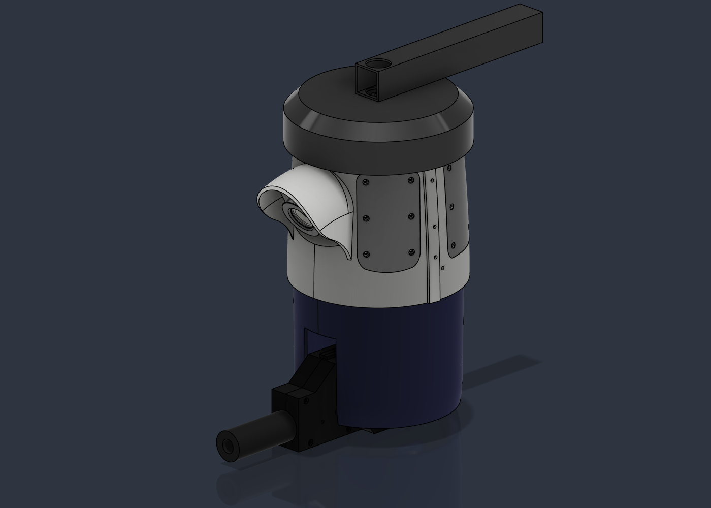 | 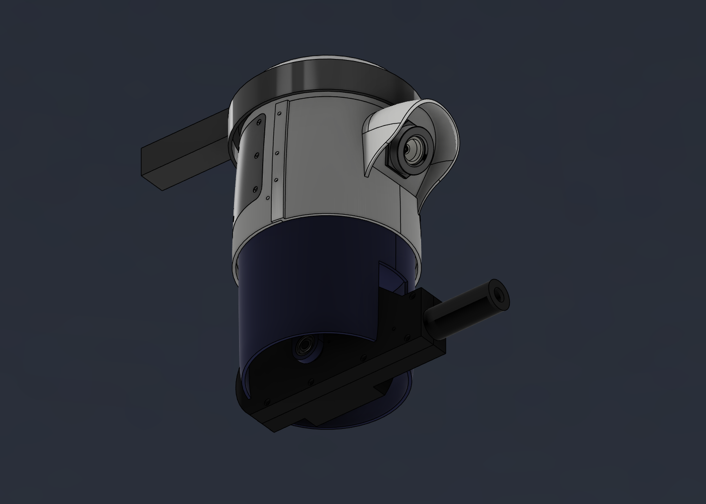 |
| 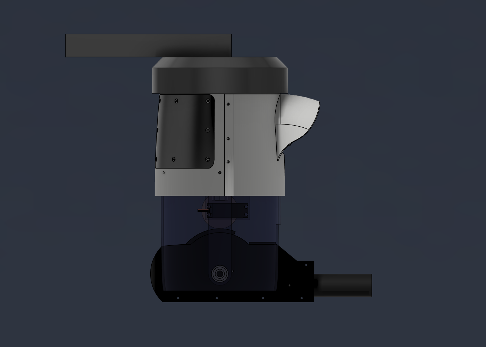 | 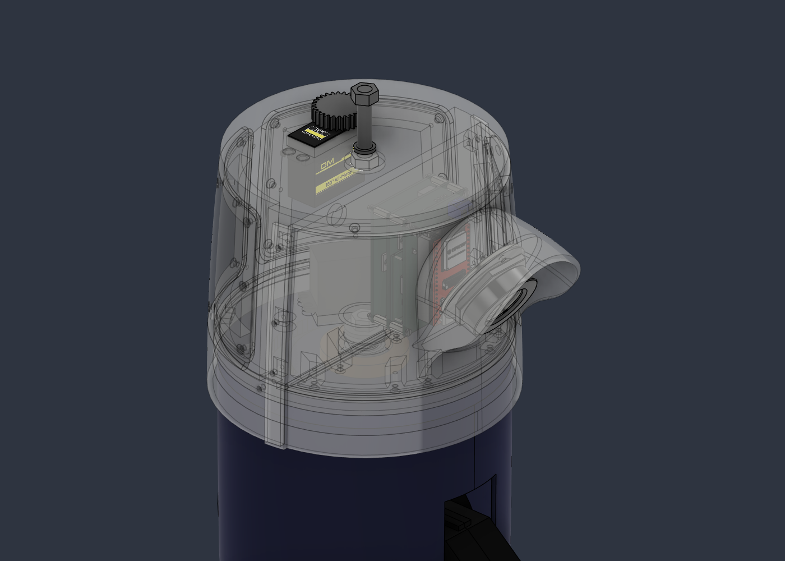 |
| 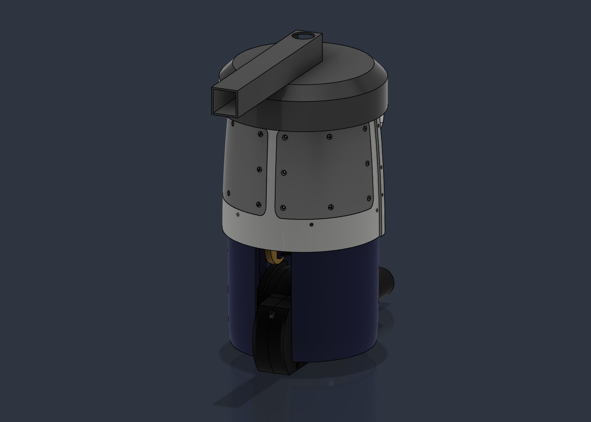 | |

## Dónde va

La huerta (`3D/huerta.STEP`) mide 20,5 × 4,6–5,6 m. El poste va junto al lado largo recto, retirado **2 m** hacia fuera y **6 m a la derecha** de su mitad (mirando desde la cámara), con la cámara a **3 m** de alto. Desde ahí la huerta abarca 151° (de −67° a +84°) y el punto más lejano, la esquina de la izquierda, está a 17,7 m.

Alrededor de la huerta hay una valla de tela metálica de 1,3 m. No tapa la vista, pero las plantas (los tomates) llegan a esa altura: desde 3 m, una planta de 1,3 m tapa el suelo detrás de ella hasta 1,8 veces su distancia, y desde 2 m lo tapaba hasta 2,9 veces. Por eso la cámara va a 3 m. Acercar el poste no compensa: los extremos de la huerta siguen igual de lejos, así que la pistola apenas gana, y la cámara deja de ver el borde de cerca y las esquinas de lejos en la misma imagen.

El poste va desplazado a la derecha para que la pistola llegue a la esquina de la derecha: con el poste en medio, las dos esquinas de lejos quedaban a 12 m y la pistola no llegaba a ninguna. Con 6 m, la esquina de lejos de la derecha queda a 7,6 m y entra en el alcance (7,8 m). A cambio, el extremo de la izquierda queda más lejos y la pistola cubre menos huerta en total (ver [Hasta dónde llega la pistola](#hasta-dónde-llega-la-pistola)). La cámara sigue viéndola casi entera bajando la inclinación a 31°.

## Cómo está montado

Es una columna de 265 mm de alto colgada del brazo: arriba el **cuerpo** (Ø169 abajo) con la electrónica y debajo el **tambor** (Ø158 arriba) con la pistola. Delante del cuerpo va atornillada la **caja seca**, con la torreta de placas y la `sema` dentro y la nariz de la cámara. El cuerpo y el plato del tambor hacen de techo de la pistola.

Las tres piezas van de mayor a menor hacia abajo y encajan unas dentro de otras como tejas, para que la lluvia no entre por las juntas: el ala del sombrero (Ø176) baja 9 mm por fuera del techo del cuerpo (Ø152), y el faldón del cuerpo (Ø169) baja 15 mm por fuera de la boca del tambor (Ø158). El agua que cae por una pieza gotea por fuera de la de abajo. El cuerpo y el tambor no son cilindros: sus paredes son revoluciones (3,2 mm en el cuerpo, 3 mm en el tambor) y juntos forman **una sola barriga**, con lo más ancho en la junta: el cuerpo se abre hacia abajo y el tambor se cierra hacia abajo. Las superficies que se ven son una sola cara lisa, sin escalones ni rayas.

Las alturas (z) se miden desde la cara de abajo del sombrero; el eje de los dos pan es el Z.

- **Soporte fijo (farola)**, en el diseño `soporte farola`:
  - Poste Ø48 (en el diseño `huerta`) y brazo de tubo cuadrado de 30, de z 26 a 56. El brazo tiene un paso de Ø24 abajo (para el axial) y otro arriba (para la llave de la tuerca).
  - Un *sombrero* de Ø176 tapa los engranajes del pan. Es una sola pieza con el engranaje fijo (z40, de z −10 a 0) y se imprime boca abajo, con la cara de arriba en la cama: mide 26 mm de grueso en la parte plana (dentro van el axial y la tuerca del pan), es plano arriba hasta R74, baja en un chaflán de 45° hasta el ala (R88, 12 mm por encima de su cara de abajo) y el ala, de 3,2 mm, baja recta hasta z −21. Así no tiene voladizos de más de 45°, salvo el asiento del axial, que queda como un puente de Ø22. El ala no puede bajar más porque el techo de la caja seca y de la nariz está 1,1 mm más abajo. Por dentro queda a unos 9 mm del cuerpo.
- **Cuerpo (pan del conjunto):** 142 mm de alto (z −12 a −154,1). Es la mitad de arriba del barril: Ø152 arriba, donde entra en el sombrero, y se abre en una curva sin cintura hasta Ø169 en el faldón, lo más ancho. Pared de 3,2 mm. El techo (6 mm, z −12 a −18) es parte del cuerpo y es plano por arriba y por abajo, a 12 mm bajo el sombrero (lo que piden los engranajes del pan), así que el cuerpo se imprime boca abajo, con el techo en la cama. La tapa está abajo: es el suelo (ver más abajo).
  - **Es una U:** delante, desde x 14,2 y por debajo del techo, la pared es la de la caja seca. Unos bujes por dentro (x 10, z −35/−80/−110, con la cara de abajo a 45°) reciben los M3 de los tapajuntas de la caja.
  - El DM996 del pan va detrás de la torreta, colgado del techo, y asoma por una ventana del techo. Su piñón (z27, pieza aparte) rueda alrededor del engranaje fijo z40 del sombrero; los dos tienen dientes de evolvente. Con 180° de servo da ±60,7°, y para que la cámara vea toda la huerta hace falta de −31° a +57° (ver [Qué ve la cámara](#qué-ve-la-cámara-a-3-m)).
  - Como el servo gira con el cuerpo, no hace falta anillo rozante.
  - **Dos puertas traseras curvas**, una a cada lado de una columna de 10 mm en el eje de detrás (180°): cada una va de 95° hasta la columna, de z −22,6 a −118,2. Son trozos de la pared de verdad (curvas por fuera, con 0,1 mm de holgura) y entran en un rebaje con marco de 8,5 mm por dentro. La ventana de cada una queda a 12,65 mm de los bordes, con el fondo plano. Llevan 8 M3 avellanados cada una (3 arriba, 3 abajo y 1 en medio de cada lado) en agujeros ciegos de Ø2,5, y una junta de cordón TPU en una ranura alrededor. Las esquinas son redondeadas (R8); las de abajo salen un poco elípticas porque el fondo del rebaje está a 45°. Cada puerta sale tirando en la dirección de su bisectriz (136° y 224°) sin chocar con nada, y se imprime con el borde de arriba en la cama.
  - El suelo es la **tapa de abajo** (`Tapa abajo`, 6 mm, z −124,3 a −130,3): entra por abajo, por dentro del faldón, con 0,1 mm de holgura contra la pared, y apoya en un escalón: un borde alrededor de la tapa sube hasta tocar por debajo un aro del cuerpo, con la cara de arriba a 45° para imprimirlo boca abajo. El escalón la para al meterla y la centra, pero no aguanta el peso (la tapa entra por abajo y el peso tira hacia abajo): eso lo hacen 4 tornillos M3 radiales que pasan por la pared a 90°, 150°, 210° y 270° (detrás y a los lados, porque delante está la caja seca) y se roscan en 4 tetones de la tapa. Lleva el pan de la pistola entero: el buje del 22-8-7, el axial, el DM996 y su ventana.
  - Por debajo de la tapa de abajo, la pared del cuerpo baja como faldón: tapa los engranajes del pan de la pistola y los 15 mm de arriba del tambor.
- **Caja seca:** pieza aparte delante del cuerpo, de x 6 a 130 y de z −22,1 a −154,1, con el techo (z −22,1 a −25,3) por debajo del ala del sombrero. Lleva dentro la torreta de placas en vertical y la `sema`, y cierra con ellas unos 636 cm³ de aire seco. Se imprime con el techo en la cama.
  - Una mampara (x 14,3 a 17,5) la separa del resto del cuerpo. En la mampara van un prensaestopas de Ø12,5 para los cables (y 40, z −60) y un tapón de ventilación (y −40, z −30).
  - Se atornilla al cuerpo con dos tapajuntas de 2,4 mm (x 6 a 18,3, hasta abajo del todo), con 3 M3 por lado.
  - **Puerta de abajo** (z −117,7 a −120,9, 0,1 mm por encima de la tapa de abajo): 9 M3×10 avellanados en nervios de 9 mm con el techo a 45°.
  - **Puerta lateral**, centrada en 52° (±21°), de z −23,5 a −110: es un trozo de la pared de verdad (plana por dentro, curva por fuera), con 6 M3×8 avellanados en cajeado, esquinas R8 y la ventana con el fondo plano.
  - **Juntas por fuera de los tornillos:** cordón TPU de Ø1,75 en ranuras de 2,3 × 1,35 mm (77 % de llenado) a 3 mm del borde; los tornillos van a 8,4 mm del borde, en agujeros ciegos de Ø2,5. Así la junta no dobla la cuña de la pared.
  - **Nariz:** una capucha en U (techo redondo R38,8 por fuera y R35,6 por dentro, costados planos tangentes) recta desde x 40 hasta la pared y, desde ahí, en arco: la punta (x 130,4) baja 10 mm. Arriba queda enrasada con el techo de la caja. El frente es una S girada alrededor del eje de la torre: convexo arriba (R44,88) y cóncavo abajo (R42,72), que entra vertical en la pared a z −120. Dentro, una placa de 3 mm perpendicular a la cámara sujeta la `sema`: por delante de la placa la nariz está abierta por abajo (es la parte mojada) y por detrás está la caja seca. Debajo de la placa, un suelo a 45° la une con la pared. La capucha necesita soportes al imprimirla.
  - La `sema` va **delante de la torreta**, inclinada `cam_inclinacion` (31°), con la lente en (90,7; 0; −64,4). Entra por detrás en la placa: la pestaña Ø54 apoya en la cara de dentro con una junta plana de TPU de 1 mm y un tetón antigiro (en un agujero ciego de Ø3,4), y por fuera se aprieta con una tuerca M38 de rosca a 45° (paso 2 mm). Delante lleva un aro con un cristal de Ø30 × 2 mm y su cordón. Los rayos de la cámara no tocan la nariz.
  - La faja de la cámara va del conector de la Freenove a la `sema` y mide 75 mm.
- **Tambor de la pistola (pan de la pistola):** Ø158 × 138 mm (z −139,1 a −277,1), abierto por abajo. El diámetro y el alto los pide el soporte de la pistola, para que no lleve muescas (ver [Soporte de la pistola](#soporte-de-la-pistola)).
  - Es la mitad de abajo del barril: arriba mide Ø158 y entra 15 mm en el faldón del cuerpo, y se va cerrando sin quiebros hasta Ø156 en el eje de tilt y Ø152 en el borde de abajo.
  - Cuelga de la tapa de abajo del cuerpo por un M8 y gira sobre el mismo eje que el conjunto.
  - El DM996 del pan de la pistola va en el cuerpo, boca abajo sobre la tapa de abajo, y saca el eje por una ventana de la tapa. Su piñón (z21) mueve el engranaje z48 que el tambor lleva sobre su plato. Da ±39°.
  - Va girado de modo que el cuerpo del servo queda hacia atrás, a lo largo de la pared, y no hacia el eje: así queda a 12,6 mm del axial y a 12,8 del 22-8-7 (con el servo recto quedaba a 1 mm).
  - Delante tiene una ranura de 41 mm de ancho (`pist_ranura`) por la que asoma el soporte de la pistola. Llega hasta 64 mm por encima del eje de tilt, para que el riel no toque el borde con la pistola 15° hacia arriba.
  - Detrás tiene otra ranura de 41 mm (`pist_ranura_atras`) por la que asoma la cola del soporte. Va del fondo del tambor hasta el plato, porque la cola sube al bajar el morro.
  - Hay un pasacables en arco en el plato (±48°) para la manguera y los cables.
- **Pistola (tilt):**
  - Va en un soporte con forma de arma que sirve para los dos kits de Bambu Lab y está dibujado dentro de `Electric Water Spray` (ver [Soporte de la pistola](#soporte-de-la-pistola)). Gira en dos 22-8-7 en los brazos del tambor (ojos de Ø30) y está centrado con la cámara: la boquilla queda en el mismo plano vertical que la lente.
  - El DM996 de tilt va tumbado encima de la pistola, entre los dos brazos, con el eje sobre el eje de tilt. Cuelga del plato por un soporte con ventana, como en el brazo de smart-sentry.
  - Mueve un sector z117 del soporte con un piñón z47 (2,49:1), como el sector de tilt de smart-sentry. Da 60° de recorrido, de 15° hacia arriba a 45° hacia abajo, con 149° de servo. El sector solo tiene dientes de 70° a 140°: el piñón engrana de 75° a 135° y así las puntas no tocan la pared del tambor.
  - El servo va 82 mm por encima del eje (`a_tilt`), lo bastante lejos para que la cola del soporte pase por debajo a +45° sin recortarla: queda a 3 mm del servo. El piñón queda 1,5 mm por debajo del plato, y eso es lo que fija el alto del tambor (`pist_caida` 108 mm).
  - Con 3:1 (z123/z41) haría falta un tambor de Ø142, porque las puntas del sector tocarían la pared.

Los engranajes del pan del conjunto (z40 del sombrero y piñón z27) tienen dientes de evolvente (20°, con el diente 0,05 mm más fino), con la fase puesta para que engranen en su sitio. Los demás todavía son cilindros con el **diámetro primitivo** (m·z), de modo que los de cada pareja se tocan justo en la línea de engrane.

### Rodamientos de los dos pan

Los dos ejes de pan son el de smart-sentry puesto boca abajo:

- El M8-40 gira con la pieza que cuelga: con el cuerpo en el pan del conjunto y con el tambor en el de la pistola.
- La pieza fija (el sombrero, o la tapa de abajo del cuerpo) lleva el 22-8-7 en la cara de abajo, metido por abajo hasta un labio. Un casquillo Ø12 de la pieza que cuelga empuja solo su aro interior.
- El axial va en la cara de arriba de la pieza fija, con la tuerca encima.
- En el pan del conjunto los dos rodamientos están lo más separados que deja el M8-40: el 22-8-7 está enrasado con la cara de abajo del engranaje fijo (z −10 a −3) (con el M8-40 no se pueden separar más) y el axial y la tuerca van dentro del sombrero, en un alojamiento de Ø23 abierto por arriba (z 11,3 a 24,8; la tuerca acaba enrasada con la punta del tornillo). El disco de abajo del axial es el fijo: apoya en el sombrero y va ajustado en Ø22 (sus 2,2 mm de alto); el de arriba gira con la tuerca y tiene 0,5 mm de holgura. En el pan de la pistola es igual: el disco de abajo, ajustado en la tapa de abajo. Encima del 22-8-7 hay un alivio de Ø15 y 1 mm: el sombrero solo toca el aro exterior, porque el interior gira con el M8. El casquillo es una pieza suelta de Ø12 × 2 mm entre el techo del cuerpo y el 22-8-7, porque el cuerpo se imprime con el techo en la cama.
- El pan de la pistola es igual: el 22-8-7 está enrasado con la cara de abajo del buje de la tapa de abajo y tiene encima el alivio de Ø15, y el axial y la tuerca van dentro de un buje R14 de la tapa, abierto por arriba. Los dos rodamientos ya estaban todo lo separados que deja el M8-40.
- Las cabezas de los dos M8 quedan escondidas en alojamientos hexagonales (13,3 mm entre caras): bajo el techo del cuerpo y bajo el plato del tambor. Así el tornillo no gira y la tuerca se aprieta desde arriba sin sujetar la cabeza.

En smart-sentry el axial está entre la base y la parte que gira porque el peso aprieta hacia abajo. Aquí todo cuelga, así que el axial va arriba, bajo la tuerca, y es el que aguanta el peso. El 22-8-7 centra el eje y frena los empujones hacia arriba.

| Pan | Cabeza del M8 | 22-8-7 | Axial y tuerca |
| --- | --- | --- | --- |
| Conjunto | En un hexágono de un buje bajo el techo del cuerpo | Enrasado abajo en el engranaje fijo, abierto hacia abajo | Dentro del sombrero, abierto hacia arriba (el brazo tiene encima el paso de la llave) |
| Pistola | En un hexágono de un buje bajo el plato del tambor | Enrasado abajo en un buje Ø28 bajo la tapa de abajo, abierto hacia abajo, con alivio Ø15 sobre el aro interior | Dentro de un buje R14 sobre la tapa de abajo, abierto hacia arriba |

### Reducciones

| Eje | Dientes | Relación | Recorrido con 180° de servo |
| --- | --- | --- | --- |
| Pan del conjunto | 40 / 27 | 1,48:1 | ±60,7° |
| Pan de la pistola | 48 / 21 | 2,29:1 | ±39° |
| Tilt de la pistola | 117 / 47 (sector) | 2,49:1 | 60° (−15° / +45°) con 149° |

La pistola apunta a la suma de los dos pan: ±99° respecto al brazo. La huerta queda entre −67° y +84°, así que el giro sobra. Lo que limita es el alcance del chorro (ver [Hasta dónde llega la pistola](#hasta-dónde-llega-la-pistola)).

### Soporte de la pistola

El diseño `Electric Water Spray` lleva el [Kit 01 y el Kit 02](../../esphome/docs/bambulab-water-spray-kits.md) superpuestos, con la boquilla en el mismo sitio, y el soporte está dibujado ahí mismo, en el componente `Soporte pistolas`. La torre inserta `Electric Water Spray` directamente en la raíz, sin componente intermedio: la articulación `Tilt pistola (DM996)` va de `Electric Water Spray` al tambor, y el círculo del eje está en un boceto del tambor (`eje tilt pistola`). Para cambiar el soporte se edita `Electric Water Spray` y luego se actualiza la referencia en la torre.

El soporte sirve para los dos kits: se monta uno u otro sin cambiar nada más. El origen de `Soporte pistolas` está en el eje de tilt, con X hacia delante (por donde sale el agua) y Z hacia arriba.

| | |
| --- | --- |
| 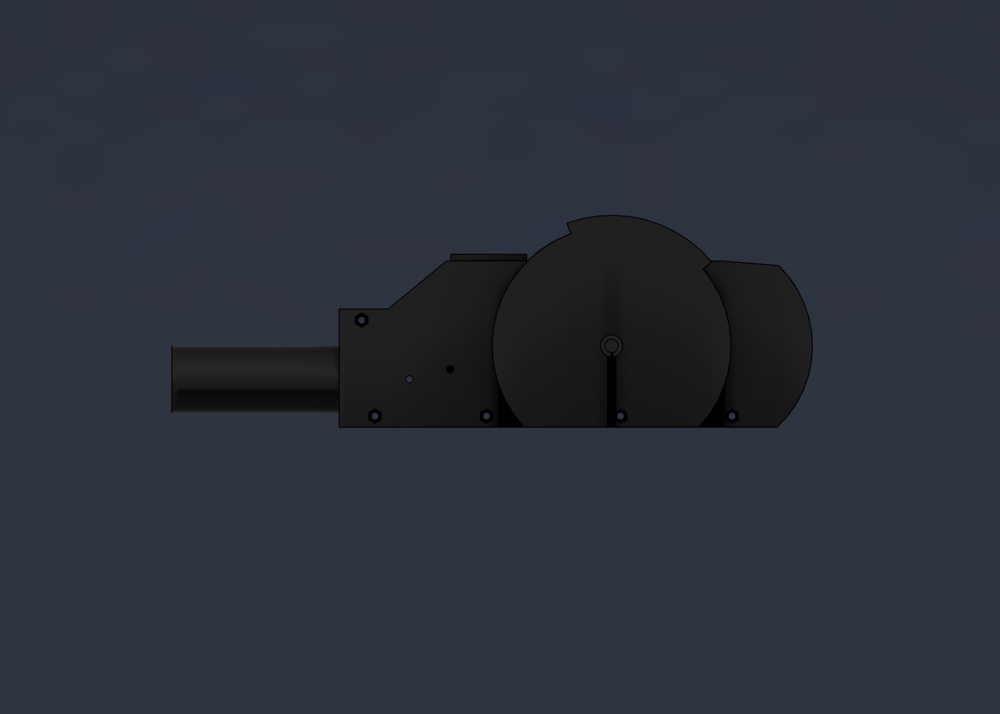 | 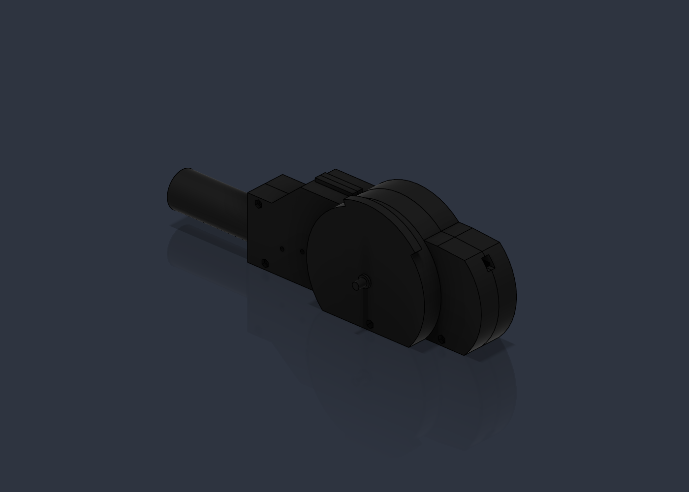 |
| 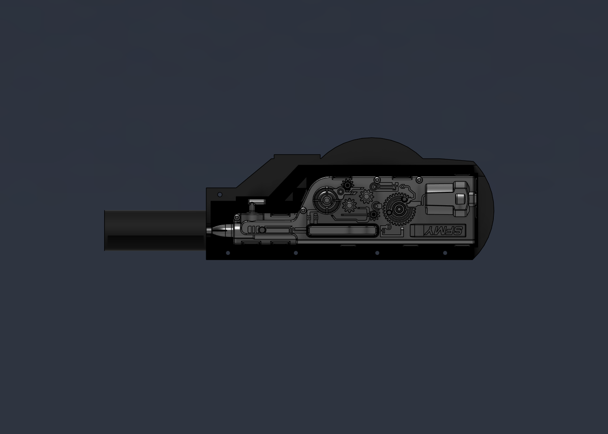 | 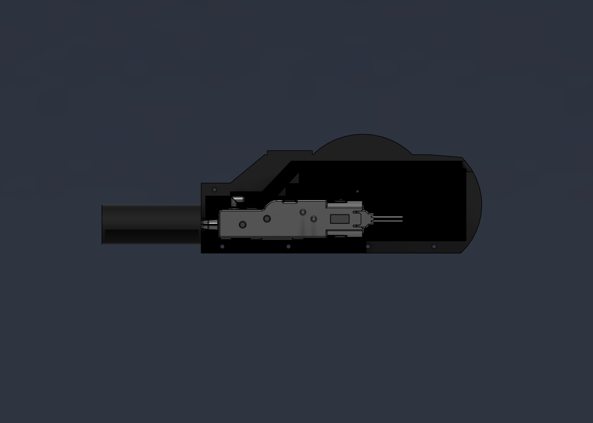 |
| 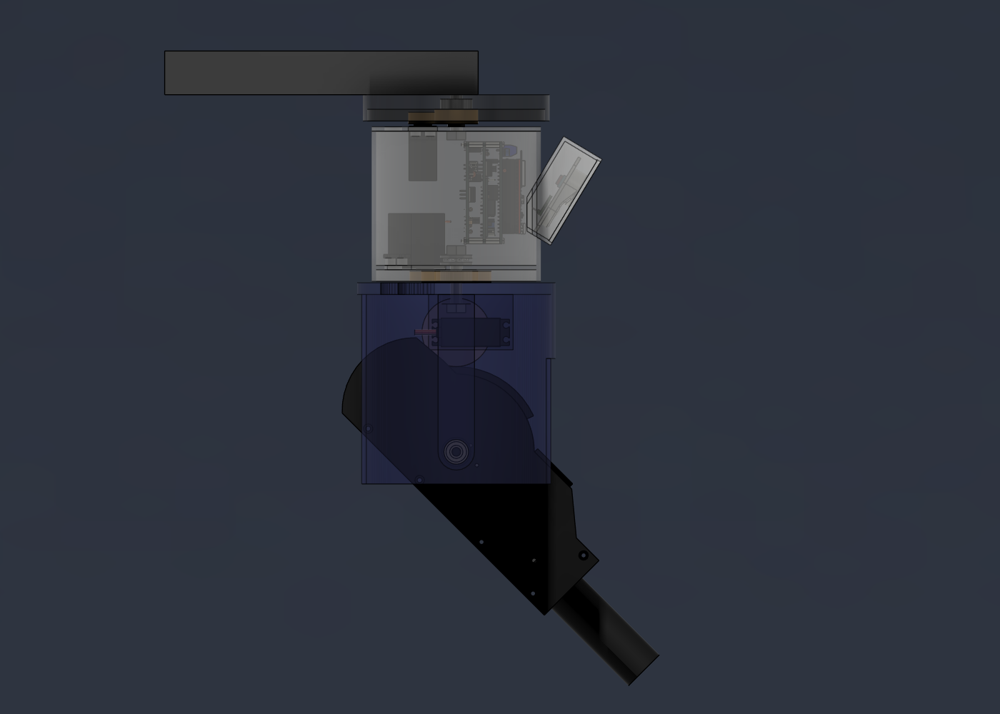 | |

- **Forma:** un cajón de 35 mm de ancho con el guardamanos más bajo delante, un riel arriba, una joroba redonda sobre el eje y un cañón. El techo es plano a 38 mm sobre el eje desde el guardamanos hasta la cola, que es redonda y está achaflanada 2 mm arriba.
- **Sin muescas:** la versión anterior tenía recortado todo lo que barrían el DM996 de tilt y el plato, y el motor del Kit 01 quedaba al aire. Ahora el tambor es más alto y más ancho y el servo va 20 mm más lejos del eje, así que la carcasa va entera. En todo el recorrido queda a 3 mm del servo y a 1,8 mm de sus cables, aunque salgan rectos hacia atrás.
- **Cañón:** es una pieza aparte, un tubo de Ø30 × 75 mm. Se encaja en una espiga de Ø20 que sale 15 mm por delante de la carcasa, con 0,2 mm de holgura. Como la espiga está partida en las dos mitades, el cañón también las mantiene juntas por delante. El agua sale por un ánima de Ø14 y no toca el cañón: la boquilla acaba dentro de la espiga, 9,5 mm antes del ánima. Se puede pegar o dejar a presión.
- **Posición de la pistola:** el eje de tilt queda 127,5 mm detrás de la punta de la boquilla y 15 mm por encima de ella. La boca del cañón queda 197 mm por delante del eje, y la cola sale 90 mm por detrás, por la ranura de detrás del tambor.
- **Sector en la carcasa:** la mitad `+Y` lleva un disco de R53,5 que va de su cara de fuera hasta la cara de fuera del sector (16,5 mm) y baja hasta la cara de abajo. El sector de dientes (R58,5, de 70° a 140°) sale por encima del disco. Así el sector forma parte de la carcasa en lugar de colgar de un buje, y la mitad se imprime sin soportes. El disco no puede ser más grande: a esa distancia del centro, la pared del tambor queda a 55,4 mm del eje.
- **Hueco de las dos pistolas:** es la unión de los dos kits con 0,5 mm de holgura. Cada kit queda a 0,34 mm o más de las paredes.
- **Cómo se sujeta cada kit:**
  - **Kit 01:** sus dos resaltes de Ø6 entran en dos alojamientos de una mitad. En la otra mitad, dos tornillos M3 se roscan en la pared y la punta entra en sus agujeros de Ø3.
  - **Kit 02:** apoya contra la pared de delante. Tres tornillos M4 se roscan en las paredes y la punta entra en sus agujeros cónicos de Ø4,3. Sus dos pivotes de Ø4,5 entran en alojamientos.
- **Manguera (5/3 mm):** las tomas de agua de los dos kits son espigas de Ø4 en el plano de la boquilla que miran hacia atrás, a 37–48 mm de la punta. Desde ahí, un canal de 7 mm de ancho sube por delante del Kit 01, pasa por encima de los kits y sale hacia atrás por la cola. Va partido entre las dos mitades.
- **Sin agujeros para cables:** se resolverá más adelante por dónde salen.
- **Dos mitades**, partidas en el plano vertical de la boquilla (`Carcasa -Y` y `Carcasa +Y (sector)`). Cada mitad lleva su eje de Ø8 para el 22-8-7, y la `+Y` lleva también el disco y el sector. Se cierran con cinco tornillos M3: la cabeza va en la mitad `-Y` y la tuerca en la `+Y`. Donde está el disco, el alojamiento de la tuerca lo atraviesa.
- **Impresión:** las dos mitades se imprimen de pie, sobre la cara de abajo, que es plana. Así el hueco de los kits queda abierto de lado, y el disco y el sector suben desde la cama sin soportes. La espiga del cañón y los ejes salen en horizontal, pero son pequeños.
- **El cañón casi no sale en la imagen de la cámara:** solo a −15° tapa el 5 % de abajo (ver [La imagen de la cámara](#la-imagen-de-la-cámara)). La carcasa no sale nunca.

## Cambiar cosas

Todo está en *Modificar → Cambiar parámetros*:

| Parámetro | Valor | Qué mueve |
| --- | --- | --- |
| `modulo` | 1 mm | Diámetro de todos los engranajes y distancias entre ejes |
| `z_fijo`, `z_pinon` | 40, 27 | Pan del conjunto (`a_pan` se recalcula sola) |
| `z_eng_pist`, `z_pin_pist` | 48, 21 | Pan de la pistola (`a_pist`) |
| `z_eng_tilt`, `z_pin_tilt` | 117, 47 | Tilt de la pistola (`a_tilt`) |
| `cuerpo_d`, `cuerpo_cuello_d`, `cuerpo_faldon_d` | 169, 152, 169 mm | Cuerpo abajo (lo más ancho), arriba y faldón (= `cuerpo_d`) |
| `cuerpo_suelo_d` | 165,3 mm | No tocar: con otro valor se rompe el techo del cuerpo |
| `caja_fondo` | −130,1 mm | Altura del pan de la pistola (de aquí salen el plato y el tambor) |
| `tambor_d`, `tambor_cuello_d` | 156, 158 mm | Tambor en el eje de tilt y en la boca (lo más ancho) |
| `casquillo_d`, `buje_rod_d` | 12, 28 mm | Casquillos de los 22-8-7 y buje del 22-8-7 bajo la tapa de abajo |
| `pared_cuerpo` | 3,2 mm | Pared del cuerpo (se aplica con *desplazar caras* sobre la de 3 mm; el techo y la tapa de abajo tienen 6 mm, con otro desplazamiento encima) |
| `plato_esp` | 8 mm | Grosor del plato del tambor |
| `pist_caida` | 108 mm | Del plato del tambor al eje de tilt |
| `pist_ranura` | 41 mm | Ancho de la ranura del tambor por la que asoma el soporte de la pistola |
| `pist_ranura_atras` | 41 mm | Ancho de la ranura de detrás del tambor por la que asoma la cola del soporte de la pistola |
| `pist_y` | 0 mm | Desplazamiento de la pistola hacia un lado (0: centrada con la cámara) |
| `pist_eng_y` | 27 mm | Cara interior del sector de tilt; deja sitio al DM996 de tilt entre los brazos |
| `pist_mejilla`, `pist_brazo_esp` | 18, 8 mm | Media anchura del soporte de la pistola (mide 35 mm) y grosor de los brazos |
| `sombrero_d`, `sombrero_esp` | 176, 26 mm | Ala del sombrero y alto de su parte plana (aloja el axial y la tuerca); el sombrero ya está en `soporte farola`, que tiene su copia de los parámetros |
| `brazo_largo`, `poste_d` | 200, 48 mm | Farola |

Hay cosas que no siguen a los parámetros:

- **Piezas insertadas:** los servos, la pistola, las placas y la cámara. Si cambias los dientes, hay que mover a mano el servo correspondiente para que su eje caiga en el centro del piñón.
- **El soporte de la pistola:** está en `Electric Water Spray`, con medidas fijas. Los ejes y el sector usan `modulo`, `z_eng_tilt`, `pist_eng_y`, `ancho_pist`, `pist_brazo_in`, `pist_brazo_in_n` y `pist_brazo_esp`, pero son **copias** de los de la torre en los parámetros de `Electric Water Spray`: si se cambian aquí, hay que cambiarlos también allí.
- **Lo que depende de la torreta, la `sema` y los servos:** su posición, `caja_fondo`, la caja seca y la nariz. Se calcularon al generar el modelo, así que cambiar `cam_inclinacion` o los dientes no basta: hay que volver a generarlo.
- **Los perfiles curvos** del sombrero, el cuerpo y el tambor son splines calculadas con los diámetros de la tabla al generarlos: cambiar `cuerpo_d`, `tambor_d` o `sombrero_d` no los mueve.
- **La caja seca, las puertas y la nariz** salen de scripts (con medidas sacadas de la pared en su sitio), no de parámetros.
- **Los dientes de evolvente** del z40 (`soporte farola`) y del z27 (`engranaje pan cuerpo z27`): sus perfiles se calcularon con un script; cambiar `modulo` o los dientes en esos diseños no los mueve.

Las tres articulaciones (`Pan conjunto (DM996) soporte` ±60°, `Pan pistola` ±39°, `Tilt pistola` −15°/+45°, positivo hacia abajo) se pueden arrastrar para comprobar los barridos.

Se comprobaron las colisiones en el centro, en los dos extremos y en dos poses cruzadas, sin la Freenove. Solo se solapan los ejes de los servos con sus piñones, que es lo esperado. El tilt se ha barrido cada 5° de −15° a +45° con el soporte y los dos kits. El soporte queda a 3 mm del servo y a 1,8 mm de sus cables, que en el modelo salen rectos hacia atrás. A +45° la mitad `+Y` pasa de lado a 0,5 mm de la placa que sujeta el DM996 de tilt. Los kits quedan a 5,7 mm o más del plato. Desde que el tambor creció a Ø158 el soporte tiene más sitio contra la pared que en ese barrido (1,5 mm con el de Ø136).

La caja seca se comprobó aparte: no choca con el cuerpo ni al sacarla (100 mm hacia delante) ni al sacar las puertas, el aire queda cerrado con el prensaestopas, el tapón y la rosca de la `sema` tapados, no tiene zonas de menos de 2 mm (salvo la piel de 1 mm que queda delante del agujero ciego del tetón de la `sema`) y solo tiene voladizos en agujeros pequeños y ranuras, además de la capucha de la nariz.

El componente oculto **Campo de visión cámara** dibuja los rayos de la cámara hacia el suelo.

## Qué ve la cámara a 3 m

Los componentes de esta sección y de la siguiente (`Huerta`, `Valla huerta`, `Vegetacion`, `Referencias vista cámara` y `Alcance pistola`) están en el diseño `huerta`, que lleva la torre como referencia (ahora, a la v96). El componente fijo **Huerta** pone en el suelo (3 m bajo la lente) tres cosas:

- **Huerta** (verde): el contorno de `3D/huerta.STEP` con el poste en su sitio.
- **Barrido cámara (pan ±60)** (azul): todo lo que llega a ver la cámara moviendo el pan del conjunto de un extremo a otro.
- **Vista cámara (pan 0)** (naranja): lo que entra en una sola imagen mirando al frente.

El componente fijo **Valla huerta** es la valla de tela metálica de 1,3 m, por fuera del borde. Se dibuja casi transparente porque no tapa la vista.

El componente **Vegetacion** pone tres bancales de 1 m de ancho y 10 cm de alto, a lo largo de la huerta y solo dentro de la zona de tiro (de 2,45 a 7,75 m del poste), con las plantas como bultos de su tamaño, al tresbolillo. De cerca a lejos:

| Bancal | Desde el poste | Planta | Tamaño | Filas |
| --- | --- | --- | --- | --- |
| 1 | 1,95 a 2,95 m | Lechugas | Ø26 × 18 cm | 3, a 30 cm |
| 2 | 3,55 a 4,55 m | Pimientos | Ø40 × 60 cm | 2, a 45 cm |
| 3 | 5,15 a 6,15 m | Tomates | Ø44 × 130 cm | 2, a 55 cm |

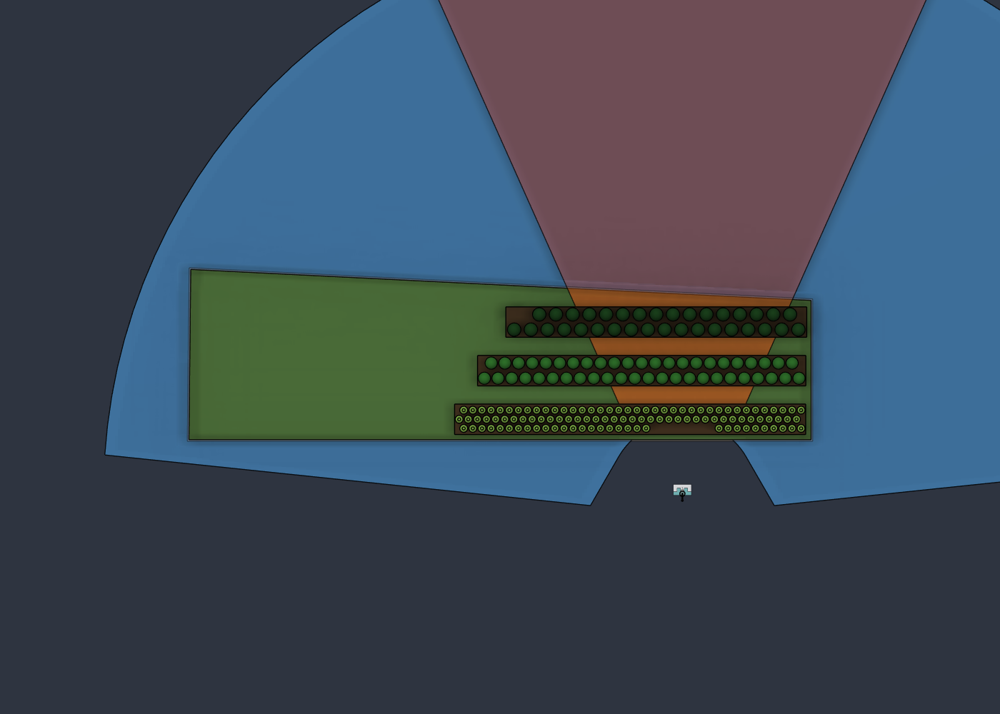

| | |
| --- | --- |
| 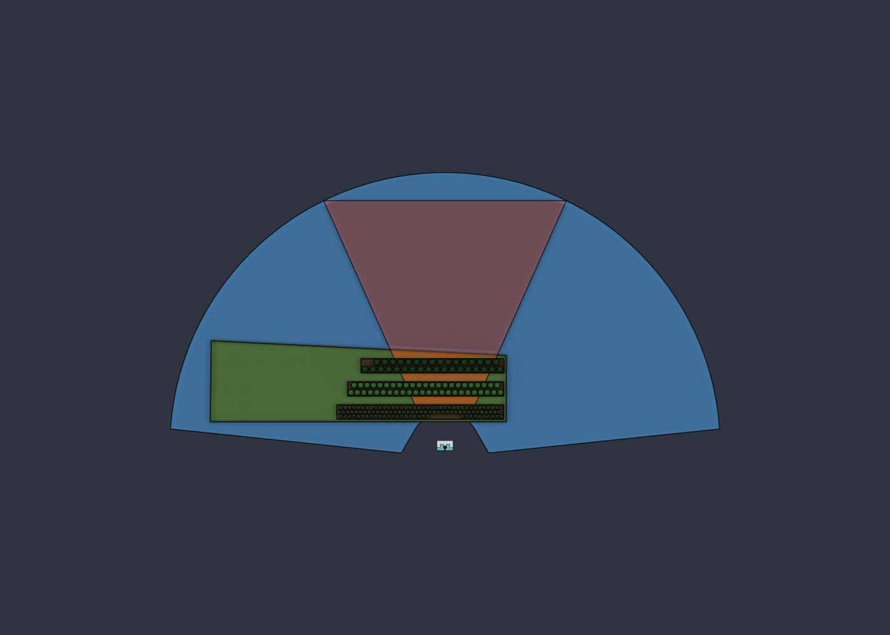 | 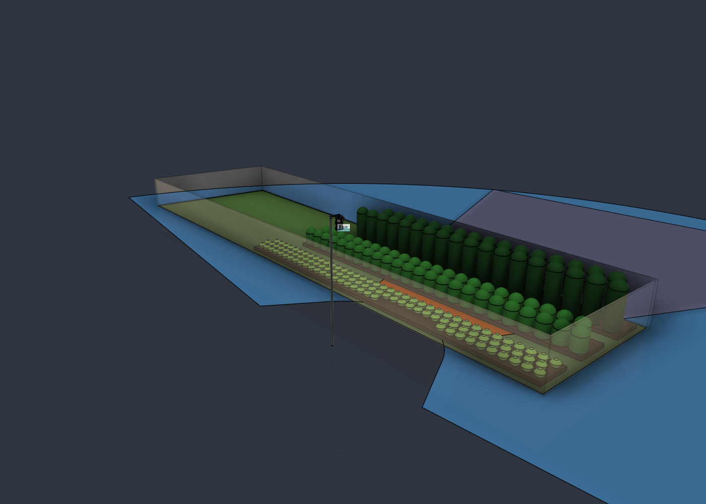 |

Con una lente de 66° (55° × 42°) inclinada 31°:

- Una imagen mirando al frente va de **2,4 m** a **17,1 m** en el centro, y llega a 19 m en las esquinas de arriba. Por la izquierda y la derecha se sale de la huerta. Ve el 22 % de la huerta.
- Al barrer con el pan del conjunto, la huerta queda dentro casi entera. Como el poste está a la derecha, el barrido es asimétrico:

  | Pan | Huerta vista | Lo que queda fuera |
  | --- | --- | --- |
  | −30° a +45° | 81 % | 19 m² en el extremo de la izquierda |
  | −30° a +50° | 91 % | 10 m² en el extremo de la izquierda |
  | −31° a +57° | 98,5 % | 1,6 m², casi todo delante del poste |
  | ±60° | 98,6 % | 1,5 m² justo delante del poste, de 1,8 a 2,4 m |

  Los ±60° del servo llegan con poco margen por la izquierda. La franja de delante del poste no se puede ganar: la esquina de la izquierda, a 17,7 m, obliga a inclinar poco la cámara. Con 35° la franja baja a 0,5 m², pero se pierden 20 m² del extremo de la izquierda.

Las huellas se calculan con `cam_inclinacion`, `cam_fov_h` y `cam_fov_v`, pero no siguen a los parámetros: si se cambian, hay que volver a generarlas.

### La imagen de la cámara

Estas vistas salen desde la lente, con la misma inclinación (31°) y el mismo campo (55° × 42°) que la cámara. El componente oculto **Referencias vista cámara** pone el suelo alrededor de la huerta y un anillo cada 2 m medido desde el eje del poste, para poder leer las distancias.

| Pan −30° | Pan 0 | Pan +55° |
| --- | --- | --- |
| 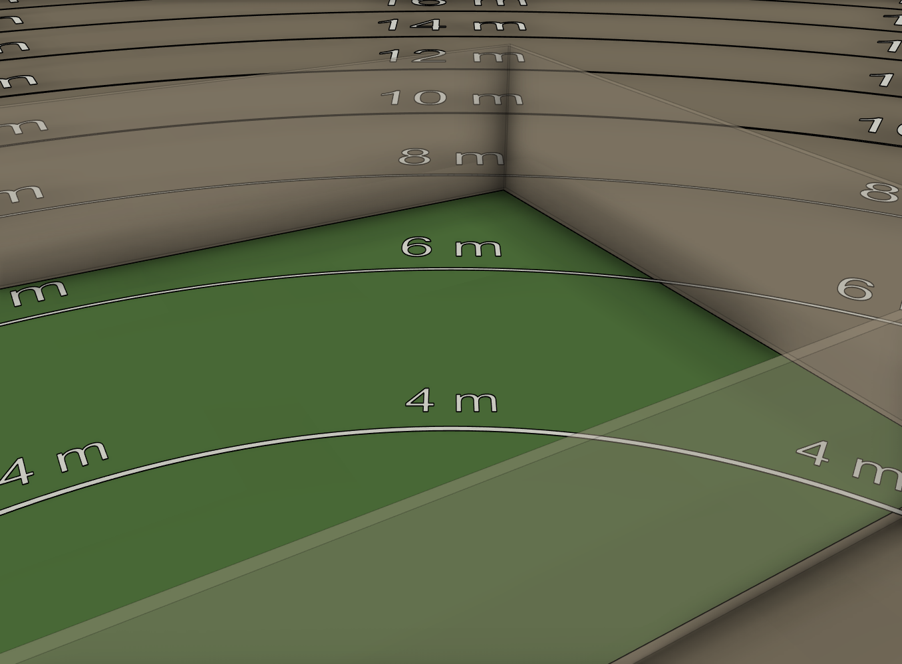 | 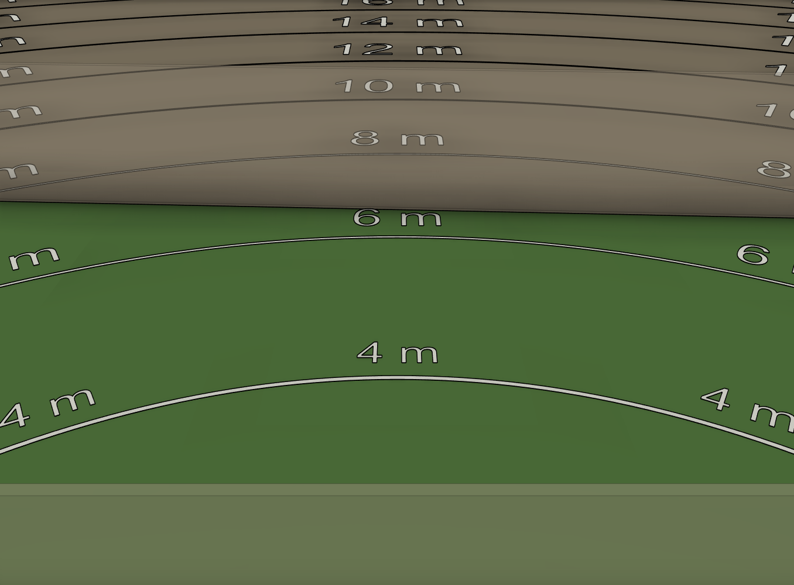 | 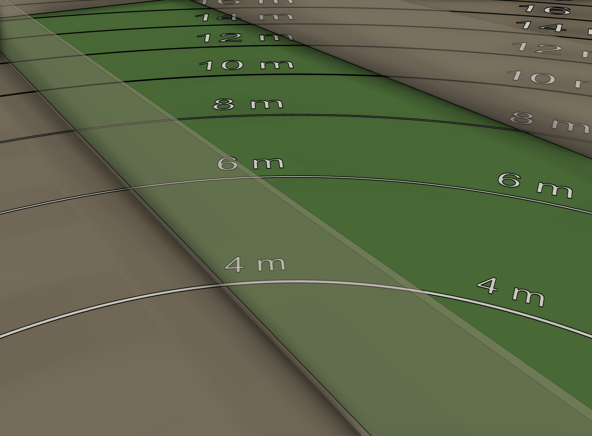 |

- **Abajo** la imagen empieza a 2,4 m, 60 cm por detrás del borde de la huerta. La banda clara de abajo es la valla de cerca vista a través.
- **Arriba** llega a unos 17 m: el horizonte no entra en la imagen.
- **Mirando al frente**, el borde de lejos de la huerta (6,6 m) queda a un tercio de la imagen desde arriba. Lo de encima es suelo de fuera. Ese margen hace falta a +55°, donde el extremo de la izquierda está a 16–18 m y queda cerca del borde de arriba.
- **A −30°** entra la esquina de la derecha entera, con la valla en las dos caras.
- **El cañón de la pistola casi no sale en la imagen.** Solo con la pistola del todo hacia arriba (−15°) tapa el 5 % de abajo. Desde −10° no sale, y la carcasa no sale nunca. Antes de bajar el eje de tilt 30 mm tapaba el 24 % a −15° y salía hasta −5°.

Estas tres imágenes son de antes de la caja seca, sin plantas. Desde entonces la lente ha bajado 10 mm y ha avanzado 10, y a 3 m eso no cambia lo que se ve.

#### Con las plantas

Las mismas vistas con el componente `Vegetacion` (lente en su sitio de ahora):

| Pan −30° | Pan 0 | Pan +55° |
| --- | --- | --- |
| 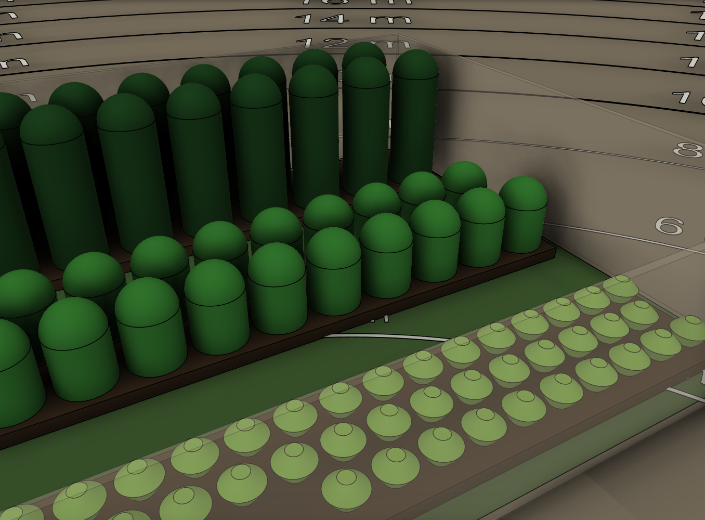 | 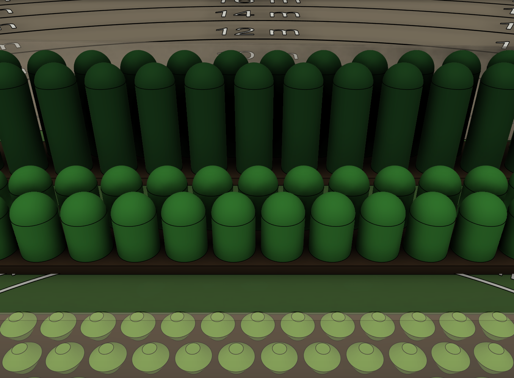 | 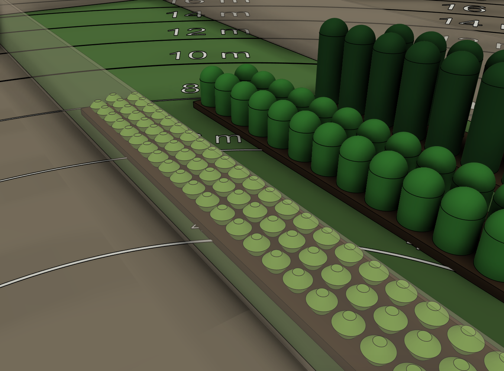 |

- **Mirando al frente** la imagen se llena de plantas: las lechugas abajo, los pimientos en medio y las tomateras arriba. Las lechugas y los pimientos se ven de arriba y enteros; las tomateras, de lado.
- **Las tomateras tapan el suelo de detrás** hasta unos 11 m (1,3 m de alto en la fila de 6,15 m, vistas desde 3 m): no se ven ni la franja entre la última fila y el borde de lejos de la huerta (6,6 m) ni el suelo de fuera. Los pimientos tapan el pie de las tomateras.
- **A los lados** (−30° y +55°) la cámara mira a lo largo de los bancales y cada planta tapa en parte la de detrás en la misma fila. A +55° el extremo de la izquierda, que no tiene plantas, se ve entero por encima de las lechugas.

## Hasta dónde llega la pistola

El componente fijo **Alcance pistola** está en `huerta` (oculto; se enciende para verlo) y tiene dos cosas:

- **Alcance pistola** (morado): la zona del suelo donde puede caer el agua, con los dos pan (±99°) y todo el tilt (−15° a +45°). Va 1 mm por encima del suelo de la huerta.
- **Chorro tilt …**: las trayectorias del agua mirando al frente, cada 15° de tilt.

Va en `huerta` y no en la torre ni en `Electric Water Spray` porque es una mancha fija en el suelo: depende de la altura del poste y de dónde está el suelo, y no tiene que girar al arrastrar las articulaciones. Se calcula con la boquilla en su sitio en la torre v96 con todo a 0: el eje de tilt en el eje de pan a z −255,1 y la punta de la boquilla 127,5 mm por delante y 15 mm por debajo de él. Si la torre cambia la altura de la pistola, hay que volver a generarlo.

En las vistas de esta sección están apagadas las capas de la cámara.

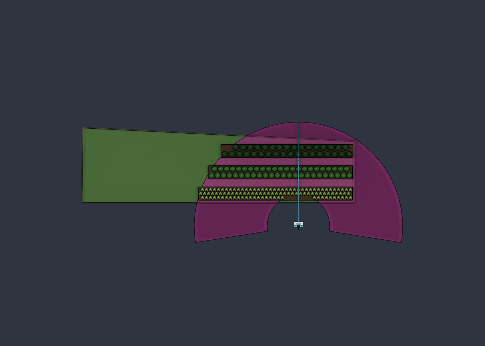

| | |
| --- | --- |
| 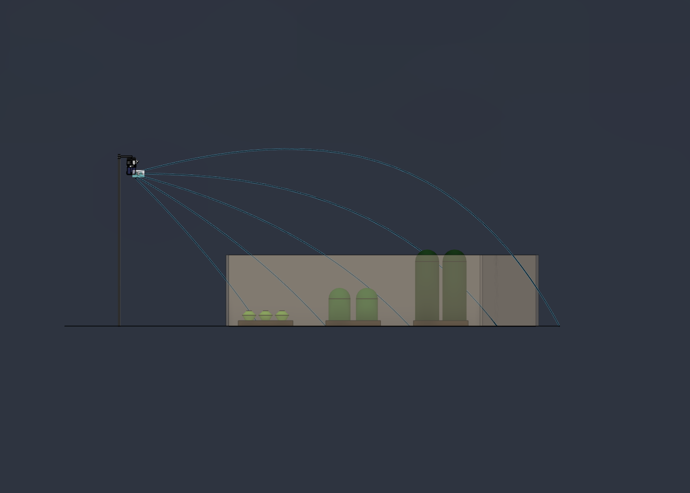 | 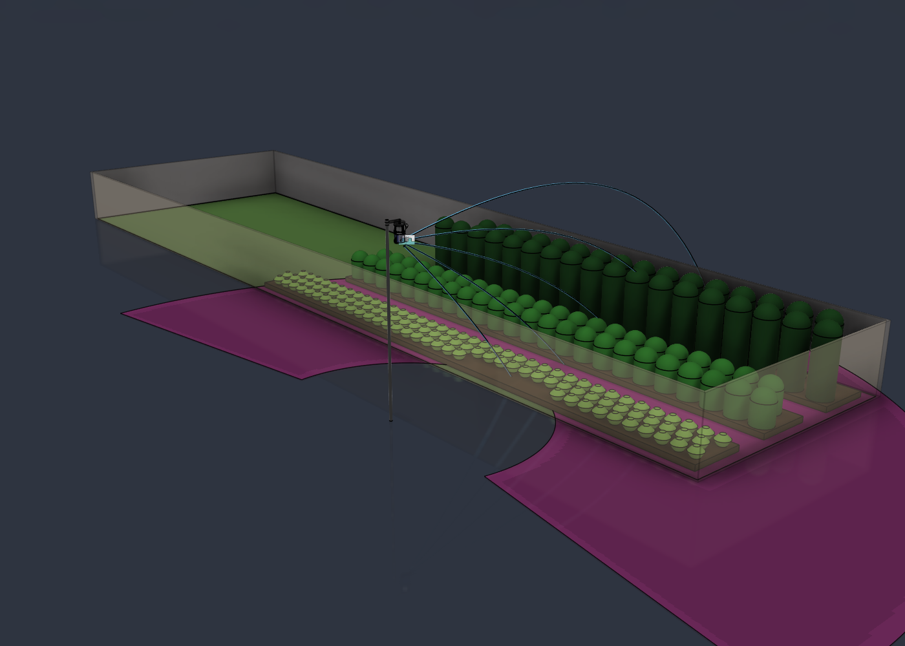 |

**Cómo se ha calculado:**

- El chorro se trata como un tiro con rozamiento cuadrático, ajustado a las [medidas en banco](../../esphome/docs/bambulab-water-spray-kits.md#medidas-en-banco): desde 1,3 m cae a ~5 m a 0° y a ~7 m a 20° hacia arriba. Eso da 13 m/s de salida y k ≈ 0,15 /m.
- La boquilla está a 2,78 m del suelo y 128 mm por delante del eje de tilt.
- Es el alcance medido con el Kit 02. El del Kit 01 no se ha medido.

Las medidas se hicieron con la pistola en su carcasa de fábrica. Montada en la torreta, con otra manguera y otra alimentación, hay que volver a medirla.

| Tilt | Cae a | Altura máxima del chorro |
| --- | --- | --- |
| −15° (arriba) | 7,8 m | 3,23 m |
| 0° | 6,7 m | 2,78 m |
| +15° | 5,1 m | 2,75 m |
| +30° | 3,55 m | 2,72 m |
| +45° (abajo) | 2,35 m | 2,70 m |

El chorro alcanza de **2,35 a 7,8 m** del eje en todo el giro:

- **Lado derecho:** entra entero. La esquina de cerca está a 4,6 m y la de lejos a 7,6 m.
- **Delante del poste:** la huerta empieza a 1,78 m, así que por cerca queda sin agua una franja de 1,5 m².
- **Lado izquierdo:** no llega. Desde unos 8 m hasta la esquina, a 17,7 m, quedan fuera unos 55 m².

En total, **la pistola cubre el 48 % de la huerta**. Con el poste en medio cubría el 60 %, pero no llegaba a ninguna de las dos esquinas de lejos.

Los tiros más bajos (tilt de más de unos +38°) cruzan la valla de cerca por debajo de 1,3 m: el agua pasa por la tela metálica, pero se rompe algo.

Subir más la pistola apenas ayuda, porque con rozamiento el mejor ángulo da poco más:

| Tilt hacia arriba | Alcance | Huerta cubierta |
| --- | --- | --- |
| −15° (el de ahora) | 7,8 m | 48 % |
| −25° | 8,2 m | 50 % |
| −30° (el mejor ángulo) | 8,2 m | 50 % |

Vista desde la cámara, la zona de tiro (morado) llega hasta unos 8 m. Mirando al frente tapa toda la huerta. A −30° tapa también la esquina de la derecha, y a +55° se ve dónde acaba por la izquierda (el verde de detrás, de 8 a 17 m, la cámara lo ve pero el agua no llega). En estas vistas están apagadas las plantas, que si no tapan casi toda la zona de tiro, y los tubos de los chorros, que pasan por delante de la lente:

| Pan −30° | Pan 0 | Pan +55° |
| --- | --- | --- |
| 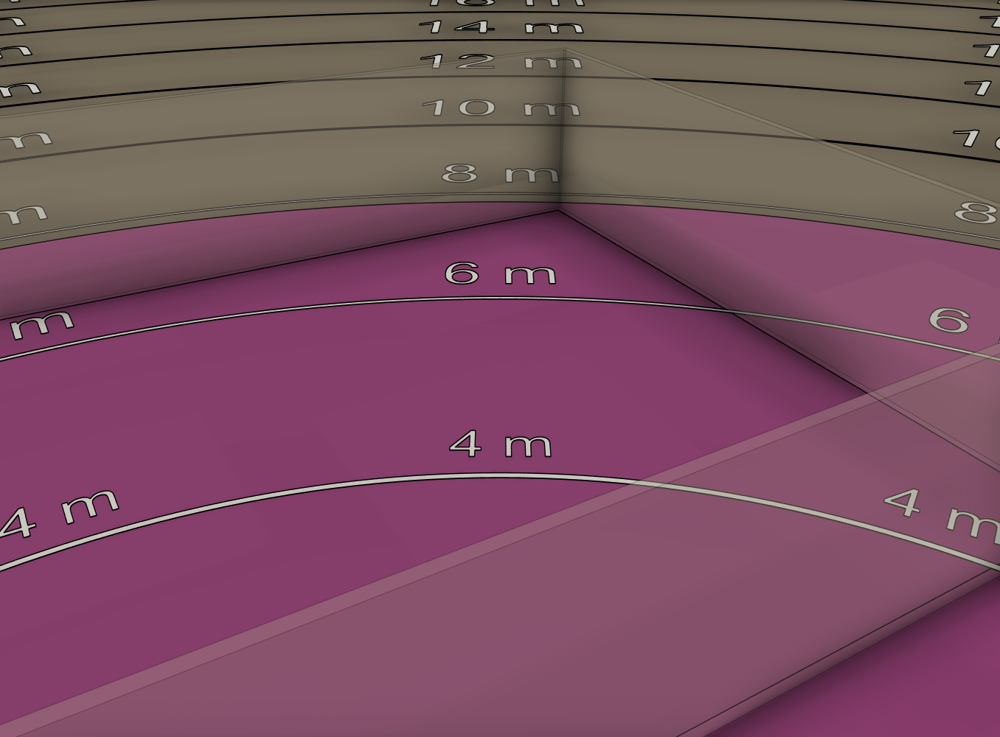 | 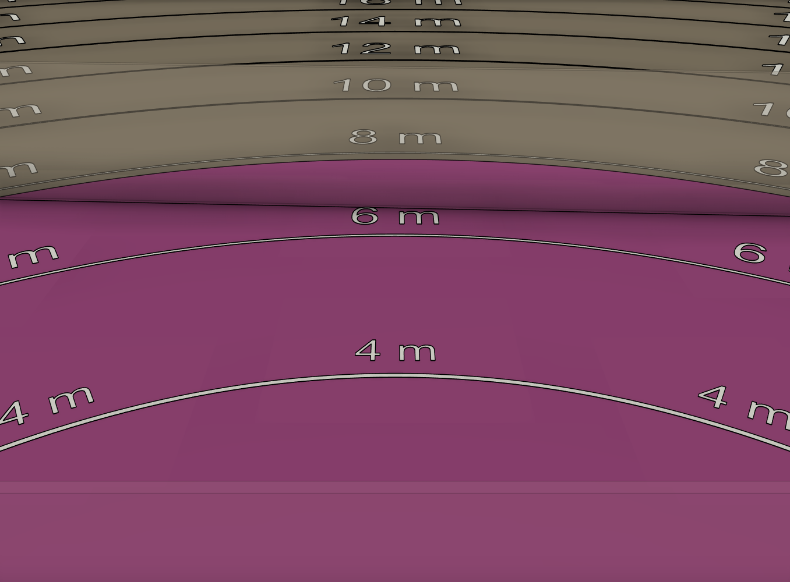 | 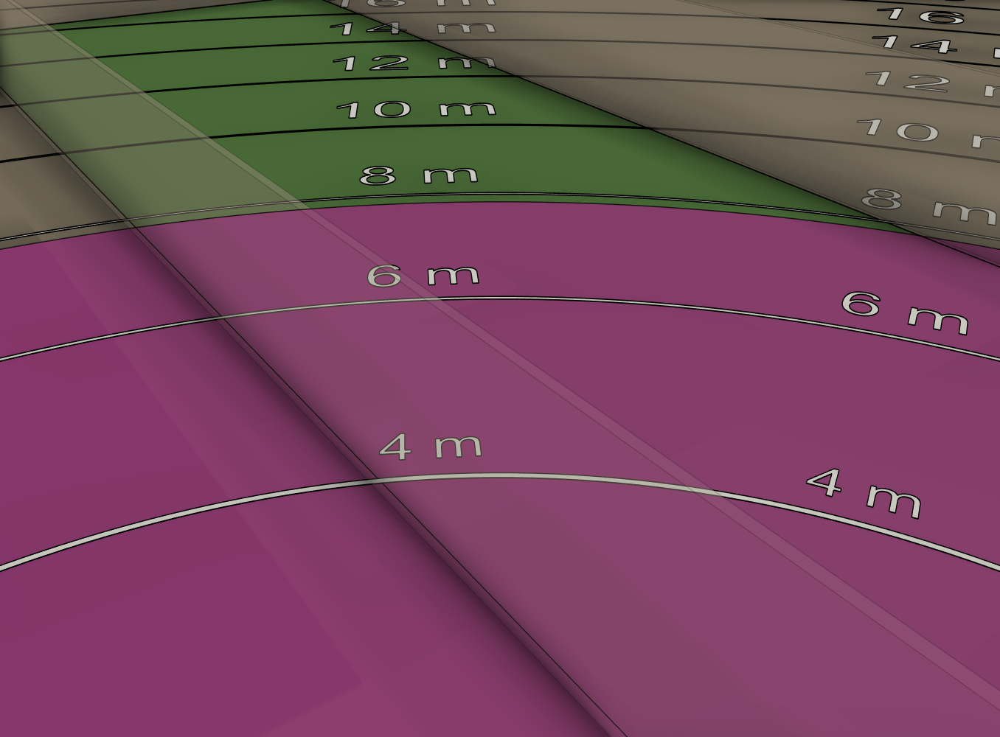 |

## Pendiente

- Medir el alcance con la pistola ya en la torreta y recalcular la zona de tiro. Con el alcance de banco, la pistola cubre el 48 % de la huerta y no llega al extremo de la izquierda; para eso haría falta más presión u otro poste.
- Soporte de la pistola:
  - Comprobar en la pieza impresa que los tornillos que hacen de pasador sujetan bien cada kit.
  - Medir el alcance del Kit 01.
  - A +45°, la mitad `+Y` pasa a 0,5 mm de la placa que sujeta el DM996 de tilt. Si roza, quitar algo de la placa por abajo.
  - Por dónde salen los cables del soporte. La manguera sale hacia atrás por la cola y por la ranura de detrás del tambor; falta decidir por dónde sube al plato.
- Las tomateras tapan a la cámara el suelo de detrás hasta unos 11 m: si hace falta ver la franja entre la última fila y el borde de la huerta, poner las plantas altas más cerca del poste o la cámara más alta.
- Piñón z27 del pan del conjunto: falta la unión con el eje del DM996 (el centro está macizo, para ajustarlo a la impresora).
- Probar en la pieza impresa que la caja seca y las puertas cierran estancas con el cordón TPU de Ø1,75.
- Manguera y cables:
  - El techo del cuerpo ya no tiene pasacables: falta decidir por dónde entran. Bajan por el de la tapa de abajo y pasan al tambor por el arco del plato. Los de la torreta pasan a la caja seca por el prensaestopas de la mampara.
  - Fuera del sombrero necesitan un bucle de holgura, porque el conjunto gira ±60°. Entre el suelo y el plato no hace falta: el arco del plato abarca ±48° y el tambor gira ±39°.
  - La pistola no aspira 3 m, así que el depósito tiene que ir arriba, junto al brazo.
- Engranajes de módulo 1 con DM996: con el servo bloqueado, el par puede romper los dientes impresos del piñón de tilt (z47). En uso normal la carga es pequeña.
- El casquillo suelto del pan del conjunto es una arandela de Ø12 × 2 mm con paso de 8,4.
- Exterior: el sombrero tapa los engranajes del pan del conjunto y el faldón del cuerpo los de la pistola. Las juntas están solapadas: 9 mm el ala del sombrero sobre el techo del cuerpo y 15 mm el faldón del cuerpo sobre la boca del tambor. El techo del cuerpo es cerrado, así que por arriba solo puede entrar agua por el paso del M8. Las puertas traseras del cuerpo llevan junta, pero el cuerpo no es estanco: lo estanco es la caja seca. Las ranuras de delante y de detrás del tambor y su fondo quedan abiertos.
