# water tower — prototipo "farola"

Diseño de Fusion **`water tower prototipo`**, en el proyecto *water tower* (junto a las piezas que usa: `torreta placas`, `sema`, 3 × `DM996 diymore`, `Electric Water Spray Kit 02`, rodamientos y tornillería).

| | |
| --- | --- |
| 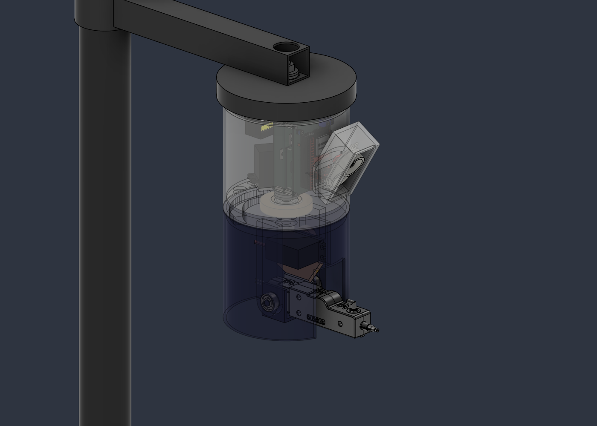 | 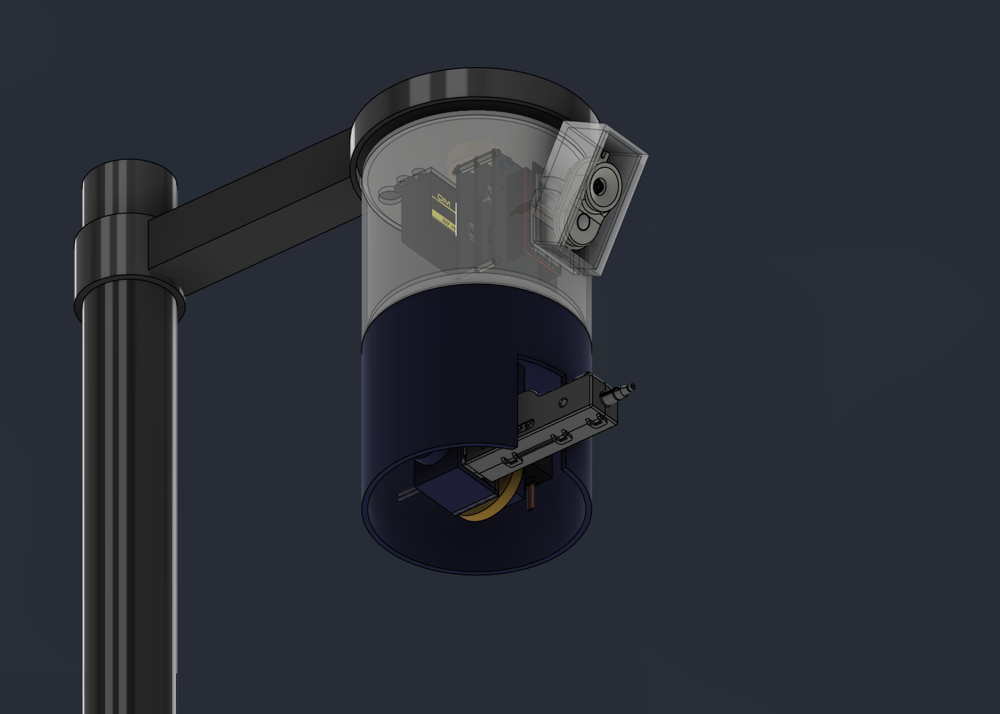 |
| 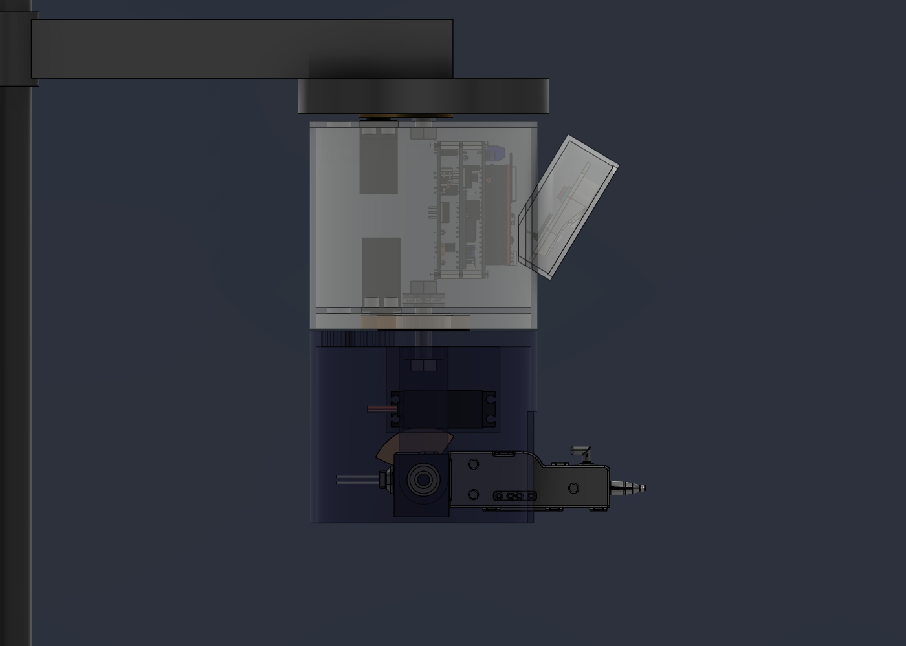 | 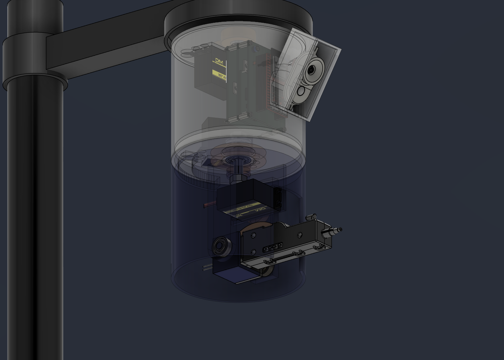 |

## Dónde va

La huerta (`3D/huerta.STEP`) mide 20,5 × 4,6–5,6 m. El poste va junto al lado largo recto, retirado **2 m** hacia fuera y **6 m a la derecha** de su mitad (mirando desde la cámara), con la cámara a **3 m** de alto. Desde ahí la huerta abarca 151° (de −67° a +84°) y el punto más lejano, la esquina de la izquierda, está a 17,7 m.

Alrededor de la huerta hay una valla de tela metálica de 1,3 m. No tapa la vista, pero las plantas (los tomates) llegan a esa altura: desde 3 m, una planta de 1,3 m tapa el suelo detrás de ella hasta 1,8 veces su distancia, y desde 2 m lo tapaba hasta 2,9 veces. Por eso la cámara va a 3 m. Acercar el poste no compensa: los extremos de la huerta siguen igual de lejos, así que la pistola apenas gana, y la cámara deja de ver el borde de cerca y las esquinas de lejos en la misma imagen.

El poste va desplazado a la derecha para que la pistola llegue a la esquina de la derecha: con el poste en medio, las dos esquinas de lejos quedaban a 12 m y la pistola no llegaba a ninguna. Con 6 m, la esquina de lejos de la derecha queda a 7,6 m y entra en el alcance (7,8 m). A cambio, el extremo de la izquierda queda más lejos y la pistola cubre menos huerta en total (ver [Hasta dónde llega la pistola](#hasta-dónde-llega-la-pistola)). La cámara sigue viéndola casi entera bajando la inclinación a 31°.

## Cómo está montado

Es una columna de Ø116 × 227 mm colgada del brazo: arriba el **cuerpo** con la electrónica y debajo el **tambor** con la pistola, del mismo diámetro. El cuerpo hace de techo de la pistola.

- **Soporte fijo (farola):**
  - Poste Ø48 y brazo de tubo cuadrado de 30.
  - Un *sombrero* Ø128 con faldón tapa los engranajes del pan.
- **Cuerpo (pan del conjunto):** Ø116 × 118 mm.
  - Dentro, delante, va la torreta de placas en vertical.
  - La `sema` va **delante de la torreta**, inclinada `cam_inclinacion` (31°), y asoma 42 mm fuera del cilindro dentro de un *morro*. El morro tiene la ventana de la lente y del PIR en la cara de delante. Así la electrónica y la cámara quedan juntas delante y luego se puede cerrar todo en un recinto.
  - La faja de la cámara va del conector de la Freenove a la `sema`: en línea recta son 34 mm, y la faja mide 75.
  - El DM996 del pan va detrás de la torreta, colgado de la tapa. Su piñón (z20) rueda alrededor del engranaje fijo (z30) del sombrero. Con 180° de servo da ±60°, y para que la cámara vea toda la huerta hace falta de −31° a +57° (ver [Qué ve la cámara](#qué-ve-la-cámara-a-3-m)).
  - Como el servo gira con el cuerpo, no hace falta anillo rozante.
  - Por debajo del suelo, la pared del cuerpo baja 8 mm más como faldón y tapa los engranajes del pan de la pistola.
- **Tambor de la pistola (pan de la pistola):** Ø116 × 100 mm, abierto por abajo.
  - Cuelga del suelo del cuerpo por un M8 y gira sobre el mismo eje que el conjunto.
  - El DM996 del pan de la pistola va en el cuerpo, boca abajo sobre el suelo, y saca el eje por una ventana del suelo. Su piñón (z21) mueve el engranaje z48 que el tambor lleva sobre su plato. Da ±39°.
  - Va girado de modo que el cuerpo del servo queda hacia atrás, a lo largo de la pared, y no hacia el eje: así queda a 12,6 mm del axial y a 12,8 del 22-8-7 (con el servo recto quedaba a 1 mm).
  - Delante tiene una ranura de 39 mm de ancho (`pist_ranura`) por la que asoma la boquilla y que deja subir y bajar la pistola. Llega hasta 45 mm por encima del eje de tilt y deja unos 7 mm a cada lado de la pistola, para un envoltorio.
  - Hay un pasacables en arco en el plato (±48°) para la manguera y los cables.
- **Pistola (tilt):**
  - Va en una cuna que gira en dos 17-6-6 en los brazos del tambor. Está centrada con la cámara: la boquilla queda en el mismo plano vertical que la lente.
  - El DM996 de tilt va tumbado encima de la pistola, entre los dos brazos, con el eje sobre el eje de tilt. Cuelga del plato por un soporte con ventana, como en el brazo de smart-sentry.
  - Mueve un sector z72 de la cuna con un piñón z24 (3:1), como el sector de tilt de smart-sentry. Da 60° de recorrido: de 15° hacia arriba a 45° hacia abajo.
  - El servo va 48 mm por encima del eje (`a_tilt`) para dejar sitio a un envoltorio de la pistola. En todo el recorrido, la pistola queda como mínimo a 13,8 mm del servo (en los dos extremos) y a 24 mm con la pistola horizontal.
  - Sin contar el servo, la pistola podría girar de unos 27° hacia arriba (toca el borde de arriba de la ranura) a 72° hacia abajo (toca el servo).
  - El eje de tilt pasa por el bloque del motor, así la parte de atrás apenas sube al bajar la boquilla.

Los engranajes son cilindros con el **diámetro primitivo** (m·z), de modo que los de cada pareja se tocan justo en la línea de engrane.

### Rodamientos de los dos pan

Los dos ejes de pan son el de smart-sentry puesto boca abajo:

- El M8-40 gira con la pieza que cuelga: con el cuerpo en el pan del conjunto y con el tambor en el de la pistola.
- La pieza fija (el sombrero, o el suelo del cuerpo) lleva el 22-8-7 en la cara de abajo. Un casquillo Ø12 de la pieza que cuelga empuja solo su aro interior.
- El axial va en la cara de arriba de la pieza fija, con la tuerca encima.

En smart-sentry el axial está entre la base y la parte que gira porque el peso aprieta hacia abajo. Aquí todo cuelga, así que el axial va arriba, bajo la tuerca, y es el que aguanta el peso. El 22-8-7 centra el eje y frena los empujones hacia arriba.

| Pan | Cabeza del M8 | 22-8-7 | Axial y tuerca |
| --- | --- | --- | --- |
| Conjunto | Bajo la tapa, dentro del cuerpo | En el sombrero, abierto hacia abajo | Encima del sombrero, dentro del brazo (tiene un agujero arriba para la llave) |
| Pistola | Bajo el plato del tambor, en un buje Ø20 | En un buje Ø28 bajo el suelo del cuerpo, abierto hacia abajo | Encima del suelo, dentro del cuerpo |

### Reducciones

| Eje | Dientes | Relación | Recorrido con 180° de servo |
| --- | --- | --- | --- |
| Pan del conjunto | 30 / 20 | 1,5:1 | ±60° |
| Pan de la pistola | 48 / 21 | 2,29:1 | ±39° |
| Tilt de la pistola | 72 / 24 (sector) | 3:1 | 60° (−15° / +45°) |

La pistola apunta a la suma de los dos pan: ±99° respecto al brazo. La huerta queda entre −67° y +84°, así que el giro sobra. Lo que limita es el alcance del chorro (ver [Hasta dónde llega la pistola](#hasta-dónde-llega-la-pistola)).

## Cambiar cosas

Todo está en *Modificar → Cambiar parámetros*:

| Parámetro | Valor | Qué mueve |
| --- | --- | --- |
| `modulo` | 1 mm | Diámetro de todos los engranajes y distancias entre ejes |
| `z_fijo`, `z_pinon` | 30, 20 | Pan del conjunto (`a_pan` se recalcula sola) |
| `z_eng_pist`, `z_pin_pist` | 48, 21 | Pan de la pistola (`a_pist`) |
| `z_eng_tilt`, `z_pin_tilt` | 72, 24 | Tilt de la pistola (`a_tilt`) |
| `casquillo_d`, `buje_rod_d` | 12, 28 mm | Casquillos de los 22-8-7 y buje del 22-8-7 bajo el suelo |
| `plato_esp` | 8 mm | Grosor del plato del tambor |
| `pist_caida` | 78 mm | Del plato del tambor al eje de tilt |
| `pist_ranura` | 39 mm | Ancho de la ranura del tambor por la que asoma la pistola |
| `pist_y` | 0 mm | Desplazamiento de la pistola hacia un lado (0: centrada con la cámara) |
| `pist_eng_y` | 22.5 mm | Cara interior del sector de tilt; deja sitio al DM996 de tilt entre los brazos |
| `pist_mejilla`, `pist_brazo_esp` | 13.5, 8 mm | Anchura de la cuna y grosor de los brazos |
| `sombrero_d`, `sombrero_esp` | cuerpo_d + 12, 10 mm | Sombrero (su grosor aloja el 22-8-7) |
| `brazo_largo`, `poste_d` | 200, 48 mm | Farola |

Hay cosas que no siguen a los parámetros:

- **Piezas insertadas:** los servos, la pistola, las placas y la cámara. Si cambias los dientes, hay que mover a mano el servo correspondiente para que su eje caiga en el centro del piñón.
- **Lo que depende de la torreta, la `sema` y los servos:** su posición, `cuerpo_d`, `caja_fondo`, el morro y la ventana. Se calcularon al generar el modelo, así que cambiar `cam_inclinacion` o los dientes no basta: hay que volver a generarlo.

Las tres articulaciones (`Pan conjunto` ±60°, `Pan pistola` ±39°, `Tilt pistola` −15°/+45°, positivo hacia abajo) se pueden arrastrar para comprobar los barridos.

Se comprobaron las colisiones en el centro, en los dos extremos y en dos poses cruzadas, sin la Freenove. Solo se solapan los ejes de los servos con sus piñones, que es lo esperado.

Lo que más se acerca a la pared del cuerpo o del tambor (radio interior 55 mm): la torreta a 54 mm, el DM996 del pan de la pistola a 50,3, la cola de la pistola a 46,1 y el DM996 de tilt a 42,3.

El componente oculto **Campo de visión cámara** dibuja los rayos de la cámara hacia el suelo.

## Qué ve la cámara a 3 m

El componente fijo **Huerta** pone en el suelo (3 m bajo la lente) tres cosas:

- **Huerta** (verde): el contorno de `3D/huerta.STEP` con el poste en su sitio.
- **Barrido cámara (pan ±60)** (azul): todo lo que llega a ver la cámara moviendo el pan del conjunto de un extremo a otro.
- **Vista cámara (pan 0)** (naranja): lo que entra en una sola imagen mirando al frente.

El componente fijo **Valla huerta** es la valla de tela metálica de 1,3 m, por fuera del borde. Se dibuja casi transparente porque no tapa la vista.

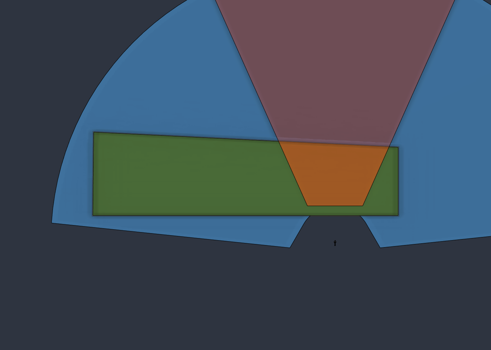

| | |
| --- | --- |
| 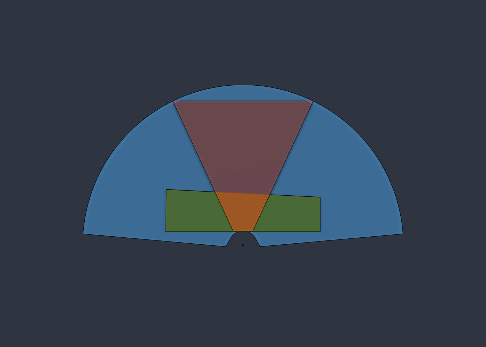 | 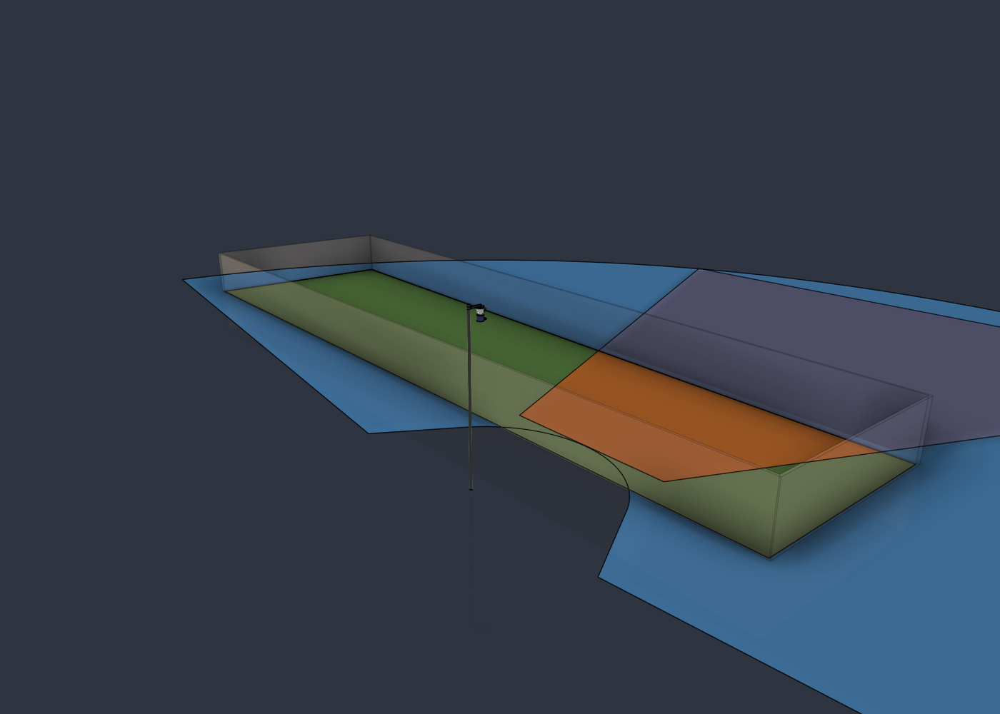 |

Con una lente de 66° (55° × 42°) inclinada 31°:

- Una imagen mirando al frente va de **2,4 m** a **17,1 m** en el centro, y llega a 19 m en las esquinas de arriba. Por la izquierda y la derecha se sale de la huerta. Ve el 22 % de la huerta.
- Al barrer con el pan del conjunto, la huerta queda dentro casi entera. Como el poste está a la derecha, el barrido es asimétrico:

  | Pan | Huerta vista | Lo que queda fuera |
  | --- | --- | --- |
  | −30° a +45° | 81 % | 19 m² en el extremo de la izquierda |
  | −30° a +50° | 91 % | 10 m² en el extremo de la izquierda |
  | −31° a +57° | 98,5 % | 1,6 m², casi todo delante del poste |
  | ±60° | 98,6 % | 1,5 m² justo delante del poste, de 1,8 a 2,4 m |

  Los ±60° del servo llegan con poco margen por la izquierda. La franja de delante del poste no se puede ganar: la esquina de la izquierda, a 17,7 m, obliga a inclinar poco la cámara. Con 35° la franja baja a 0,5 m², pero se pierden 20 m² del extremo de la izquierda.

Las huellas se calculan con `cam_inclinacion`, `cam_fov_h` y `cam_fov_v`, pero no siguen a los parámetros: si se cambian, hay que volver a generarlas.

### La imagen de la cámara

Estas vistas salen desde la lente, con la misma inclinación (31°) y el mismo campo (55° × 42°) que la cámara. El componente oculto **Referencias vista cámara** pone el suelo alrededor de la huerta y un anillo cada 2 m medido desde el eje del poste, para poder leer las distancias.

| Pan −30° | Pan 0 | Pan +55° |
| --- | --- | --- |
| 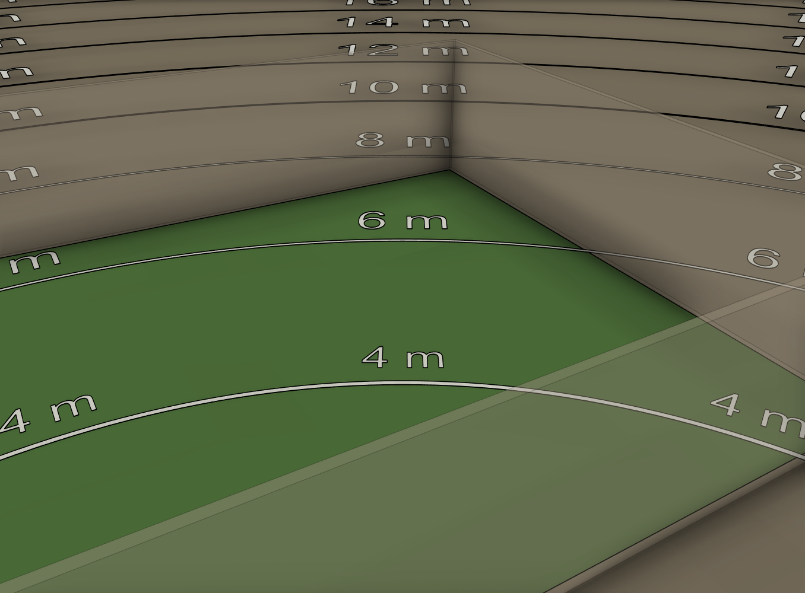 | 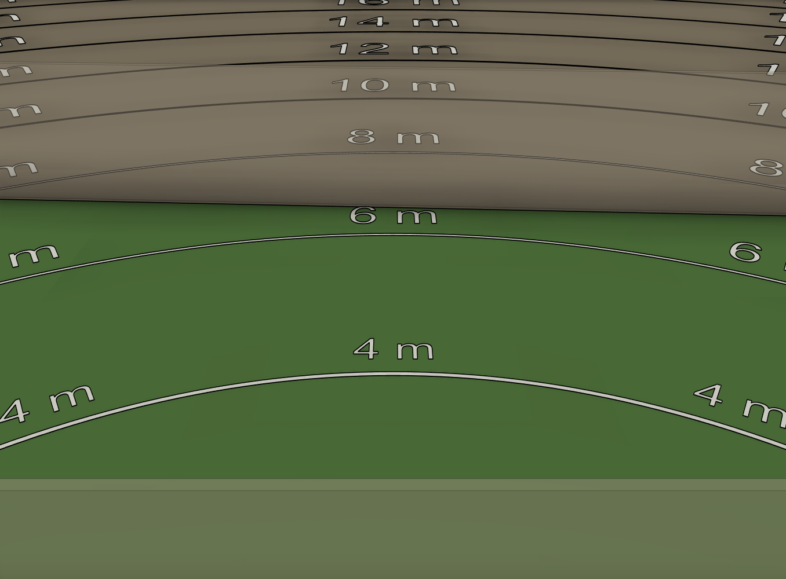 | 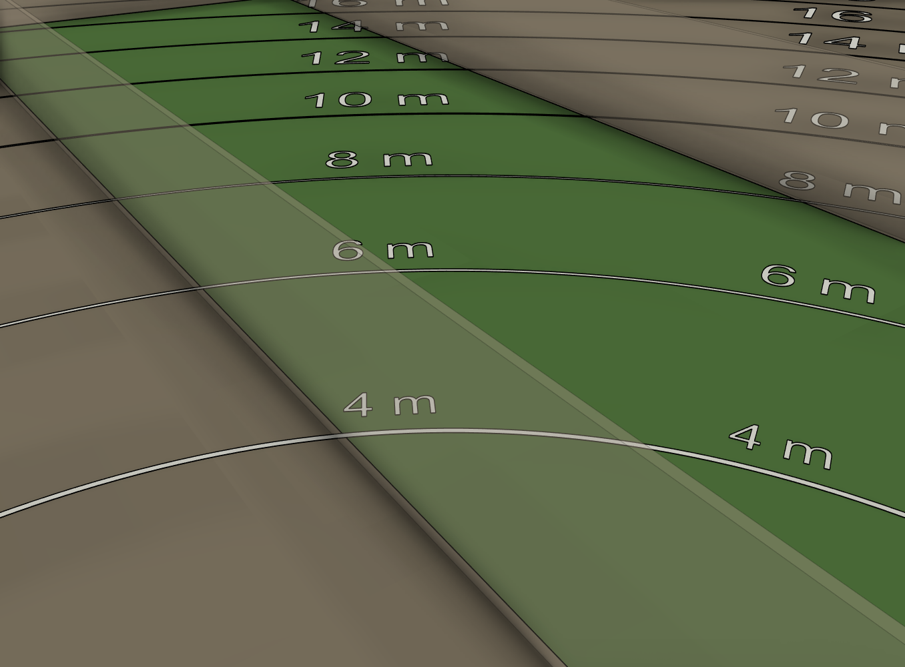 |

- **Abajo** la imagen empieza a 2,4 m, 60 cm por detrás del borde de la huerta. La banda clara de abajo es la valla de cerca vista a través.
- **Arriba** llega a unos 17 m: el horizonte no entra en la imagen.
- **Mirando al frente**, el borde de lejos de la huerta (6,6 m) queda a un tercio de la imagen desde arriba. Lo de encima es suelo de fuera. Ese margen hace falta a +55°, donde el extremo de la izquierda está a 16–18 m y queda cerca del borde de arriba.
- **A −30°** entra la esquina de la derecha entera, con la valla en las dos caras.
- **La pistola no sale en la imagen**: la boquilla queda 77° por debajo de la horizontal vista desde la lente, y el borde de abajo de la imagen está a 52°.

## Hasta dónde llega la pistola

El componente fijo **Alcance pistola** tiene dos cosas:

- **Alcance pistola** (morado): la zona del suelo donde puede caer el agua, con los dos pan (±99°) y todo el tilt (−15° a +45°).
- **Chorro tilt …**: las trayectorias del agua mirando al frente, cada 15° de tilt.

En las vistas de esta sección están apagadas las capas de la cámara.

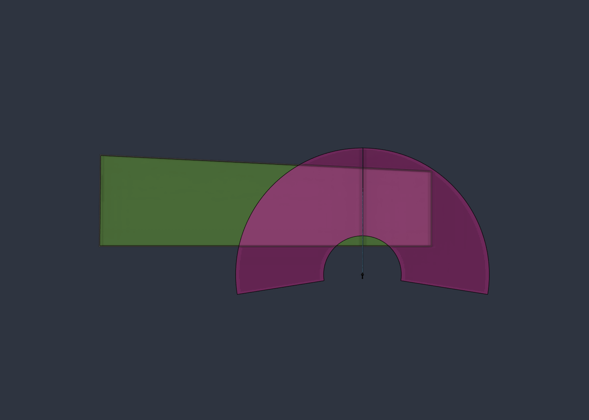

| | |
| --- | --- |
| 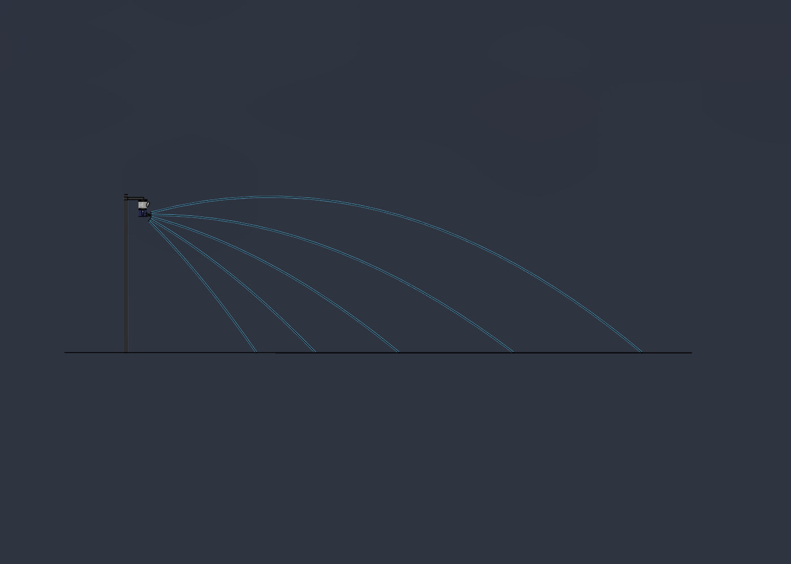 | 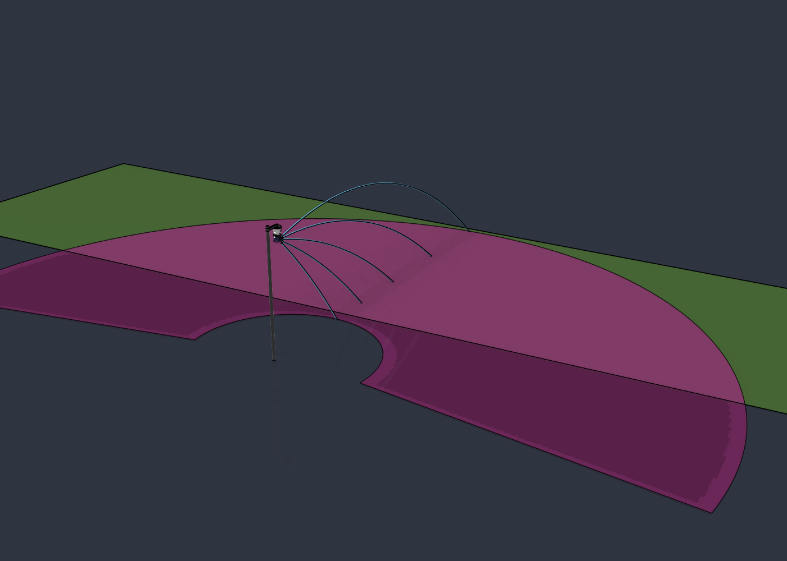 |

**Cómo se ha calculado:**

- El chorro se trata como un tiro con rozamiento cuadrático, ajustado a las [medidas en banco](../../esphome/docs/bambulab-water-spray-kits.md#medidas-en-banco): desde 1,3 m cae a ~5 m a 0° y a ~7 m a 20° hacia arriba. Eso da 13 m/s de salida y k ≈ 0,15 /m.
- La boquilla está a 2,85 m del suelo y 113 mm por delante del eje de tilt.

Las medidas se hicieron con la pistola en su carcasa de fábrica. Montada en la torreta, con otra manguera y otra alimentación, hay que volver a medirla.

| Tilt | Cae a | Altura máxima del chorro |
| --- | --- | --- |
| −15° (arriba) | 7,8 m | 3,3 m |
| 0° | 6,7 m | 2,85 m |
| +15° | 5,1 m | 2,82 m |
| +30° | 3,6 m | 2,79 m |
| +45° (abajo) | 2,4 m | 2,77 m |

El chorro alcanza de **2,4 a 7,8 m** del eje en todo el giro:

- **Lado derecho:** entra entero. La esquina de cerca está a 4,6 m y la de lejos a 7,6 m.
- **Delante del poste:** la huerta empieza a 1,78 m, así que por cerca queda sin agua una franja de 1,5 m².
- **Lado izquierdo:** no llega. Desde unos 8 m hasta la esquina, a 17,7 m, quedan fuera unos 53 m².

En total, **la pistola cubre el 48 % de la huerta**. Con el poste en medio cubría el 60 %, pero no llegaba a ninguna de las dos esquinas de lejos.

Los tiros más bajos (tilt de más de unos +38°) cruzan la valla de cerca por debajo de 1,3 m: el agua pasa por la tela metálica, pero se rompe algo.

Subir más la pistola apenas ayuda, porque con rozamiento el mejor ángulo da poco más:

| Tilt hacia arriba | Alcance | Huerta cubierta |
| --- | --- | --- |
| −15° (el de ahora) | 7,8 m | 48 % |
| −25° | 8,2 m | 50 % |
| −30° (el mejor ángulo) | 8,2 m | 50 % |

Vista desde la cámara, la zona de tiro (morado) llega hasta unos 8 m. Mirando al frente tapa toda la huerta. A −30° tapa también la esquina de la derecha:

| Pan 0 | Pan −30° |
| --- | --- |
| 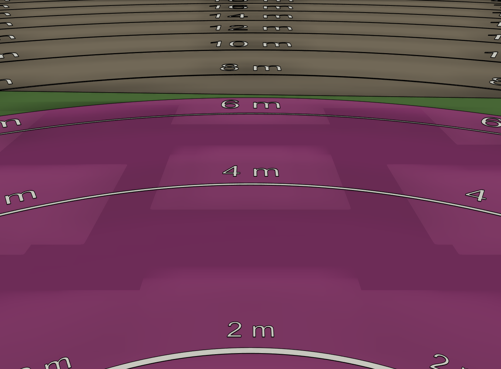 | 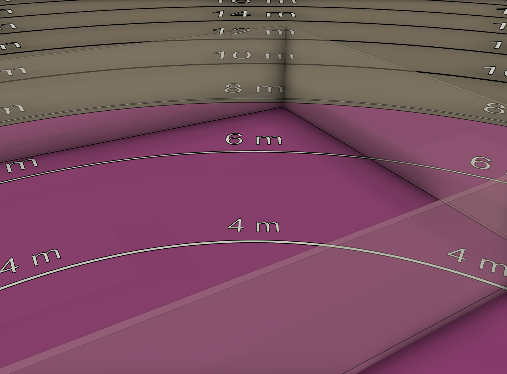 |

## Pendiente

- Medir el alcance con la pistola ya en la torreta y recalcular la zona de tiro. Con el alcance de banco, la pistola cubre el 48 % de la huerta y no llega al extremo de la izquierda; para eso haría falta más presión u otro poste.
- Sujeción de la pistola en la cuna: va apoyada en el fondo y entre las mejillas; falta una brida o un tornillo.
- Recinto cerrado para la torreta y la `sema`: el morro ya envuelve la `sema`, pero ni su ventana ni el cuerpo son estancos.
- Manguera y cables:
  - Entran por el pasacables de la tapa, bajan por el del suelo y pasan al tambor por el arco del plato.
  - Fuera del sombrero necesitan un bucle de holgura, porque el conjunto gira ±60°. Entre el suelo y el plato no hace falta: el arco del plato abarca ±48° y el tambor gira ±39°.
  - La pistola no aspira 3 m, así que el depósito tiene que ir arriba, junto al brazo.
- Engranajes de módulo 1 con DM996: con el servo bloqueado, el par puede romper los dientes impresos del piñón de tilt (z24). En uso normal la carga es pequeña.
- El casquillo de la tapa (Ø12 con paso de 8,5) tiene paredes de 1,75 mm. Solo trabaja a compresión, pero conviene imprimirlo macizo.
- Exterior: el sombrero tapa los engranajes del pan del conjunto, el faldón del cuerpo los de la pistola y el cuerpo hace de tejado del tambor. La ranura de delante del tambor y su fondo quedan abiertos.
