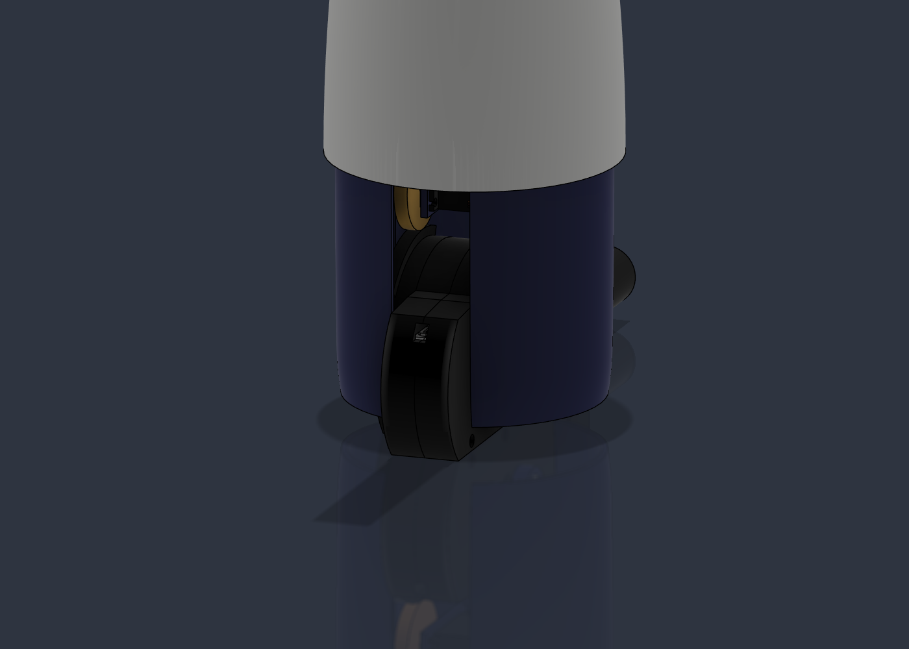
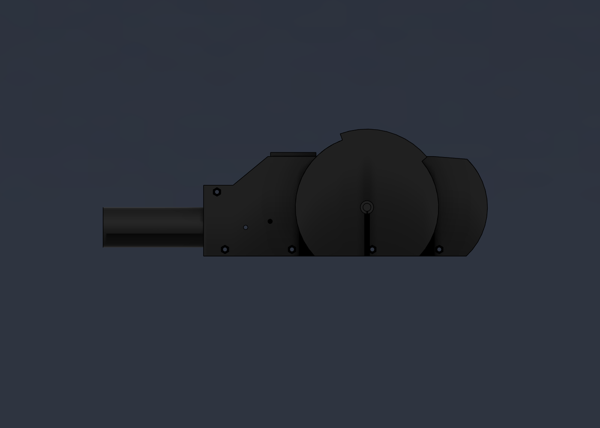
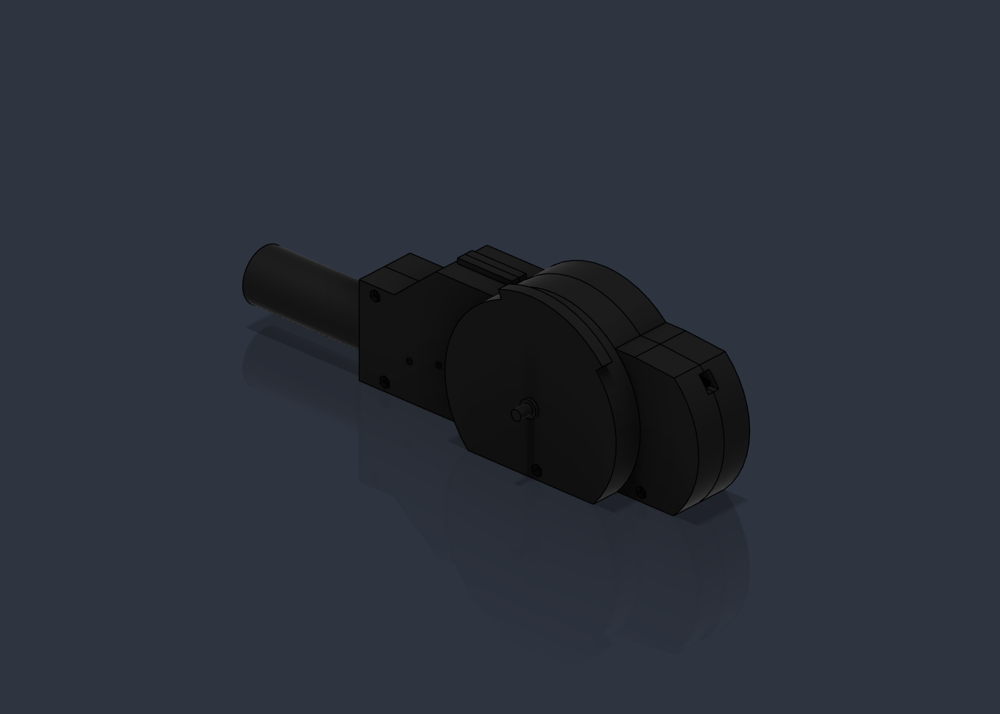
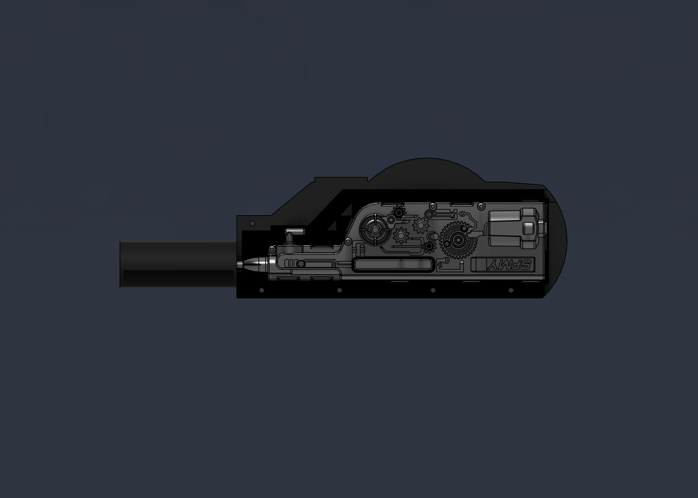
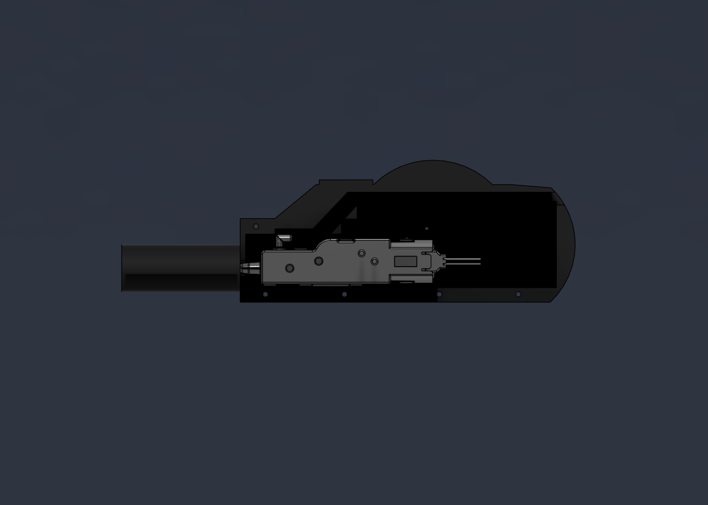
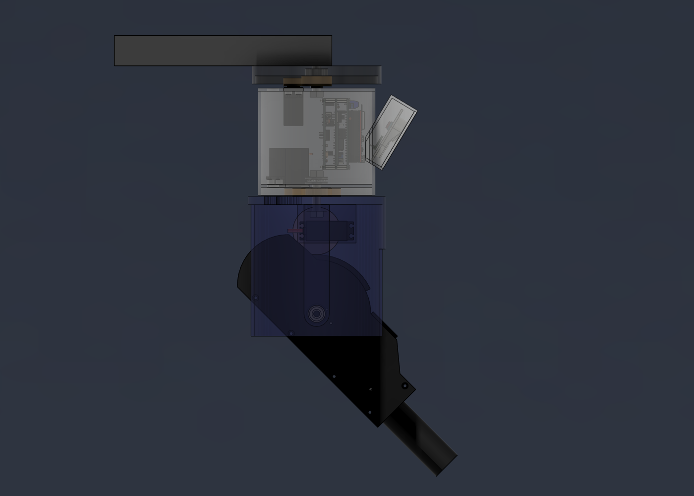

# water tower — prototipo "farola"

Diseño de Fusion **`water tower prototipo`**, en el proyecto *water tower* (junto a las piezas que usa: `sema`, 3 × `DM996 diymore`, `Electric Water Spray` con el Kit 01 y el Kit 02, rodamientos y tornillería). Tiene la columna colgada del brazo y los componentes ocultos `Campo de visión cámara` y `Alcance pistola`.

Para que pese menos, las placas van en el componente `Torreta placas (simple)`: es una copia de `torreta placas` en la que la Freenove solo conserva las piezas de más de 2 mm (placa, módulo, pines, conectores y USB-C). Las placas de pistola, servos y control, el TPS63020 y la tornillería van enteras. La torre pasa de 799 a 176 cuerpos. Si cambia `torreta placas`, la copia no se entera: hay que volver a sacarla.

El conjunto final es el diseño **`huerta`**, en la misma carpeta: el poste, la huerta, la valla y las referencias de la vista de la cámara, con `water tower prototipo` metido como referencia en su sitio. Para trabajar en la columna se abre `water tower prototipo`, que pesa mucho menos; `huerta` se pone al día con *Actualizar referencias*.

| | |
| --- | --- |
|  |  |
|  |  |
|  | |

## Dónde va

La huerta (`3D/huerta.STEP`) mide 20,5 × 4,6–5,6 m. El poste va junto al lado largo recto, retirado **2 m** hacia fuera y **6 m a la derecha** de su mitad (mirando desde la cámara), con la cámara a **3 m** de alto. Desde ahí la huerta abarca 151° (de −67° a +84°) y el punto más lejano, la esquina de la izquierda, está a 17,7 m.

Alrededor de la huerta hay una valla de tela metálica de 1,3 m. No tapa la vista, pero las plantas (los tomates) llegan a esa altura: desde 3 m, una planta de 1,3 m tapa el suelo detrás de ella hasta 1,8 veces su distancia, y desde 2 m lo tapaba hasta 2,9 veces. Por eso la cámara va a 3 m. Acercar el poste no compensa: los extremos de la huerta siguen igual de lejos, así que la pistola apenas gana, y la cámara deja de ver el borde de cerca y las esquinas de lejos en la misma imagen.

El poste va desplazado a la derecha para que la pistola llegue a la esquina de la derecha: con el poste en medio, las dos esquinas de lejos quedaban a 12 m y la pistola no llegaba a ninguna. Con 6 m, la esquina de lejos de la derecha queda a 7,6 m y entra en el alcance (7,8 m). A cambio, el extremo de la izquierda queda más lejos y la pistola cubre menos huerta en total (ver [Hasta dónde llega la pistola](#hasta-dónde-llega-la-pistola)). La cámara sigue viéndola casi entera bajando la inclinación a 31°.

## Cómo está montado

Es una columna de 257 mm de alto colgada del brazo: arriba el **cuerpo** (Ø149 abajo) con la electrónica y debajo el **tambor** (Ø138 arriba) con la pistola. El cuerpo y el plato del tambor hacen de techo de la pistola.

Las tres piezas van de mayor a menor hacia abajo y encajan unas dentro de otras como tejas, para que la lluvia no entre por las juntas: el ala del sombrero (Ø156) baja 15 mm por fuera de la boca del cuerpo (Ø132), y el faldón del cuerpo (Ø149) baja 15 mm por fuera de la boca del tambor (Ø138). El agua que cae por una pieza gotea por fuera de la de abajo. El cuerpo y el tambor no son cilindros: sus paredes son revoluciones de 3 mm y juntos forman **una sola barriga**, con lo más ancho en la junta: el cuerpo se abre hacia abajo y el tambor se cierra hacia abajo.

- **Soporte fijo (farola):**
  - Poste Ø48 (en el diseño `huerta`) y brazo de tubo cuadrado de 30.
  - Un *sombrero* de Ø156 tapa los engranajes del pan. Es plano arriba hasta R25 (donde apoyan el brazo y el axial), cae en curva hasta el ala y el ala baja hasta 16 mm por debajo de su cara de abajo. Por dentro queda a 9 mm de la boca del cuerpo.
- **Cuerpo (pan del conjunto):** 133 mm de alto. Es la mitad de arriba del barril: Ø132 arriba, donde entra en el sombrero, y se abre en una curva sin cintura hasta Ø149 en el faldón, lo más ancho. La tapa entra por arriba y apoya en un escalón.
  - Dentro, delante, va la torreta de placas en vertical. Va tan adelante que la Freenove se mete en el hueco del morro, a 4,9 mm de su pared, y así sigue a la misma distancia de la `sema`.
  - La `sema` va **delante de la torreta**, inclinada `cam_inclinacion` (31°), y asoma fuera de la pared dentro de un *morro*. Como en la caja de la cámara (`cam/interior`), la `sema` entra por detrás en una **placa plana paralela a ella**: la pestaña apoya en la cara de dentro, lo de delante asoma por una ventana en estadio (R12,6, la de `case v2`) y dos agujeros ciegos de Ø2,2 recogen sus tornillos. La placa es un estadio de 42 × 73 mm a 31° y queda casi entera fuera del barril: solo su borde de abajo entra ≈1,5 mm, y ahí un rebaje poco profundo, abierto 20° hacia delante, la deja al aire. Arriba la placa sobresale unos 43 mm y el morro llega a 111 mm del eje, 33 mm más allá del ala del sombrero. El morro se abre 20° desde la placa hacia la pared y no tiene cantos vivos: la placa, el rebaje y el techo tienen el borde redondeado R5, la unión con el cuerpo es de R10 y la pared de 3 mm sigue los redondeos. El techo del morro queda a 18,5 mm bajo el sombrero. Así la electrónica y la cámara quedan juntas delante y luego se puede cerrar todo en un recinto.
  - La faja de la cámara va del conector de la Freenove a la `sema`: en línea recta son 34 mm, y la faja mide 75.
  - El DM996 del pan va detrás de la torreta, colgado de la tapa. Su piñón (z20) rueda alrededor del engranaje fijo (z30) del sombrero. Con 180° de servo da ±60°, y para que la cámara vea toda la huerta hace falta de −31° a +57° (ver [Qué ve la cámara](#qué-ve-la-cámara-a-3-m)).
  - Como el servo gira con el cuerpo, no hace falta anillo rozante.
  - Por debajo del suelo, la pared del cuerpo baja 24 mm más como faldón: tapa los engranajes del pan de la pistola y los 15 mm de arriba del tambor.
- **Tambor de la pistola (pan de la pistola):** Ø138 × 138 mm, abierto por abajo. El diámetro y el alto los pide el soporte de la pistola, para que no lleve muescas (ver [Soporte de la pistola](#soporte-de-la-pistola)).
  - Es la mitad de abajo del barril: arriba mide Ø138 y entra 15 mm en el faldón del cuerpo, y se va cerrando sin quiebros hasta Ø136 en el eje de tilt (lo que pide el sector) y Ø132 en el borde de abajo.
  - Cuelga del suelo del cuerpo por un M8 y gira sobre el mismo eje que el conjunto.
  - El DM996 del pan de la pistola va en el cuerpo, boca abajo sobre el suelo, y saca el eje por una ventana del suelo. Su piñón (z21) mueve el engranaje z48 que el tambor lleva sobre su plato. Da ±39°.
  - Va girado de modo que el cuerpo del servo queda hacia atrás, a lo largo de la pared, y no hacia el eje: así queda a 12,6 mm del axial y a 12,8 del 22-8-7 (con el servo recto quedaba a 1 mm).
  - Delante tiene una ranura de 41 mm de ancho (`pist_ranura`) por la que asoma el soporte de la pistola. Llega hasta 64 mm por encima del eje de tilt, para que el riel no toque el borde con la pistola 15° hacia arriba.
  - Detrás tiene otra ranura de 41 mm (`pist_ranura_atras`) por la que asoma la cola del soporte. Va del fondo del tambor hasta el plato, porque la cola sube al bajar el morro.
  - Hay un pasacables en arco en el plato (±48°) para la manguera y los cables.
- **Pistola (tilt):**
  - Va en un soporte con forma de arma que sirve para los dos kits de Bambu Lab y está dibujado dentro de `Electric Water Spray` (ver [Soporte de la pistola](#soporte-de-la-pistola)). Gira en dos 22-8-7 en los brazos del tambor (ojos de Ø30) y está centrado con la cámara: la boquilla queda en el mismo plano vertical que la lente.
  - El DM996 de tilt va tumbado encima de la pistola, entre los dos brazos, con el eje sobre el eje de tilt. Cuelga del plato por un soporte con ventana, como en el brazo de smart-sentry.
  - Mueve un sector z117 del soporte con un piñón z47 (2,49:1), como el sector de tilt de smart-sentry. Da 60° de recorrido, de 15° hacia arriba a 45° hacia abajo, con 149° de servo. El sector solo tiene dientes de 70° a 140°: el piñón engrana de 75° a 135° y así las puntas no tocan la pared del tambor.
  - El servo va 82 mm por encima del eje (`a_tilt`), lo bastante lejos para que la cola del soporte pase por debajo a +45° sin recortarla: queda a 3 mm del servo. El piñón queda 1,5 mm por debajo del plato, y eso es lo que fija el alto del tambor (`pist_caida` 108 mm).
  - Con 3:1 (z123/z41) haría falta un tambor de Ø142, porque las puntas del sector tocarían la pared.

Los engranajes son cilindros con el **diámetro primitivo** (m·z), de modo que los de cada pareja se tocan justo en la línea de engrane.

### Rodamientos de los dos pan

Los dos ejes de pan son el de smart-sentry puesto boca abajo:

- El M8-40 gira con la pieza que cuelga: con el cuerpo en el pan del conjunto y con el tambor en el de la pistola.
- La pieza fija (el sombrero, o el suelo del cuerpo) lleva el 22-8-7 en la cara de abajo. Un casquillo Ø12 de la pieza que cuelga empuja solo su aro interior.
- El axial va en la cara de arriba de la pieza fija, con la tuerca encima.

En smart-sentry el axial está entre la base y la parte que gira porque el peso aprieta hacia abajo. Aquí todo cuelga, así que el axial va arriba, bajo la tuerca, y es el que aguanta el peso. El 22-8-7 centra el eje y frena los empujones hacia arriba.

| Pan | Cabeza del M8 | 22-8-7 | Axial y tuerca |
| --- | --- | --- | --- |
| Conjunto | Bajo la tapa, dentro del cuerpo | En el sombrero, abierto hacia abajo | Encima del sombrero, dentro del brazo (tiene un agujero arriba para la llave) |
| Pistola | Bajo el plato del tambor, en un buje Ø20 | En un buje Ø28 bajo el suelo del cuerpo, abierto hacia abajo | Encima del suelo, dentro del cuerpo |

### Reducciones

| Eje | Dientes | Relación | Recorrido con 180° de servo |
| --- | --- | --- | --- |
| Pan del conjunto | 30 / 20 | 1,5:1 | ±60° |
| Pan de la pistola | 48 / 21 | 2,29:1 | ±39° |
| Tilt de la pistola | 117 / 47 (sector) | 2,49:1 | 60° (−15° / +45°) con 149° |

La pistola apunta a la suma de los dos pan: ±99° respecto al brazo. La huerta queda entre −67° y +84°, así que el giro sobra. Lo que limita es el alcance del chorro (ver [Hasta dónde llega la pistola](#hasta-dónde-llega-la-pistola)).

### Soporte de la pistola

El diseño `Electric Water Spray` lleva el [Kit 01 y el Kit 02](../../esphome/docs/bambulab-water-spray-kits.md) superpuestos, con la boquilla en el mismo sitio, y el soporte está dibujado ahí mismo, en el componente `Soporte pistolas`. La torre inserta `Electric Water Spray` directamente en la raíz, sin componente intermedio: la articulación `Tilt pistola (DM996)` va de `Electric Water Spray` al tambor, y el círculo del eje está en un boceto del tambor (`eje tilt pistola`). Para cambiar el soporte se edita `Electric Water Spray` y luego se actualiza la referencia en la torre.

El soporte sirve para los dos kits: se monta uno u otro sin cambiar nada más. El origen de `Soporte pistolas` está en el eje de tilt, con X hacia delante (por donde sale el agua) y Z hacia arriba.

| | |
| --- | --- |
|  |  |
|  |  |
|  | |

- **Forma:** un cajón de 35 mm de ancho con el guardamanos más bajo delante, un riel arriba, una joroba redonda sobre el eje y un cañón. El techo es plano a 38 mm sobre el eje desde el guardamanos hasta la cola, que es redonda y está achaflanada 2 mm arriba.
- **Sin muescas:** la versión anterior tenía recortado todo lo que barrían el DM996 de tilt y el plato, y el motor del Kit 01 quedaba al aire. Ahora el tambor es más alto y más ancho y el servo va 20 mm más lejos del eje, así que la carcasa va entera. En todo el recorrido queda a 3 mm del servo y a 1,8 mm de sus cables, aunque salgan rectos hacia atrás.
- **Cañón:** es una pieza aparte, un tubo de Ø30 × 75 mm. Se encaja en una espiga de Ø20 que sale 15 mm por delante de la carcasa, con 0,2 mm de holgura. Como la espiga está partida en las dos mitades, el cañón también las mantiene juntas por delante. El agua sale por un ánima de Ø14 y no toca el cañón: la boquilla acaba dentro de la espiga, 9,5 mm antes del ánima. Se puede pegar o dejar a presión.
- **Posición de la pistola:** el eje de tilt queda 127,5 mm detrás de la punta de la boquilla y 15 mm por encima de ella. La boca del cañón queda 197 mm por delante del eje, y la cola sale 90 mm por detrás, por la ranura de detrás del tambor.
- **Sector en la carcasa:** la mitad `+Y` lleva un disco de R53,5 que va de su cara de fuera hasta la cara de fuera del sector (16,5 mm) y baja hasta la cara de abajo. El sector de dientes (R58,5, de 70° a 140°) sale por encima del disco. Así el sector forma parte de la carcasa en lugar de colgar de un buje, y la mitad se imprime sin soportes. El disco no puede ser más grande: a esa distancia del centro, la pared del tambor queda a 55,4 mm del eje.
- **Hueco de las dos pistolas:** es la unión de los dos kits con 0,5 mm de holgura. Cada kit queda a 0,34 mm o más de las paredes.
- **Cómo se sujeta cada kit:**
  - **Kit 01:** sus dos resaltes de Ø6 entran en dos alojamientos de una mitad. En la otra mitad, dos tornillos M3 se roscan en la pared y la punta entra en sus agujeros de Ø3.
  - **Kit 02:** apoya contra la pared de delante. Tres tornillos M4 se roscan en las paredes y la punta entra en sus agujeros cónicos de Ø4,3. Sus dos pivotes de Ø4,5 entran en alojamientos.
- **Manguera (5/3 mm):** las tomas de agua de los dos kits son espigas de Ø4 en el plano de la boquilla que miran hacia atrás, a 37–48 mm de la punta. Desde ahí, un canal de 7 mm de ancho sube por delante del Kit 01, pasa por encima de los kits y sale hacia atrás por la cola. Va partido entre las dos mitades.
- **Sin agujeros para cables:** se resolverá más adelante por dónde salen.
- **Dos mitades**, partidas en el plano vertical de la boquilla (`Carcasa -Y` y `Carcasa +Y (sector)`). Cada mitad lleva su eje de Ø8 para el 22-8-7, y la `+Y` lleva también el disco y el sector. Se cierran con cinco tornillos M3: la cabeza va en la mitad `-Y` y la tuerca en la `+Y`. Donde está el disco, el alojamiento de la tuerca lo atraviesa.
- **Impresión:** las dos mitades se imprimen de pie, sobre la cara de abajo, que es plana. Así el hueco de los kits queda abierto de lado, y el disco y el sector suben desde la cama sin soportes. La espiga del cañón y los ejes salen en horizontal, pero son pequeños.
- **El cañón casi no sale en la imagen de la cámara:** solo a −15° tapa el 5 % de abajo (ver [La imagen de la cámara](#la-imagen-de-la-cámara)). La carcasa no sale nunca.

## Cambiar cosas

Todo está en *Modificar → Cambiar parámetros*:

| Parámetro | Valor | Qué mueve |
| --- | --- | --- |
| `modulo` | 1 mm | Diámetro de todos los engranajes y distancias entre ejes |
| `z_fijo`, `z_pinon` | 30, 20 | Pan del conjunto (`a_pan` se recalcula sola) |
| `z_eng_pist`, `z_pin_pist` | 48, 21 | Pan de la pistola (`a_pist`) |
| `z_eng_tilt`, `z_pin_tilt` | 117, 47 | Tilt de la pistola (`a_tilt`) |
| `cuerpo_d`, `cuerpo_cuello_d`, `cuerpo_faldon_d` | 149, 132, 149 mm | Cuerpo abajo (lo más ancho), arriba y faldón (= `cuerpo_d`) |
| `tambor_d`, `tambor_cuello_d` | 136, 138 mm | Tambor en el eje de tilt y en la boca (lo más ancho) |
| `casquillo_d`, `buje_rod_d` | 12, 28 mm | Casquillos de los 22-8-7 y buje del 22-8-7 bajo el suelo |
| `plato_esp` | 8 mm | Grosor del plato del tambor |
| `pist_caida` | 108 mm | Del plato del tambor al eje de tilt |
| `pist_ranura` | 41 mm | Ancho de la ranura del tambor por la que asoma el soporte de la pistola |
| `pist_ranura_atras` | 41 mm | Ancho de la ranura de detrás del tambor por la que asoma la cola del soporte de la pistola |
| `pist_y` | 0 mm | Desplazamiento de la pistola hacia un lado (0: centrada con la cámara) |
| `pist_eng_y` | 27 mm | Cara interior del sector de tilt; deja sitio al DM996 de tilt entre los brazos |
| `pist_mejilla`, `pist_brazo_esp` | 18, 8 mm | Media anchura del soporte de la pistola (mide 35 mm) y grosor de los brazos |
| `sombrero_d`, `sombrero_esp` | 156, 10 mm | Ala del sombrero y alto de su parte plana (aloja el 22-8-7) |
| `brazo_largo`, `poste_d` | 200, 48 mm | Farola |

Hay cosas que no siguen a los parámetros:

- **Piezas insertadas:** los servos, la pistola, las placas y la cámara. Si cambias los dientes, hay que mover a mano el servo correspondiente para que su eje caiga en el centro del piñón.
- **El soporte de la pistola:** está en `Electric Water Spray`, con medidas fijas. Los ejes y el sector usan `modulo`, `z_eng_tilt`, `pist_eng_y`, `ancho_pist`, `pist_brazo_in`, `pist_brazo_in_n` y `pist_brazo_esp`, pero son **copias** de los de la torre en los parámetros de `Electric Water Spray`: si se cambian aquí, hay que cambiarlos también allí.
- **Lo que depende de la torreta, la `sema` y los servos:** su posición, `caja_fondo`, el morro y la ventana. Se calcularon al generar el modelo, así que cambiar `cam_inclinacion` o los dientes no basta: hay que volver a generarlo.
- **Los perfiles curvos** del sombrero, el cuerpo y el tambor son splines calculadas con los diámetros de la tabla al generarlos: cambiar `cuerpo_d`, `tambor_d` o `sombrero_d` no los mueve.

Las tres articulaciones (`Pan conjunto` ±60°, `Pan pistola` ±39°, `Tilt pistola` −15°/+45°, positivo hacia abajo) se pueden arrastrar para comprobar los barridos.

Se comprobaron las colisiones en el centro, en los dos extremos y en dos poses cruzadas, sin la Freenove. Solo se solapan los ejes de los servos con sus piñones, que es lo esperado. El tilt se ha barrido cada 5° de −15° a +45° con el soporte y los dos kits, ya con el tambor más grande. El soporte queda a 3 mm del servo y a 1,8 mm de sus cables, que en el modelo salen rectos hacia atrás. Con el tambor deja 1,5 mm (el disco del sector con la pared), salvo a +45°: ahí la mitad `+Y` pasa de lado a 0,5 mm de la placa que sujeta el DM996 de tilt. Los kits quedan a 5,7 mm o más del plato.

Lo que más se acerca a la pared del cuerpo (radio interior de 63 mm arriba a 71,5 en el faldón): la torreta, que entra en el morro y queda a 4,9 mm de su pared, y el DM996 del pan de la pistola a 50,3. El tambor tiene de 66 a 63 mm de radio interior, de arriba abajo. El DM996 de tilt queda a 44,6 y la ranura del plato llega a 52. La `sema` toca la placa del morro solo con la pestaña. Entre el faldón del cuerpo y la boca del tambor quedan 2,5 mm de lado, y en los extremos de los dos pan el sombrero, el cuerpo y el tambor quedan a 1 mm o más.

El componente oculto **Campo de visión cámara** dibuja los rayos de la cámara hacia el suelo.

## Qué ve la cámara a 3 m

Los componentes de esta sección (`Huerta`, `Valla huerta` y `Referencias vista cámara`) están en el diseño `huerta`. El componente fijo **Huerta** pone en el suelo (3 m bajo la lente) tres cosas:

- **Huerta** (verde): el contorno de `3D/huerta.STEP` con el poste en su sitio.
- **Barrido cámara (pan ±60)** (azul): todo lo que llega a ver la cámara moviendo el pan del conjunto de un extremo a otro.
- **Vista cámara (pan 0)** (naranja): lo que entra en una sola imagen mirando al frente.

El componente fijo **Valla huerta** es la valla de tela metálica de 1,3 m, por fuera del borde. Se dibuja casi transparente porque no tapa la vista.

| | |
| --- | --- |
|  |  |

Con una lente de 66° (55° × 42°) inclinada 31°:

- Una imagen mirando al frente va de **2,4 m** a **17,1 m** en el centro, y llega a 19 m en las esquinas de arriba. Por la izquierda y la derecha se sale de la huerta. Ve el 22 % de la huerta.
- Al barrer con el pan del conjunto, la huerta queda dentro casi entera. Como el poste está a la derecha, el barrido es asimétrico:

  | Pan | Huerta vista | Lo que queda fuera |
  | --- | --- | --- |
  | −30° a +45° | 81 % | 19 m² en el extremo de la izquierda |
  | −30° a +50° | 91 % | 10 m² en el extremo de la izquierda |
  | −31° a +57° | 98,5 % | 1,6 m², casi todo delante del poste |
  | ±60° | 98,6 % | 1,5 m² justo delante del poste, de 1,8 a 2,4 m |

  Los ±60° del servo llegan con poco margen por la izquierda. La franja de delante del poste no se puede ganar: la esquina de la izquierda, a 17,7 m, obliga a inclinar poco la cámara. Con 35° la franja baja a 0,5 m², pero se pierden 20 m² del extremo de la izquierda.

Las huellas se calculan con `cam_inclinacion`, `cam_fov_h` y `cam_fov_v`, pero no siguen a los parámetros: si se cambian, hay que volver a generarlas.

### La imagen de la cámara

Estas vistas salen desde la lente, con la misma inclinación (31°) y el mismo campo (55° × 42°) que la cámara. El componente oculto **Referencias vista cámara** pone el suelo alrededor de la huerta y un anillo cada 2 m medido desde el eje del poste, para poder leer las distancias.

| Pan −30° | Pan 0 | Pan +55° |
| --- | --- | --- |
|  |  |  |

- **Abajo** la imagen empieza a 2,4 m, 60 cm por detrás del borde de la huerta. La banda clara de abajo es la valla de cerca vista a través.
- **Arriba** llega a unos 17 m: el horizonte no entra en la imagen.
- **Mirando al frente**, el borde de lejos de la huerta (6,6 m) queda a un tercio de la imagen desde arriba. Lo de encima es suelo de fuera. Ese margen hace falta a +55°, donde el extremo de la izquierda está a 16–18 m y queda cerca del borde de arriba.
- **A −30°** entra la esquina de la derecha entera, con la valla en las dos caras.
- **El cañón de la pistola casi no sale en la imagen.** Solo con la pistola del todo hacia arriba (−15°) tapa el 5 % de abajo. Desde −10° no sale, y la carcasa no sale nunca. Antes de bajar el eje de tilt 30 mm tapaba el 24 % a −15° y salía hasta −5°.

## Hasta dónde llega la pistola

El componente fijo **Alcance pistola** tiene dos cosas:

- **Alcance pistola** (morado): la zona del suelo donde puede caer el agua, con los dos pan (±99°) y todo el tilt (−15° a +45°).
- **Chorro tilt …**: las trayectorias del agua mirando al frente, cada 15° de tilt.

En las vistas de esta sección están apagadas las capas de la cámara.

| | |
| --- | --- |
|  |  |

**Cómo se ha calculado:**

- El chorro se trata como un tiro con rozamiento cuadrático, ajustado a las [medidas en banco](../../esphome/docs/bambulab-water-spray-kits.md#medidas-en-banco): desde 1,3 m cae a ~5 m a 0° y a ~7 m a 20° hacia arriba. Eso da 13 m/s de salida y k ≈ 0,15 /m.
- La boquilla está a 2,80 m del suelo y 128 mm por delante del eje de tilt.
- Es el alcance medido con el Kit 02. El del Kit 01 no se ha medido.

Las medidas se hicieron con la pistola en su carcasa de fábrica. Montada en la torreta, con otra manguera y otra alimentación, hay que volver a medirla.

| Tilt | Cae a | Altura máxima del chorro |
| --- | --- | --- |
| −15° (arriba) | 7,8 m | 3,25 m |
| 0° | 6,7 m | 2,80 m |
| +15° | 5,1 m | 2,77 m |
| +30° | 3,6 m | 2,74 m |
| +45° (abajo) | 2,4 m | 2,72 m |

El chorro alcanza de **2,4 a 7,8 m** del eje en todo el giro:

- **Lado derecho:** entra entero. La esquina de cerca está a 4,6 m y la de lejos a 7,6 m.
- **Delante del poste:** la huerta empieza a 1,78 m, así que por cerca queda sin agua una franja de 1,5 m².
- **Lado izquierdo:** no llega. Desde unos 8 m hasta la esquina, a 17,7 m, quedan fuera unos 53 m².

En total, **la pistola cubre el 48 % de la huerta**. Con el poste en medio cubría el 60 %, pero no llegaba a ninguna de las dos esquinas de lejos.

Los tiros más bajos (tilt de más de unos +38°) cruzan la valla de cerca por debajo de 1,3 m: el agua pasa por la tela metálica, pero se rompe algo.

Subir más la pistola apenas ayuda, porque con rozamiento el mejor ángulo da poco más:

| Tilt hacia arriba | Alcance | Huerta cubierta |
| --- | --- | --- |
| −15° (el de ahora) | 7,8 m | 48 % |
| −25° | 8,2 m | 50 % |
| −30° (el mejor ángulo) | 8,2 m | 50 % |

Vista desde la cámara, la zona de tiro (morado) llega hasta unos 8 m. Mirando al frente tapa toda la huerta. A −30° tapa también la esquina de la derecha:

| Pan 0 | Pan −30° |
| --- | --- |
|  |  |

## Pendiente

- Medir el alcance con la pistola ya en la torreta y recalcular la zona de tiro. Con el alcance de banco, la pistola cubre el 48 % de la huerta y no llega al extremo de la izquierda; para eso haría falta más presión u otro poste.
- Soporte de la pistola:
  - Comprobar en la pieza impresa que los tornillos que hacen de pasador sujetan bien cada kit.
  - Medir el alcance del Kit 01.
  - A +45°, la mitad `+Y` pasa a 0,5 mm de la placa que sujeta el DM996 de tilt. Si roza, quitar algo de la placa por abajo.
  - Por dónde salen los cables del soporte. La manguera sale hacia atrás por la cola y por la ranura de detrás del tambor; falta decidir por dónde sube al plato.
  - Las imágenes del alcance de esta página y el componente `Alcance pistola` son de antes del soporte. La boquilla ha bajado 45 mm y ha avanzado 14 mm; la zona de tiro casi no cambia (los datos de las tablas ya son los nuevos).
- Recinto cerrado para la torreta y la `sema`: el morro ya envuelve la `sema`, pero ni su ventana ni el cuerpo son estancos (falta una junta entre la pestaña de la `sema` y la placa).
- Manguera y cables:
  - Entran por el pasacables de la tapa, bajan por el del suelo y pasan al tambor por el arco del plato.
  - Fuera del sombrero necesitan un bucle de holgura, porque el conjunto gira ±60°. Entre el suelo y el plato no hace falta: el arco del plato abarca ±48° y el tambor gira ±39°.
  - La pistola no aspira 3 m, así que el depósito tiene que ir arriba, junto al brazo.
- Engranajes de módulo 1 con DM996: con el servo bloqueado, el par puede romper los dientes impresos del piñón de tilt (z47). En uso normal la carga es pequeña.
- El casquillo de la tapa (Ø12 con paso de 8,5) tiene paredes de 1,75 mm. Solo trabaja a compresión, pero conviene imprimirlo macizo.
- Exterior: el sombrero tapa los engranajes del pan del conjunto y el faldón del cuerpo los de la pistola. Las juntas están solapadas 15 mm (ala del sombrero sobre la boca del cuerpo y faldón del cuerpo sobre la boca del tambor). Las ranuras de delante y de detrás del tambor y su fondo quedan abiertos.
