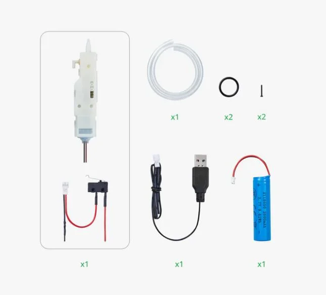

# Mecanismo de disparo: Bambu Lab Electric Water Spray Kit 02 (ZC005)

Ficha de referencia del kit que hará de "pistola de agua eléctrica" del nodo
final del proyecto (ver README, sección "water-tower-defense"). No es una
pieza genérica de bazar sino un **kit oficial de Bambu Lab** pensado para
montar réplicas de juguete imprimibles en 3D. La carcasa que se imprimió aquí
es la **T-15** del modelo MakerWorld
["TEC-9 / T-15 water toy gun"](https://makerworld.com/en/models/689632), el
modelo oficial para este kit. Hay otros modelos que usan el mismo kit, como
["FMG9"](https://makerworld.com/en/models/770810-fmg9-water-spray-electric-water-spray-kit-02).
Aquí se reaprovecha solo el mecanismo eléctrico, no la carcasa de juguete.

## Identificación

- **Kit:** Bambu Lab "Electric Water Spray Kit 02", pieza interna
  identificada como **ZC005** (existe también en variantes ZC004/ZC006/
  ZH054/ZH055 para otros modelos de carcasa del mismo fabricante).
- **Motor:** DC, **3.7V / ~0.9A** en funcionamiento normal.
- **Batería de serie:** 18650 Li-ion **3.7V 2600mAh**, con cargador externo
  USB de **5V 1-2A** por conector **PH2.0** (el cargador solo carga la
  batería; no es la alimentación del motor, que sale directo de la 18650).
- **Prestaciones de fábrica:** alcance 7-8m, **8 ráfagas/segundo**, 133.9g,
  ~100×135×45mm. En banco se han medido ~4.8 disparos/s y ~7 m (ver
  [Medidas en banco](#medidas-en-banco)).
- **Incluye:** el módulo motor+mecanismo, la batería 18650, el cargador y el
  pulsador de disparo. **No incluye bomba de autollenado** (eso es exclusivo
  del "Kit 01"): el depósito se rellena a mano.

## Cómo dispara (mecanismo)

Coincide con lo observado a simple vista: un **motor DC mueve un husillo**
(tornillo sin fin) que empuja/retrae un émbolo cargado por muelle contra su
recorrido; al llegar al final del husillo, un perfil de leva **suelta el
émbolo de golpe**, que dispara el chorro de agua por la energía acumulada en
el muelle — no es el motor empujando el agua directamente, es un mecanismo
de **carga y disparo por leva**, como un percutor. Mientras el motor sigue
girando, el ciclo se repite una y otra vez, dando el disparo **a ráfagas**
(los 8 "rounds/segundo" de fábrica) en vez de un chorro continuo — de ahí
también la "función de recoil simulado" que anuncia Bambu Lab: cada ráfaga
da un tirón mecánico perceptible.

De fábrica el disparo es puramente mecánico/eléctrico simple: un **pulsador**
en serie con el motor y la batería 18650. Eléctricamente es un motor DC de
bajo consumo activado por un interruptor — no lleva ninguna electrónica de
control propia que haya que respetar ni "hablar" con protocolo alguno.

## Integración en el proyecto

- **Sustituir el pulsador por un GPIO del ESP32-S3** con un MOSFET en vez
  de un relé: es un motor DC de bajo consumo (0.9A en marcha), conmuta en
  silencio y sin desgaste. "Disparar una ráfaga" desde firmware es
  simplemente poner el GPIO en alto el tiempo necesario para que el husillo
  complete uno o varios ciclos de leva: **solo on/off, no un PWM**. Hay dos
  variantes, las dos con un **1N4007** (franja hacia el +) y un cerámico
  **104 (100nF)** en los bornes del motor:
  - **[IRLZ44N](irlz44n-mosfet.md) cortando la GND del motor** (montaje del
    autor, que ya lo tenía): 1 MOSFET, 220Ω y 10k. Cortar la GND vale aquí
    porque el motor solo tiene dos cables y ninguno va al ESP32.
  - **[IPP120P04P4L-03](ipp120p04p4l-p-mosfet.md) cortando el positivo**,
    con el mismo circuito que corta los servos (PN2222A, 10k, 1k, 10k),
    basado en el artículo de Taste The Code
    [Sensor Power Switch Using an ESP32 and P-Channel MOSFET](https://www.tastethecode.com/sensor-power-switch-using-an-esp32-and-p-channel-mosfet).
    Para quien replique el proyecto: un solo tipo de MOSFET para todo.
- **Corriente a presupuestar:** 0.9A en marcha es modesto comparado con los
  servos de la torreta (ver [`servos-pan-tilt.md`](servos-pan-tilt.md)),
  pero un motor DC puede dar un **pico de arranque/atasco de 3-5× la
  corriente nominal** (~2.7-4.5A) si el husillo se traba — dimensionar el
  MOSFET y cualquier fusible/PTC de protección con ese margen, no solo con
  los 0.9A nominales.
- **Tensión: no hace falta pasar por el riel de 5V.** El motor de fábrica ya
  corre a 3.7V, que es prácticamente la tensión nativa de la batería Li-ion
  1S del nodo (3.0-4.2V) descrita en
  [`cn3791-mppt-charger.md`](cn3791-mppt-charger.md). Lo más simple es
  alimentar este motor **directamente desde la batería principal**, en
  paralelo con la entrada del [TPS63020](tps63020-buck-boost.md) y del
  [TPS61088](tps61088-boost-converter.md), en vez de sacarlo de una salida
  ya regulada — así no se añade esta carga al presupuesto de corriente de
  los rieles de la cámara (3.3V) ni de los servos (5V).
- **Batería:** se puede prescindir de la 18650 propia del kit y alimentar el
  motor desde la batería única del nodo, o mantenerla como una segunda
  batería dedicada solo al disparo si se prefiere aislar esa carga por
  completo del resto del sistema — a decidir según cómo evolucione el
  diseño final del "espantapájaros".
- **Sin bomba de autollenado:** el depósito de agua de este kit concreto
  (ZC005 / Kit 02) hay que rellenarlo a mano; si el nodo final necesita
  recarga automática, esa pieza vendría del "Kit 01" (u otra solución aparte),
  no de este componente.

Esquemas de las dos variantes del interruptor:

*Esquema generado con IA; no verificado en banco.*

*Esquema generado con IA; no verificado en banco.*

## Medidas en banco

Tomadas con la pistola montada de fábrica (carcasa T-15 impresa), antes de
desmontar el mecanismo, como referencia para comparar una vez integrado en
la torreta.

| Medida | Valor | Notas |
|---|---|---|
| Consumo (batería a medias) | **67 ml en 35 s ≈ 1.9 ml/s** | Disparo continuo, batería de serie |
| Consumo (batería cargada) | **66 ml en 31 s ≈ 2.1 ml/s (~128 ml/min)** | Disparo continuo, batería de serie |
| Cadencia | **~4.8 disparos/s** | Batería cargada. Audio del vídeo a 60 fps a velocidad normal: un golpe cada 0.207 s. El vídeo a cámara lenta 1/4× da un golpe y un chorro cada 0.84 s, que es lo mismo. La ficha de fábrica dice 8/s |
| Agua por disparo | **~0.45 ml** | 2.1 ml/s ÷ 4.8 disparos/s |
| Alcance a 0° | **~5.5 m** | Donde cae el grueso del agua, con la pistola a 1.2 m de altura y sin apenas viento. Otro día dio ~5 m |
| Alcance a 20° hacia arriba | **~6.5 m** | Misma prueba. Otro día dio ~7 m |
| Alcance a 30° hacia arriba | **~7.5 m** | Misma prueba |
| Modelo del chorro | **~18 m/s, k ≈ 0.24 /m** | Tiro parabólico con rozamiento cuadrático ajustado a las tres medidas sin viento (error ~0.4 m). Velocidad y rozamiento salen poco definidos por separado, pero el alcance sí: el mejor ángulo es ~30° y da ~7.1-7.5 m desde 1.2 m, en línea con los 7-8 m de la ficha |

---

*Documento de referencia de hardware, sin foto propia adjunta en este
proyecto — datos recopilados de la ficha oficial de Bambu Lab, Alibaba y el
modelo MakerWorld TEC-9 / T-15 que usa este mismo kit. Componente aún no integrado
en ningún YAML del proyecto.*

*Documento generado con IA; revisar los valores antes de montar.*
