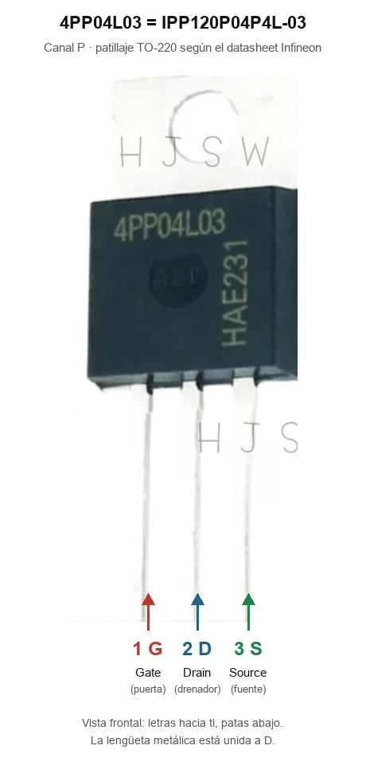
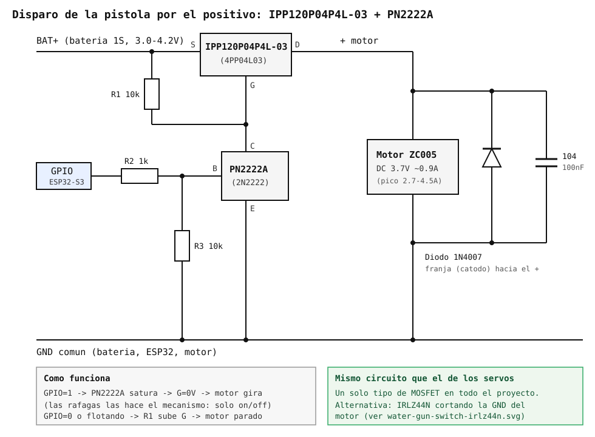

# MOSFET de canal P IPP120P04P4L-03 (4PP04L03)

Ficha de referencia del interruptor que corta **por el positivo** la
alimentación de los [servos](servos-pan-tilt.md) (boost
[TPS61088](tps61088-boost-converter.md) incluido) y, opcionalmente, el motor
de la [pistola de agua ZC005](bambulab-zc005-water-gun.md). Con el mismo
circuito para las dos cargas, quien replique el proyecto solo tiene que
comprar **un tipo de MOSFET**. El autor dispara la pistola con un
[IRLZ44N](irlz44n-mosfet.md) que ya tenía; las dos variantes funcionan igual.

## Por qué hace falta (y por qué por el positivo)

- **El módulo TPS61088 no saca `EN`** a ningún pad, y aunque lo sacara el
  chip **no desconecta la salida**: con `EN` bajo la batería pasa a VOUT por
  el diodo interno del MOSFET de salida (VOUT ≈ VBAT − Vf). Detalle en
  [`tps61088-boost-converter.md`](tps61088-boost-converter.md).
- **Cortar la GND de los servos no sirve.** Con la masa cortada, el servo
  sigue teniendo el + y el cable de señal enchufado a un GPIO, y busca
  retorno por ahí: tirones, consumo fantasma y riesgo para el GPIO. Para la
  pistola sí vale, porque el motor solo tiene dos cables.
- Por eso el corte va **en BAT+, antes del VIN del TPS61088**. Así se apagan
  a la vez el boost y los servos.

## Identificación

- **Fabricante:** Infineon, familia OptiMOS-P2. **Logic level** (la "L" del
  nombre).
- **Marcado en la pieza:** `4PP04L03`, que es como suele aparecer en los
  anuncios.
- **Encapsulado:** TO-220 de patillas, para placa perforada sin adaptador.
  Patillaje del datasheet ("Gate pin 1, Drain pin 2/Tab, Source pin 3"):
  **1 = G, 2 = D, 3 = S**, mirando la cara con las letras y las patas hacia
  abajo. La lengüeta es el Drain.

*Etiquetas añadidas con IA sobre una foto del vendedor; comprobar con el
datasheet.*

## Datos clave

Del [datasheet de Infineon](https://www.infineon.com/dgdl/Infineon-IPP_B_I120P04P4L_03-DataSheet-v01_02-EN.pdf):

| Parámetro | Valor | Nota |
| --- | --- | --- |
| VDS / ID | −40V / −120A | Muy por encima de la batería 1S y de los ~7A de pico |
| VGS(th) | −1.2 / −1.7 / −2.2V (mín/típ/máx) | Empieza a conducir con menos de 2V en la puerta |
| RDS(on) a VGS = −4.5V | 4.0mΩ típ / 5.2mΩ máx | Con la batería a 3.0V sigue en pocos mΩ |
| VGS máx | +5 / −16V | En este circuito la puerta va de 0 a −VBAT |

Con los dos DS3218MG bloqueados (~4.2A a 5V, ~7A desde la batería) caen
unos **0.04V** en el MOSFET. En uso normal, nada apreciable.

## Circuito

La puerta del P-MOSFET hay que llevarla a VBAT para apagarlo y a 0V para
encenderlo. Un GPIO no puede hacerlo directamente, por dos motivos:

- Con la batería a 4.2V, un GPIO a 3.3V deja −0.9V en la puerta y el MOSFET
  conduce a medias.
- La resistencia que sube la puerta llevaría 4.2V al pin, y el ESP32-S3
  admite 3.6V como máximo.

Por eso un **NPN (PN2222A / 2N2222)** hace de driver:

- **GPIO a 1** → el NPN satura → la puerta baja a 0V → el MOSFET conduce.
- **GPIO a 0 o flotando** (arranque, deep sleep) → R3 corta el NPN y R1 sube
  la puerta a BAT+ → apagado, con fuga de µA.

Es el montaje estándar de P-MOSFET + transistor que tira de la puerta (por
ejemplo, [asciimx – MOSFET switches](https://asciimx.com/log/mosfet-switches/)),
cambiando el típico IRF9540N, que necesita ~10V en la puerta, por este.

### Servos

*Esquema generado con IA; no verificado en banco.*

### Pistola (variante con el mismo MOSFET)

*Esquema generado con IA; no verificado en banco.*

El motor solo se enciende y se apaga: las ráfagas las hace el propio
mecanismo de leva. Con R1 de 10k el MOSFET tarda del orden de 100µs en
apagarse, de sobra para eso. No sirve para PWM de varios kHz, que aquí no se
usa.

## Lista de materiales

Por cada circuito (servos y, si se usa esta variante, pistola):

| Pieza | Valor | Colores (4 bandas) |
| --- | --- | --- |
| P-MOSFET | IPP120P04P4L-03 (4PP04L03) | — |
| NPN | [PN2222A](pn2222a-npn.md) / 2N2222 | — |
| R1 puerta → BAT+ | 10kΩ | marrón-negro-naranja |
| R2 GPIO → base | 1kΩ | marrón-negro-rojo |
| R3 base → GND | 10kΩ | marrón-negro-naranja |

Solo en el de la pistola: **1N4007** en paralelo con el motor (franja hacia
el +) y un cerámico **104 (100nF)** en sus bornes. En el de los servos no
hace falta diodo: el corte va antes del boost y sus condensadores absorben la
descarga de los motores.

## Montaje y comprobaciones

- **Placa perforada:** el TO-220 y el PN2222A entran directamente. Las pistas
  del camino BAT+ → S → D → carga, con estaño grueso o cable, porque llevan
  la corriente de los servos.
- **Patillaje del PN2222A:** mirando la cara plana con las letras y las patas
  abajo, **E-B-C**. Foto etiquetada y prueba con el multímetro en su ficha,
  [`pn2222a-npn.md`](pn2222a-npn.md). Ojo: el P2N2222A va al revés (C-B-E).
- **Prueba contra falsificaciones:** en AliExpress hay chips remarcados. Con
  el MOSFET conduciendo y una carga de ~1A, la caída entre S y D debe ser de
  pocos mV. Si son décimas de voltio, la pieza no es lo que dice.
- **Si el ESP32 se reinicia al encender los servos:** al conducir, los
  condensadores de entrada y salida del boost se cargan de golpe (el diodo
  interno del TPS61088 deja pasar la batería aunque aún no conmute). Se
  suaviza con 10k en serie con la puerta y 100nF entre puerta y source.
- **Orden de apagado de los servos:** primero soltar el PWM
  (`auto_detach`), después bajar el GPIO de corte. Ver
  [`servos-pan-tilt.md`](servos-pan-tilt.md#cortar-la-alimentación-de-los-servos-ahorro-en-reposo).
- GPIO de cada corte: **por asignar**. Todavía no hay nada en ningún YAML.

## Dónde comprarlo

Anuncios revisados en octubre de 2026:

- [K Mleon Store – 10 uds](https://es.aliexpress.com/item/1005011635595174.html)
  (~9.4€ + envío)
- [GHTD Global Chip IC – 5 uds](https://es.aliexpress.com/item/1005013102134080.html)
  (~9€)
- [Shop1104385434 – 5/10/20 uds](https://es.aliexpress.com/item/1005010209042473.html)

## Alternativas descartadas

- **IRF9540N / IRF5305:** no son logic-level; necesitan ~10V en la puerta y
  con 3-4.2V apenas conducen. Es el MOSFET que llevan los "módulos PMOS"
  baratos de AliExpress (F5305S), que por eso tampoco sirven aquí.
- **NDP6020P:** TO-220 logic-level (75mΩ a −2.5V), pero descatalogado y con
  ~0.5V de caída en los picos.
- **IRF7425:** 13mΩ a −2.5V, pero en SO-8; necesita placa adaptadora para la
  perforada.
- **Módulo XY-MOS (D4184):** corta por el negativo, igual que el IRLZ44N.
  Vale para la pistola, no para los servos.

---

*Documento de referencia de hardware. Componente aún no comprado ni
cableado en ningún YAML del proyecto.*

*Documento generado con IA; revisar los valores antes de montar.*
