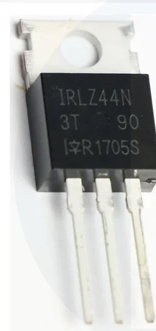
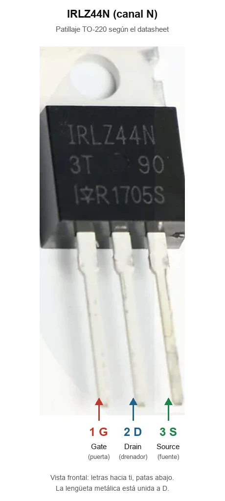
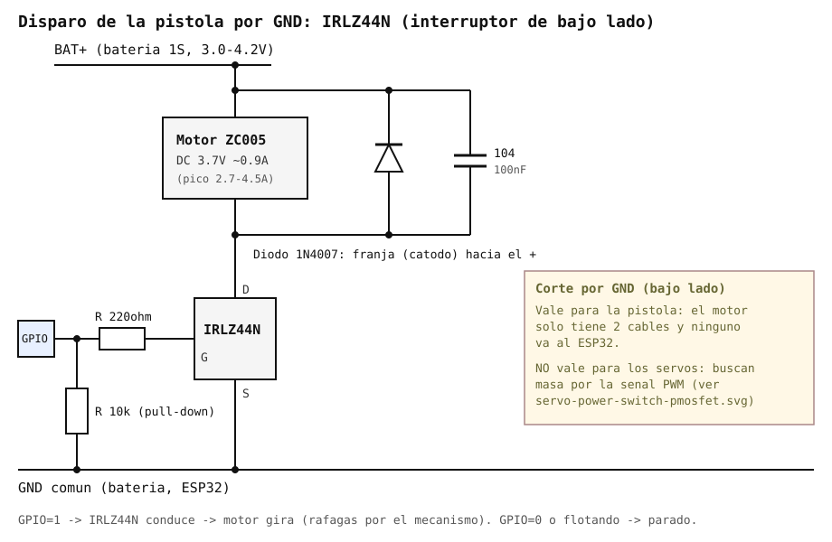

# MOSFET de conmutación IRLZ44N

Ficha de referencia del MOSFET usado como interruptor de bajo lado (corta
la GND) para disparar el motor de la
[pistola de agua ZC005](bambulab-zc005-water-gun.md) en el montaje del
autor. **No se usa para los servos**: cortarles la GND hace que busquen masa
por la señal PWM. Los servos se cortan por el positivo con un
[IPP120P04P4L-03](ipp120p04p4l-p-mosfet.md), y ese mismo P-MOSFET es la
alternativa para la pistola si se quiere un solo tipo de MOSFET en todo el
proyecto.

## Identificación

- **Fabricante:** International Rectifier (hoy Infineon).
- **Tipo:** MOSFET de canal N, **logic-level** (la "L" del nombre) — se
  satura completamente con tensiones de puerta bajas, a diferencia de un
  MOSFET de potencia "normal" que necesita ~10V en la puerta.
- **Encapsulado:** TO-220 (3 patillas: Gate, Drain, Source; con lengüeta
  metálica trasera unida al Drain, para disipador si hiciera falta).
  Patillaje del datasheet: **1 = G, 2 = D, 3 = S**, mirando la cara con las
  letras y las patas hacia abajo.

*Etiquetas añadidas con IA sobre la foto; comprobar con el datasheet.*

## Specs clave

| Parámetro | Valor | Nota |
| --- | --- | --- |
| V_DS máxima | 55V | Muy por encima de los 5V de este proyecto |
| I_D continua | 47A (a 25°C, con disipador) | Sobredimensionado para este uso |
| V_GS(th) (umbral) | 1.0–2.0V | Ya conduce por encima de este valor |
| R_DS(on) | ~0.022Ω a V_GS=10V / ~0.028Ω a V_GS=5V | Sube algo más a 3.3V (ver abajo) |
| Carga de puerta (Qg) | ~48nC | Modesta; un GPIO la carga sin problema a estas frecuencias de conmutación tan bajas |
| Disipación máxima | ~110W (con disipador adecuado) | Muy por encima de lo que disipará aquí |

## Por qué encaja en este proyecto

- **Nivel lógico real:** aunque está pensado para 5V/10V de puerta, su
  umbral (1.0–2.0V) está por debajo de los **3.3V** que da un GPIO de la
  ESP32-S3 directamente — se satura sin necesitar un driver de puerta
  aparte. A 3.3V la R_DS(on) es algo mayor que la de la hoja de datos
  (que se mide a 5V/10V), pero con los 0.9A del motor de la pistola (picos
  de 2.7-4.5A si se atasca) esa diferencia no genera calentamiento
  apreciable.
- **Muy sobredimensionado en corriente:** 47A de capacidad frente a ~1A
  real de carga — no hace falta disipador para este uso; el margen térmico
  es enorme.
- **Cortar la GND sí vale aquí:** el motor solo tiene dos cables y ninguno va
  al ESP32, así que al cortar la masa no hay otro camino de retorno. Es
  justo lo que falla con los servos (ver
  [`servos-pan-tilt.md`](servos-pan-tilt.md#cortar-la-alimentación-de-los-servos-ahorro-en-reposo)).
- **Ya en la mano del usuario:** no es una elección de catálogo, es la
  pieza que ya estaba disponible (reaprovechada de un proyecto de tira de
  LED), de ahí que este documento parta del componente real en vez de
  recomendar uno nuevo.

## Notas de la implementación en este proyecto

*Esquema generado con IA; no verificado en banco.*

- **Circuito:** resistencia de puerta de 220Ω desde el GPIO, pull-down de
  10kΩ a GND, y en los bornes del motor un **1N4007** (franja hacia el +) y
  un cerámico **104 (100nF)**. El motor va de BAT+ al Drain.
- **Solo on/off:** el GPIO se pone en alto mientras dura la ráfaga; las
  ráfagas las hace el mecanismo de leva, no un PWM.
- **Drain vs. Source:** el Drain va hacia el − del motor, el Source va
  directo a GND — no hay ninguna resistencia entre
  Source y GND; el pull-down de 10kΩ solo está entre la puerta y GND, para
  evitar que el MOSFET conduzca sin querer si el GPIO queda flotando
  durante el arranque de la ESP32.
- El patillaje G-D-S es el de la foto de arriba. En clones podría variar:
  si hay dudas, comprobar con el multímetro que la lengüeta y la pata
  central están unidas (son el Drain).

---

*Documento de referencia de hardware. Componente aún no soldado en ningún
YAML/placa activa del proyecto.*

*Documento generado con IA; revisar los valores antes de montar.*
