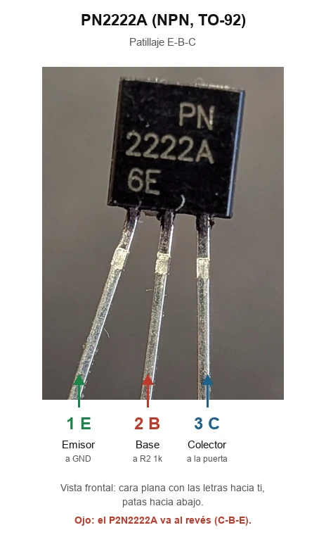

# Transistor NPN PN2222A

Ficha de referencia del transistor que hace de **driver de puerta** del
P-MOSFET [IPP120P04P4L-03](ipp120p04p4l-p-mosfet.md), en el corte de los
servos y en la variante P de la pistola. Es el de un kit de iniciación;
cualquier 2N2222 en TO-92 vale igual, **con cuidado con el patillaje**.

## Patillaje

*Etiquetas añadidas con IA sobre la foto del componente; comprobar con el
datasheet.*

Mirando la **cara plana con las letras hacia ti** y las patas hacia abajo,
de izquierda a derecha:

| Pata | Nombre | Va a |
| --- | --- | --- |
| 1 | **E** – Emisor | GND |
| 2 | **B** – Base | R2 1k al GPIO, y R3 10k a GND |
| 3 | **C** – Colector | Puerta del P-MOSFET, y R1 10k a BAT+ |

**Ojo con los "2222" parecidos:** el **PN2222A** es **E-B-C**, pero el
**P2N2222A** (casi el mismo nombre) es **C-B-E**, al revés. Algunos
2N2222 chinos en TO-92 tampoco siguen el orden. Mirar bien el rótulo y, ante
la duda, comprobarlo con el multímetro.

## Comprobación con el multímetro

En modo diodo:

- Con la **punta roja en la base** (la pata central en el PN2222A) y la
  negra en cada una de las otras dos, deben salir unos **0.6-0.7V**.
- La pata que da una lectura **algo más alta** es el **emisor**.
- En cualquier otra combinación, nada (circuito abierto).
- Si la base no es la pata central, el transistor no es E-B-C: recolocar
  antes de soldar.

## Datos clave

| Parámetro | Valor |
| --- | --- |
| Tipo | NPN, TO-92 |
| VCEO | 40V |
| IC máx | 600mA |

En este circuito apenas trabaja:

- **Colector:** solo absorbe la corriente de R1, unos 0.4mA con la batería
  a 4.2V.
- **Base:** con el GPIO a 3.3V y R2 de 1k le entran unos 2.6mA, de sobra
  para saturarlo.

Fuentes: [etechnophiles – PN2222 pinout](https://www.etechnophiles.com/pn2222-transistor-basics/),
[microcontrollerslab – PN2222A vs P2N2222A](https://microcontrollerslab.com/?p=13781),
[ProtoSupplies – PN2222](https://protosupplies.com/product/pn2222/).

---

*Documento de referencia de hardware. Componente en la mano, aún no soldado
en ninguna placa del proyecto.*

*Documento generado con IA; revisar los valores antes de montar.*
