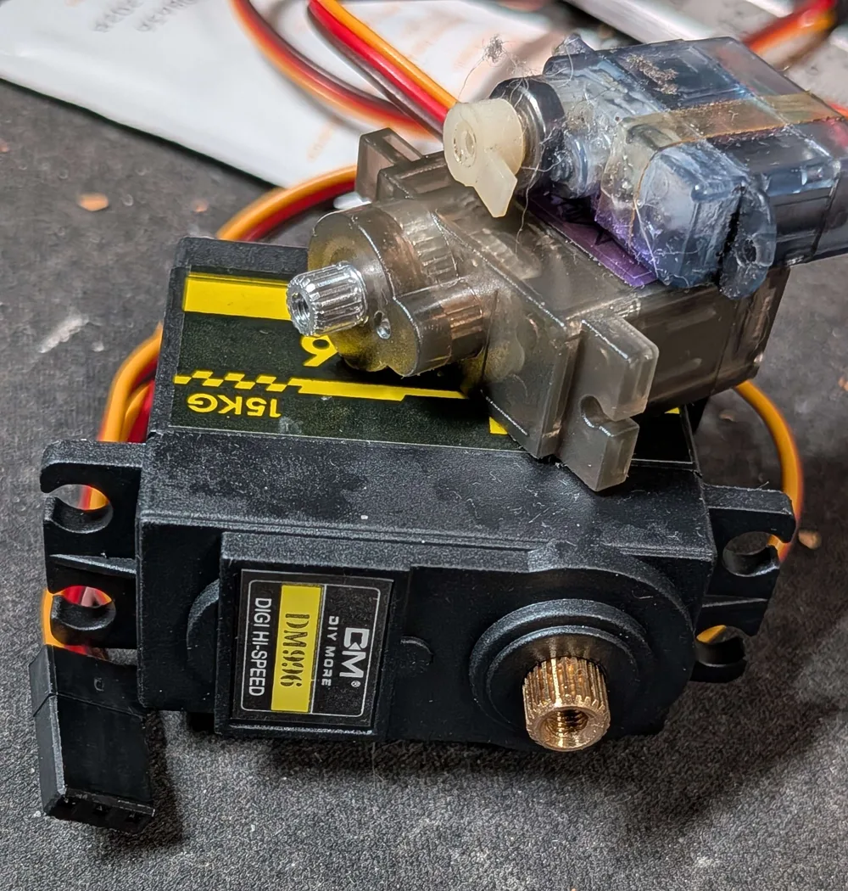
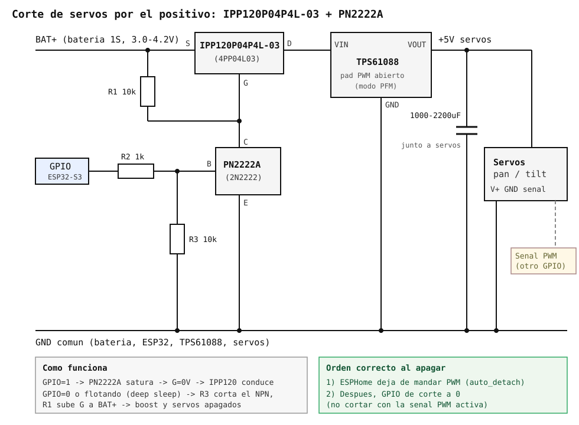
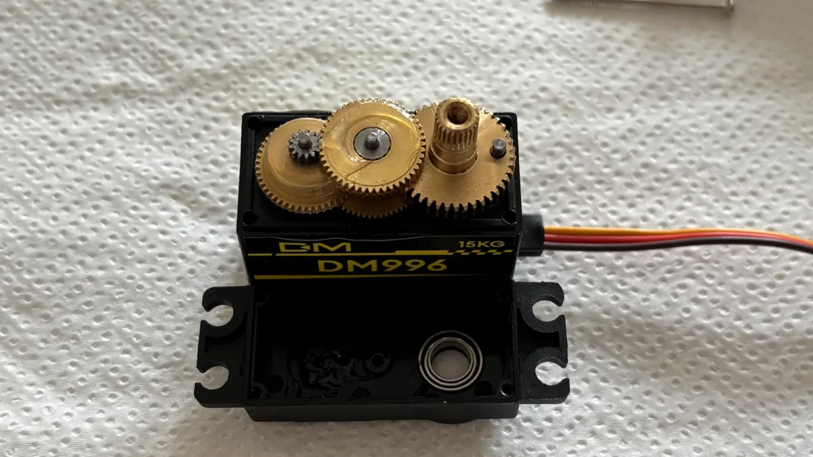
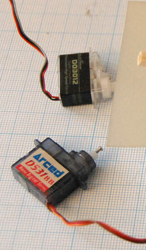

# Servos de la torreta pan/tilt



Ficha de referencia de los servos de la torreta de `esp32-s3-cam-servo.yaml`
(ver [`esp32-s3-cam-board.md`](esp32-s3-cam-board.md)). La torreta usa servos
de **clase 9 g como mínimo**: los servos "pico" de 3-5 g se descartaron tras
quemar dos en el pan (ver [Servos pico descartados](#servos-pico-descartados)).

## Servo montado: Miuzei MF90

El servo montado es el **Miuzei MF90**
([Amazon](https://www.amazon.es/dp/B0C38H8TBY), pack de 4): micro servo de
9 g con **engranajes metálicos**, 180°, de la clase MG90S. No hay ficha
técnica publicada del MF90 como tal; las cifras de la tabla son las de
[ServoDatabase para el Miuzei MG90S](https://servodatabase.com/servo/miuzei/mg90s),
**de la clase, no medidas sobre el MF90**.

| Servo | Peso | Dimensiones (L×An×Al) | Engranajes | Par | Tensión |
| --- | --- | --- | --- | --- | --- |
| **Miuzei MF90** (montado) | ~13.4 g | 22.8 × 12.2 × 28.5 mm | Metal | 1.8 kg·cm a 4.8V / 2.2 kg·cm a 6V | 4.8-6.0V |
| MG90S genérico | ~13.4 g | ~23 × 12.2 × 29 mm | Metal | ~1.8-2.2 kg·cm | 4.8-6.0V |
| SG90 | ~9 g | ~23 × 12.2 × 29 mm | Plástico | ~1.8 kg·cm a 4.8V | 4.8-6.0V |
| MG996R | 55 g | 40.7 × 19.7 × 42.9 mm | Metal | 9.4 kg·cm a 4.8V / 11 kg·cm a 6V | 4.8-7.2V |
| DS3218MG / DS3225MG | ~60 g | ~40 × 20 × 40 mm | Metal | ~20 / 25 kg·cm | 4.8-6.8V |

El SG90 tiene la misma huella y los mismos brazos (horns) que el MF90 y vale
como alternativa barata; con engranajes de plástico, ante un bloqueo suele
pelar dientes antes que quemar el motor, pero aguanta peor los cambios de
dirección bruscos del seguimiento. El MG996R y las DS32xx son otra clase de
servo (tamaño estándar, eje de 25 dientes), para la torreta final con pistola
de agua, donde el par importa más que el tamaño. Los tres comparten huella, así
que un mismo soporte vale para cualquiera (ver
[MG996R: candidato para la torreta con pistola](#mg996r-candidato-para-la-torreta-con-pistola)).

El par (kg·cm) es el máximo con el servo bloqueado: 1.8 kg·cm sostiene 1.8 kg
a 1 cm del eje, 0.6 kg a 3 cm. Con una reducción por engranajes, el par en la
cámara se multiplica por la relación de dientes (corona de la cámara entre
piñón del servo); el tamaño absoluto de los engranajes no cambia el par.

## Compatibilidad de tensión: los alimenta el TPS61088 a 5V fijo

En este proyecto los servos no cuelgan de una pila suelta ni del riel de la
placa: tienen su propio regulador, un [TPS61088](tps61088-boost-converter.md)
fijado a **5V**, separado del [TPS63020](tps63020-buck-boost.md) que da
3.3V a la ESP32-S3-CAM (con `GND` común entre ambos). Los servos de clase
MG90S son de 4.8-6V, no de 3.3V, así que hace falta un riel de 5V real.

| Servo | Rango de tensión | ¿Vale a 5V fijos? |
| --- | --- | --- |
| Miuzei MF90 / MG90S | 4.8-6.0V | Sí |
| SG90 | 4.8-6.0V | Sí |
| MG996R | 4.8-7.2V | Sí |
| DS3218MG | 4.8-6.8V (variante "Pro": 5.0-6.8V) | Sí |

El módulo TPS61088 ofrece también 9V y 12V, pero ninguno de estos servos los
admite (MG90S máx 6V, DS3218MG máx 6.8V, MG996R máx 7.2V), así que 5V es la
única opción válida.

## El pico de consumo real: por qué los servos no comparten regulador con la cámara

**Decisión tomada:** los servos van en un riel de 5V propio con un
[TPS61088](tps61088-boost-converter.md); la ESP32-S3-CAM va a 3.3V con el
[TPS63020](tps63020-buck-boost.md). Lo que sigue es el análisis que llevó a
esa separación, referido a la idea inicial de colgar todo del TPS63020 a 5V.

Más allá de la tensión, el problema serio es de **corriente instantánea**. El
datasheet del [TPS63020](tps63020-buck-boost.md) promete 2A en modo boost,
pero en la práctica (ver el detalle con caso real citado en esa ficha) un
usuario que también boosteaba desde 1S Li-ion solo consiguió sostener
**~1.9A con la batería a 3.0V**, y pasado ese punto la tensión de salida
empieza a hundirse en vez de cortar limpiamente — así que el límite
**utilizable con margen real es más bien ~1.5A**, no los 2A de la etiqueta.
Ese presupuesto (más estrecho de lo que parece) tiene que cubrir a la vez la
ESP32-S3-CAM (picos de transmisión Wi-Fi y captura de cámara) **y** los dos
servos moviéndose o forzando contra un tope mecánico — el caso normal de un
seguimiento proporcional continuo (`detect/servo_tracker.py`), no una
rareza.

Corriente de **parada forzada (stall)** por servo — el pico que hay que
presupuestar, no la corriente en movimiento libre:

| Servo | Corriente de stall (aprox.) | 2 servos a la vez |
| --- | --- | --- |
| **SG90** | ~650-800mA; en movimiento normal ~100-250mA | ~1.3-1.6 A |
| **Miuzei MF90** (montado) | **~0.55A medidos** frenándolo a mano a 5.2V (medición propia; la tensión cae ≤0.01V, así que la fuente no la limita) | **~1.1 A** |
| MG90S genérico | ~700-900mA, según reportes de usuarios en foros de Arduino/RC ([fuente 1](https://www.kpower.com/insight_bldc/7870.html/), [fuente 2](https://forum.arduino.cc/t/how-to-power-mg90s-motors-and-arduino-nano/1001853)); en movimiento normal (no forzado) ronda 120-250mA | ~1.4-1.8 A |
| **MG996R** | **2.5A a 6V** según datasheet TowerPro; a 5V, presupuestar ~2-2.5A. En movimiento, 500-900mA a 6V (datasheet). Detalle en [MG996R](#mg996r-candidato-para-la-torreta-con-pistola) | **~4-5 A** |
| **DS3218MG** | **~1.8A a 5V** (2.6A a 6.8V, según [ServoDatabase](https://servodatabase.com/servo/dsservo/ds3218-mg) y [AIFitLab](https://aifitlab.com/products/dsservo-ds3218-mg-servo-motor)); el DS3225MG, 2.1A / 2.9A | **~3.6 A** |

A eso hay que sumarle el consumo de la propia placa: la ESP32-S3 puede dar
picos de varios cientos de mA en la entrada de 5V durante una transmisión
Wi-Fi o una captura de cámara.

Medida de conjunto con el MF90, todo alimentado por USB con un cargador de
5.19V: **placa + un servo bloqueado = 0.7A**. Con los dos bloqueados a la vez
serían ~0.15 + 2 × 0.55 ≈ **1.25A**: no cabe en un USB de PC (0.5-0.9A), sí
en un cargador de 2A.

**Conclusión práctica:**

- Con **MF90/MG90S** (o SG90), el consenso de la comunidad Arduino/RC es
  tajante: usar **una fuente separada para los servos** y no colgarlos del
  mismo riel que la lógica, precisamente porque la caída de tensión bajo
  carga causa comportamiento errático (brownouts). Con dos servos parados a
  la vez (~1.4-1.8A) ya se come casi todo el presupuesto real del TPS63020,
  dejando la ESP32-S3-CAM sin margen para sus propios picos.
- Con **DS3218MG/DS3225MG** (recomendados para la torreta final con pistola
  de agua), **dos servos parados a la vez ya superan solos el límite del
  módulo** (~4.2A frente a ~1.5A reales) — descartado compartir el
  TPS63020 con estos servos bajo cualquier escenario.
- **Recomendación general, validada tanto por el caso real del TPS63020 como
  por la experiencia de la comunidad con el MG90S:** alimentar los servos
  desde una etapa de potencia aparte, no desde el mismo riel de 5V que la
  ESP32-S3-CAM, con GND común entre ambas fuentes. Añadir un condensador
  electrolítico de valor alto (1000-2200µF) cerca de los servos ayuda a
  amortiguar picos cortos, pero no sustituye a dimensionar la fuente para la
  corriente de stall real.

## Ruido en la imagen y condensador de los servos

**Síntoma:** bandas horizontales en el vídeo mientras el PWM de los servos
está activo, que desaparecen en cuanto actúa el auto-detach. Mientras
sujeta la posición, el servo da un tirón de corriente en cada pulso (50 veces
por segundo); los 5V bajan, el bajón pasa por el AMS1117 y los XC6206 hasta
el sensor, y el rolling shutter (la cámara lee fila a fila) lo convierte en
bandas.

**Arreglo probado:** dos condensadores en paralelo entre V+ y GND de los
servos, lo más cerca posible del punto donde se separan los cables del pan y
del tilt:

- **Electrolítico de 470-1000µF**, 10V o más. Tiene polaridad: la pata larga
  (+) a V+ y la de la franja (−) a GND.
- **Cerámico de 100nF**, marcado "104", sin polaridad. Los 104 baratos pueden
  medir 40-70nF con el polímetro y valen igual.

Resultado: vídeo sin bandas.

Los saltos de dirección de ±30° en movimiento, que no registraban ni Python
ni ESPHome, tenían probablemente el mismo origen (bajones de tensión o GND
compartida que deforman el pulso que lee el servo). **Los condensadores no
bastan contra ellos:** con los MF90, servos y placa en el mismo 5V/USB y los
dos condensadores puestos, siguen saliendo tirones, sobre todo en el pan.
Solo aparecen con el PWM activo; con los servos en auto-detach, no.

Con el PWM cortado (auto-detach) pasa lo contrario: con la torreta quieta y
YOLO funcionando, el pan da a veces un giro solo de ~30° a la izquierda y
vuelve en cuanto recibe una orden. Con auto-detach a 0 no pasa: sin señal, el
servo obedece a cualquier pico espurio de la línea. Por eso el seguimiento
activo no deja soltar los servos (`set_servo_hold`, ver más abajo). El
remedio de hardware, sin probar todavía: pull-down de 10kΩ de la señal a GND
junto al servo y 220-470Ω en serie, o cortar V+ de los servos al soltarlos.

Descartado: GPIO47 a 1.8V (eso solo pasa en las S3 de la serie "V", como
N8R8V; esta placa es N16R8 y el pin va a 3.3V) y un choque de timers LEDC con
el XCLK de la cámara (ver el comentario de `output:` en
`esp32-s3-cam-servo.yaml`).

Pendiente, por este orden:

1. Con "Servo auto detach" a 0, comparar los tirones con el stream abierto y
   con el stream cerrado. Si salen solo con el stream, la causa son los picos
   de consumo.
2. Alimentar los servos con un 5V propio, uniendo la GND con la de la placa
   en un único punto.
3. Si aún quedan tirones: cable de señal corto y trenzado con su GND, una
   resistencia de 220-470Ω en serie y, en último caso, un buffer a 5V
   (74AHCT125).

## Consumo si no se corta la alimentación durante el deep sleep

Las cifras de arriba son el pico de stall — lo que hay que presupuestar para
la fuente. Pero para decidir si merece la pena cortar la alimentación de los
servos en deep sleep (ver sección siguiente), importa otro número distinto:
cuánto consumen los servos **en reposo, con alimentación puesta pero sin
moverse**.

| Servo | Idle/reposo según fabricante (banco, sin carga) |
| --- | --- |
| **Miuzei MF90 / MG90S** | ~5-6mA con la electrónica en reposo sin corregir posición; sube a ~70-90mA en cuanto corrige activamente sin carga externa ([fuente](https://www.kpower.com/insight_bldc/7870.html/)). Medida propia del conjunto con dos MF90 parados: **0.165A** por USB, casi todo de la placa con la cámara transmitiendo |
| **DS3218MG / DS3225MG** | ~4-5mA "detenido" (idle), según datasheet DSSERVO, medido en banco sin carga externa |

**El matiz importante:** esa cifra de datasheet es de banco, sin carga
externa — no es lo que va a consumir el servo sujetando de verdad el peso de
la torreta (cámara y mecanismo, y en la variante pesada también la pistola
de agua) contra la gravedad. Si el conjunto no está bien equilibrado, el
motor tiene que corregir de forma continua para no ceder, y el consumo real
de "reposo con alimentación puesta" puede acercarse al rango de movimiento
normal ya documentado arriba (120-250mA en el caso del MG90S) en vez de
quedarse en los pocos mA del datasheet — depende del equilibrio mecánico de
la torreta, no solo del servo.

**Impacto en la autonomía si no se corta la alimentación:** incluso en el
mejor caso (servos bien equilibrados, consumo cercano al idle de datasheet),
dos servos sin cortar suponen del orden de **8-10mA continuos** solo por
estar encendidos — y si tienen que corregir contra el peso de la torreta,
eso puede subir con facilidad a **decenas o unos pocos cientos de mA**. Comparado
con el consumo de deep sleep de una ESP32 (decenas de µA), la diferencia es
de **2 a 4 órdenes de magnitud**: dejar los servos alimentados domina por
completo el consumo del nodo durante el sueño, sin importar cuánto se
optimice el resto del circuito (incluido el propio regulador boost, ver
[`xl6009-boost-converter.md`](xl6009-boost-converter.md#rol-previsto-xl6009-como-riel-de-servos-cortado-por-un-irlz44n)).
Es la justificación práctica de cortar la alimentación de los servos en vez
de solo despertar/dormir el regulador.

## Cortar la alimentación de los servos (ahorro en reposo)

Además de separar el riel, se corta del todo la corriente a los servos
cuando no hay seguimiento activo. Hay tres formas que parecen valer y no
valen:

- **El pin `EN` del [TPS61088](tps61088-boost-converter.md):** los módulos
  que se venden no lo sacan a ningún pad (el pad "PWM" es el selector de
  modo). Y aunque lo sacaran, el chip no desconecta la salida: con `EN` bajo
  la batería llega a los servos por el diodo interno del MOSFET de salida
  (VOUT ≈ VBAT − Vf).
- **Cortar la GND de los servos** (un N-MOSFET como el
  [IRLZ44N](irlz44n-mosfet.md) en el retorno): el servo sigue con el + puesto
  y el cable de señal enchufado a un GPIO, y busca masa por ahí. Da tirones,
  consumo fantasma y riesgo para el pin.
- **Un relé:** funciona, pero la bobina gasta 70-90mA mientras está
  encendido, hace ruido y abulta en la caja estanca.

Lo que se usa es un **P-MOSFET [IPP120P04P4L-03](ipp120p04p4l-p-mosfet.md)
cortando BAT+ antes del VIN del TPS61088**, con un PN2222A como driver de la
puerta. Así se apagan a la vez el boost y los servos, con una fuga de µA. El
circuito se basa en el artículo de Taste The Code
[Sensor Power Switch Using an ESP32 and P-Channel MOSFET](https://www.tastethecode.com/sensor-power-switch-using-an-esp32-and-p-channel-mosfet).



*Esquema generado con IA; no verificado en banco.*

Puntos clave del esquema:

- **R1 10k** de la puerta a BAT+ (apagado por defecto), **R2 1k** del GPIO
  a la base y **R3 10k** de la base a GND. R3 mantiene el NPN cortado si el
  GPIO flota en el arranque o en deep sleep.
- **Sin diodo flyback** en esta rama: el corte va antes del boost, y sus
  condensadores absorben la descarga de los motores de los servos.
- **Si el ESP32 se reinicia al encender los servos**, es el pico de carga de
  los condensadores del boost. Se suaviza con 10k en serie con la puerta del
  P-MOSFET y 100nF entre puerta y source (detalle en la
  [ficha](ipp120p04p4l-p-mosfet.md)).
- **Orden de apagado importante:** primero dejar que ESPHome corte la señal
  PWM (`auto_detach_time: 2s`, ya presente en `esp32-s3-cam-servo.yaml`), y
  solo después bajar el GPIO de corte. Cortar la alimentación mientras el pin
  de señal todavía manda PWM puede alimentar el servo a medias a través de
  sus diodos de protección internos.

## Qué necesita el proyecto a nivel de firmware

En `esp32-s3-cam-servo.yaml` los servos se controlan por PWM estándar a
50Hz vía el componente `servo:` de ESPHome (pulso ~1-2ms, rango -1.0..1.0
mapeado por `servo.write`) — **cualquiera de los servos de arriba sirve
igual a nivel de firmware**, es una cuestión puramente mecánica (tamaño del
soporte) y de la fuente de alimentación.

El movimiento no lo hace el `transition_length` de ESPHome (va a 0), que
arranca y para a velocidad constante, de golpe. Lo hace un `interval` de
20 ms que, por eje, lleva el servo hacia el objetivo en dos etapas:

```
mid += clamp(target - mid, ±vmax·dt)    vmax = 2 / "Servo transition"
pos += (mid - pos) · k                  k = 1 - exp(-dt / "Servo smoothing")
```

La primera es un limitador de velocidad (lo que hacía la transición de
antes); la segunda es la fórmula clásica de animación `x += (xfinal - x) / vel`,
que frena suave. Juntas, la velocidad del servo nunca salta: ni al arrancar,
ni al frenar, ni cuando llega una orden nueva a mitad de camino. Python sigue
mandando solo el objetivo.

Ajustes, sin compilar, con los number de configuración (desde Home Assistant o
desde `POST /cameras/{id}/config/servo` del servicio):

- **"Servo transition"**: velocidad máxima, como tiempo de recorrido completo
  (-1 a +1). 0 = sin límite.
- **"Servo smoothing"**: suavizado del arranque y la frenada (`tau`, hace ~95%
  del camino en 3 `tau`). 0 = movimiento lineal, el de antes. Tiene que quedar
  bastante por debajo del `min_interval_sec` del seguimiento (0.2 s): el
  suavizado retrasa la torreta y, si se acerca al intervalo entre órdenes, el
  lazo oscila. Por defecto 0.03 s.
- **"Servo auto detach"**: segundos quieto tras los que se corta el PWM. El
  interval deja de escribir al llegar, así que el auto-detach sigue
  funcionando. Mientras el seguimiento está activo, haya objetivo o no, no se
  aplica: el servicio Python llama a la acción `set_servo_hold`
  (`hold: true`), que pone el auto-detach a 0 sin tocar el number, y la repite
  cada 3 s. Con `hold: false` (seguimiento apagado), o a los 10 s sin
  refresco, vuelve el valor del number. El motivo, en "Ruido en la imagen y
  condensador de los servos".

Los valores del bloque `servo:` del YAML son solo los de arranque. El servicio
Python lee los tres number para mostrarlos en `/status`.

## Notas de integración

- El YAML ya avisa (comentario "OJO CON EL TIMER LEDC") de que los servos van
  en los canales LEDC 4 y 6 para no chocar con el reloj de la cámara — eso no
  cambia con ningún servo.
- Si se pasa a un servo de mayor par (MG996R, DS3218/DS3225), revisar la
  alimentación: tiran de más corriente en el arranque/parada (~2-2.5A de stall
  cada uno), pero siguen cabiendo en el riel del
  [TPS61088](tps61088-boost-converter.md) a 5V — solo hay que revisar que la
  batería aguante la corriente de entrada correspondiente.

## MG996R: candidato para la torreta con pistola

Para la torreta con la [pistola de agua](bambulab-water-spray-kits.md) el MF90
se queda corto, y el DS3218MG cuesta el doble que el **TowerPro MG996R**.
Datasheet de TowerPro
([copia en Cornell](https://people.ece.cornell.edu/land/courses/ece4760/FinalProjects/f2017/kmv48_rp625/kmv48_rp625/kmv48_rp625/MG996RTowerPro.pdf),
[ServoDatabase](https://servodatabase.com/servo/towerpro/mg996r)):

| Dato | MG996R |
| --- | --- |
| Peso / tamaño | 55 g, 40.7 × 19.7 × 42.9 mm (huella estándar, como las DS32xx) |
| Eje | 25 dientes, 5.9 mm |
| Par de bloqueo | 9.4 kg·cm a 4.8V, 11 kg·cm a 6V |
| Velocidad | 0.17 s/60° a 4.8V, 0.14 s/60° a 6V |
| Tensión | 4.8-7.2V |
| Corriente en movimiento | 500-900mA a 6V |
| Corriente de bloqueo | 2.5A a 6V |
| Zona muerta | 5 µs |
| Recorrido | **~120°** según el datasheet; muchos vendedores anuncian 180° |
| Electrónica / engranajes | Digital, metal, doble rodamiento (según ficha; los clones suelen ser analógicos y con casquillos, ver [Calidad y clones](#calidad-y-clones)) |

### Consumo según foros

- Las tiendas dan cifras de bloqueo de **1.2-1.5A**, y en el
  [foro de Arduino](https://forum.arduino.cc/t/mg996-current-draw/647906)
  un usuario midió ~1.5A a 5V con multímetro. Los demás le contestaron que el
  multímetro no ve el pico de los primeros milisegundos y que hay que
  dimensionar para **2.5-3A a 5-6V** por servo. Kpower también da 2.5A de
  bloqueo a 6V con picos de 3A, y 200-300mA moviéndose sin carga
  ([Kpower](https://www.kpower.com/insight_gearbox/7237.html), página de
  fabricante).
- Los problemas típicos (tirones, reinicios de la placa, servos que se
  vuelven locos) se acaban atribuyendo casi siempre a la alimentación: fuente
  propia de 5-6V, GND común y condensador cerca del servo
  ([foro de Arduino, clones](https://forum.arduino.cc/t/clone-mg996r-problems/643172)).
  Es lo que ya hace este proyecto con el TPS61088.
- **Reposo con alimentación:** un usuario midió **3.6mA** con el MG996R
  conectado solo a 5V y GND, y **5.6mA** en su montaje con la señal
  conectada y sin PWM. Le contestaron que el lazo de posición del servo no se
  puede dormir
  ([foro de Arduino](https://forum.arduino.cc/t/servo-power-consumption-while-idle/1000984)).
  Es del orden de los 4-5mA de la DS3218MG y apoya cortar la alimentación en
  deep sleep.
- **Caída de tensión en el cableado:** en un brazo con MG996R y una fuente
  de 5V 40A ajustada a 5.3V, la tensión en los servos bajaba 0.1-0.2V con
  carga y **por debajo de 4.6V** cuando el servo patinaba o temblaba
  ([foro de Arduino](https://forum.arduino.cc/t/6dof-robotic-arm-kit-mg996r-servo-dont-work-properly/1226054)).
  Una fuente grande no basta si los cables y conectores son finos.
- **Bloqueo contra el tope:** es la causa de calentamiento más repetida. Un
  clon barrido de 0 a 180° durante 10-15 minutos, con fuente de 3A, acabó
  atascado en un extremo, con ruido de engranajes y olor a bobinado caliente;
  tras enfriarse volvió a funcionar
  ([Robotics StackExchange](https://robotics.stackexchange.com/questions/8103)).
  Otro se calentó con un sketch de prueba hasta que saltó la protección del
  step-down que lo alimentaba
  ([foro de Arduino](https://forum.arduino.cc/t/could-a-sketch-burn-a-servo/483046)).
  En ambos casos la explicación es la misma: pedir un pulso más allá del tope
  mecánico deja el motor en bloqueo permanente, a corriente de stall. Lo
  delata un gruñido continuo.
- **En Reddit** se repiten las mismas cifras: hasta 2.5A de bloqueo por servo
  ([r/robotics](https://www.reddit.com/r/robotics/comments/nc2f2o/servo_motors_tremble_and_i_cant_control_them_at/)),
  y para un hexápodo de 18 MG996R calculan ~45A a 6V con todos bloqueados
  ([r/arduino](https://www.reddit.com/r/arduino/comments/1vqhytt/please_advise_me_on_the_circuit_of_my_hexapod/)).
  Los temblores se achacan a menudo a conexiones de protoboard; soldando
  desaparecen
  ([r/arduino](https://www.reddit.com/r/arduino/comments/1kv2a5v/why_are_my_servos_like_this/)).

### Calidad y clones

Casi todo lo que se vende es clon. En las
[opiniones de ServoDatabase](https://servodatabase.com/servo/towerpro/mg996r)
se repite lo mismo: buen par por el precio, pero servos que no vuelven bien al
centro, zona muerta más ancha y peor repetibilidad que un Hitec, ruido, calor
y unidades que fallan o se queman. Un usuario que los comparó con láser vio
menos holgura en los TowerPro originales que en los clones. Hay clones con
engranajes de plástico
([foro de Arduino](https://forum.arduino.cc/t/is-my-plastic-geared-mg996r-fake/897090)).
Al recibirlos, comprobar los engranajes, el recorrido real (120° o 180°) y que
centren bien antes de montarlos.

En Reddit:

- **Recorrido:** varios usuarios con MG996R vendidos como 180° solo consiguen
  ~120-135°, incluso a 2400 µs
  ([r/arduino](https://www.reddit.com/r/arduino/comments/167phd1/mg996r_180_servo_from_the_pi_hut_seemingly_not/),
  [r/arduino](https://www.reddit.com/r/arduino/comments/1qc2y98/servo_motor_range_of_motion_issues/),
  [r/raspberrypipico](https://www.reddit.com/r/raspberrypipico/comments/18wdbqk/pi_pico_w_not_controlling_mg996r_servo/)).
- **Engranajes:** MG996R "metal gear" que al abrirlos solo traen metal el
  engranaje de salida
  ([r/Electronicsinindia](https://www.reddit.com/r/Electronicsinindia/comments/1tma595/ordered_mg996r_and_mg90s_metal_gear_servos_from/)),
  y engranajes que se rompen en brazos robóticos pequeños
  ([r/arduino](https://www.reddit.com/r/arduino/comments/1tdqzo5/mg996_problem/)).
- **Torreta con seguimiento:** el caso más parecido a este proyecto, una
  torreta pan/tilt con YOLO y dos MG996R, se queja de movimiento a tirones en
  los ajustes pequeños y continuos del seguimiento; le sugieren pasos a paso
  con micropasos o motor DC con reductora y encoder
  ([r/AskRobotics](https://www.reddit.com/r/AskRobotics/comments/1vn28ml/title_mg996r_servos_feel_jerky_when_my_turret/)).
  Aquí lo suaviza en parte el limitador de velocidad y el suavizado del
  firmware (ver [Qué necesita el proyecto a nivel de firmware](#qué-necesita-el-proyecto-a-nivel-de-firmware)),
  pero la zona muerta y la holgura del servo no las arregla el software.

*Lo de Reddit está sacado de los resúmenes de Google: la extensión del
navegador no deja abrir reddit.com.*

Lo que añaden otros foros:

- **Zona muerta real y electrónica analógica:** en RCGroups, un usuario
  midió **150 µs de zona muerta** en ocho MG996R comprados en eBay, frente a
  los 5 µs de la ficha, y encontró casquillos de Delrin donde se anunciaban
  rodamientos. El chip era un AA51880, un clon del NE544 analógico: **no son
  servos digitales**, aunque la ficha (y la tabla de arriba) lo diga. Los
  dejó por debajo de 5 µs cambiando dos componentes (R3 por 1kΩ, C4 por
  100nF) y añadiendo 100nF en bornes del motor
  ([RCGroups](https://www.rcgroups.com/forums/showthread.php?2485803-Fixup-MG996R-servos)).
  Con unos 0.09° por µs (500-2500 µs para ~180°), 150 µs son **~13°**: el
  seguimiento no movería el servo con correcciones pequeñas y luego daría un
  salto. Si una unidad no reacciona a cambios pequeños de posición, sospechar
  de esto antes que del firmware.
- **120° o 180° depende del pulso:** con un clon chino y los pulsos que daba
  el vendedor (500-2500 µs), el barrido fue de **~185-190°**; con los límites
  estándar de la librería se quedaba en ~100°
  ([foro de Arduino](https://forum.arduino.cc/t/using-standard-example-servo-icw-mg996r-180/1079650)).
  El componente `servo:` de ESPHome usa por defecto `min_level: 3%` y
  `max_level: 12%` (600-2400 µs a 50Hz). Para calibrar, abrir esos límites
  poco a poco hasta que el servo deje de ganar recorrido, sin llegar a que
  gruña contra el tope (ver "Bloqueo contra el tope" en
  [Consumo según foros](#consumo-según-foros))
  ([Robotics StackExchange](https://robotics.stackexchange.com/questions/8103)).
- **Oscilación con cargas de mucha inercia:** en un brazo con MG996R, los
  servos de abajo, los más cargados, seguían oscilando tras un empujón
  suave. La explicación aceptada es que el regulador interno viene ajustado
  para cargas ligeras, como las superficies de un avión de RC, y con mucha
  inercia se pasa de largo
  ([Robotics StackExchange](https://robotics.stackexchange.com/questions/22723)).
  Es el caso del pan con la pistola; equilibrar y acercar la masa al eje
  ayuda también aquí.
- **Versiones de 360°:** se venden "MG996R 360°" de rotación continua con la
  misma carcasa. Un usuario recibió uno que giraba sin topes a mano, aunque
  con señal se comportaba como posicional
  ([Electronics StackExchange](https://electronics.stackexchange.com/questions/564443)).
  Girarlo a mano sin alimentar antes de montarlo: debe tener topes.
- **Extremos que se desplazan:** un clon cuyos extremos se movieron ~15°
  tras unos cuantos encendidos resultó ser, con toda probabilidad, el brazo
  patinando sobre el eje
  ([Robotics StackExchange](https://robotics.stackexchange.com/questions/8104)).
  Apretar el tornillo del brazo (horn).

### diymore DM996: dos versiones con la misma serigrafía

diymore vende su MG996R como **DM996** en dos versiones. Las dos llevan
"DM996" serigrafiado y la misma pegatina de "15KG · 180° All-Metal", así que
solo se distinguen por el anuncio:

| | Latón y rodamientos | Cobre y hierro |
| --- | --- | --- |
| Anuncio | "Upgraded version, All Copper Gear, Double Ball Bearing" ([Amazon.es](https://www.amazon.es/dp/B09WQSX9KC), [Amazon UK](https://www.amazon.co.uk/dp/B09WQSX9KC)) | "DM996 Servo, Metal Gear" ([Amazon.es](https://www.amazon.es/dp/B09V5B6SB6); en UK, packs de [2](https://www.amazon.co.uk/dp/B09KZ8VTNB), [4](https://www.amazon.co.uk/dp/B09V5B6SB6) y [6](https://www.amazon.co.uk/dp/B09KZRPJ41)) |
| Engranajes | Todos de latón | Salida de latón, intermedios de acero |
| Rodamientos | 2 de bolas | No se anuncian; en la foto de la carcasa no se ven |
| Tensión (ficha) | 4.8-6V | 4.8-6V |
| Par (ficha) | 13 kg·cm a 4.8V, 15 a 6V | 9 kg·cm a 4.8V, 13-15 a 6V según el anuncio |
| Precio (Amazon.es, oct. 2026) | 23.98 € el pack de 4 | 24.99 € el pack de 4 |
| Opiniones | 4.4-4.5★ (368 en UK) | 4.4-4.5★ (122-341 por anuncio) |

Opiniones de la versión de latón y rodamientos (Amazon UK):

- Un usuario que monta unos 80 servos al año abrió varios: bien
  engrasados, mecanismo entero de latón y "realmente llevan rodamientos de
  bolas metálicos". Rinden como servos de marca de 8 a 10 veces el precio;
  algo más ruidosos hasta que asientan los engranajes.
- Otro lo confirma con fotos: todos los engranajes metálicos y 2
  rodamientos. Un tercero los describe como "nada nerviosos" (*not twitchy
  at all*).
- En contra: "no mucho par" en un brazo robótico, y ~4 mm más altos de lo
  que da a entender la foto de medidas.



*Foto de un cliente en las opiniones de Amazon, no nuestra.* Se ven los
engranajes de latón y un rodamiento de bolas en la tapa; el único piñón
plateado es el del motor.

En la versión de cobre y hierro hay fallos graves en las opiniones: uno que
había tenido MG996R originales dice que suenan ásperos y que se queman tras
una hora de uso; otro, a algo menos de 6V, vio echar humo a 3 de 6 a los 10
minutos por un cortocircuito interno, y el primero le estropeó la fuente;
otro se murió a las pocas semanas.

Ninguna opinión dice qué chip llevan, así que el "digital" de la ficha está
sin comprobar. Con el servo sujetando una posición y empujando el brazo con
el dedo: un analógico solo corrige con cada pulso de la señal y suena como un
zumbido grave de 50 Hz, y cerca de la posición cede un poco antes de
empujar; un digital da un pitido agudo y empuja con toda la fuerza en cuanto
se le desvía. La prueba segura es abrir la tapa de abajo: un chip de 16 patas
AA51880, KC8801, M51660 o BA6688 (clones del NE544) es analógico; un
microcontrolador, a menudo con la marca borrada, es digital. Los transistores
del puente (8205) aparecen en los dos. Que sea digital importa también
porque muchos digitales siguen sujetando la posición sin señal, y entonces
el auto-detach no los suelta: hay que cortarles la alimentación.

### Alternativas digitales: familia DS3218

Servos digitales de la misma huella (40 × 20 × 40 mm, eje de 25 dientes) con
zona muerta de **3 µs** en ficha, frente a los 150 µs medidos en clones del
MG996R. En Reddit se repite que un digital tipo DS3218 tiene "mejor
resolución y mucho menos temblor" que un analógico
([r/robotics](https://www.reddit.com/r/robotics/comments/1od47jx/robotic_arm_for_writing/)).
Precios de Amazon.es en octubre de 2026:

| Servo | Par (ficha) | Bloqueo | Precio | Opiniones |
| --- | --- | --- | --- | --- |
| [Miuzei 15 kg 180°](https://www.amazon.es/dp/B0C1TXW74L) | 13 kg·cm a 4.8V, 15 a 7.4V; 0.17 s/60° a 4.8V; 56 g | 1.8A a 4.8V | 10.99 € (1), 15.99 € (2), 6.20 €/u en pack de 5 | 4.5★ (942): "con arduino ni un temblor", "funcionamiento preciso, fácil de configurar en esp32"; "no dan 15 kilos y son algo lentos", "un poco ruidoso" |
| [Miuzei 20 kg 180°](https://www.amazon.es/dp/B0G7HKKD77) | 20 kg·cm | — | 14.99 € (1), 27.99 € (2) | Anuncio nuevo, sin opiniones propias |
| [Miuzei 20 kg 270° (DS3218MG)](https://www.amazon.es/dp/B0BV6HQF2X) | hasta 22.8 kg·cm a 6.8V; 56 g, 40 × 20.5 × 40.5 mm | — | 15.98 € (1), 12.33 €/u en pack de 3 | 4.6★ (883): "aparenta 12 kg más o menos", "se calienta"; uno "perdió su centro" y empezó a dar saltos a los pocos días |
| DSServo DS3115MG | 14.5 kg·cm a 4.8V, 17.3 a 6.5V; 60 g | 1.8A a 4.8V | En Amazon.es solo revendedores a ~97 € | Fichas de tiendas con cifras dispares (otra da 15 / 17 kg·cm y 1.6 / 2.5A: [RoboticsDNA](https://roboticsdna.in/product/servo-15kg-ds3115mg-270deg-metal-gear-digital-servo-motor-arduino-high-torque/)) |

Las opiniones de Amazon se comparten entre variantes del mismo anuncio, así
que valen como orientación. Miuzei es la misma marca que el MF90 montado.

**180° o 270°:** los dos usan 500-2500 µs, así que el de 270° reparte más
grados por µs: ~0.135°/µs frente a ~0.09°/µs. Con los 3 µs de zona muerta
son 0.4° frente a 0.27°, despreciable en los dos. El de 270° da más
recorrido al pan; el de 180° es más fino. Con los límites por defecto de
ESPHome (600-2400 µs) el de 270° llega a ~243°.

En precio, el Miuzei 15 kg 180° en pack sale como el MG996R de diymore
(~6 €/u) siendo digital, y el DS3218MG de Miuzei, a 12-15 €/u.

**AliExpress** (octubre de 2026, con envío a España) no sale más barato:

- DSServo DS3218MG 180° suelto: 21.19 €, 19.39 €/u desde 2
  ([RC Toy Hobby Store](https://es.aliexpress.com/item/1005003446676428.html),
  4.9★, 119 valoraciones).
- Pack de 4 DSServo
  ([anuncio](https://es.aliexpress.com/item/1005007822346908.html), 4.9★,
  661 valoraciones): DS3218 180° a 56.69 € (14.17 €/u), DS3218 270° a
  50.99 € (12.75 €/u), DS3218 Pro 180° a 58.39 €.
- DS3115MG: no aparece en las búsquedas de AliExpress España.
- MG995/MG996R "digitales" de 15 kg: desde ~4.80 € la unidad, sin datos
  sobre electrónica ni rodamientos.
- Feetech STS3215: servo de bus serie (TTL) con encoder magnético en lugar
  de potenciómetro, sin zona muerta de lectura y con lectura de posición.
  ~25 € la unidad y a 12V: es otra clase de servo, con otro riel y otro
  protocolo. No encaja con el TPS61088 a 5V
  ([anuncio](https://es.aliexpress.com/item/1005008284773473.html)).

### Par frente a consumo

El par de bloqueo depende de la corriente, del motor (par por amperio) y de la
reductora. Con las cifras de ficha:

| Servo | Par / corriente de bloqueo |
| --- | --- |
| MF90 | 1.8 / 0.55 ≈ 3.3 kg·cm/A (corriente medida) |
| MG996R | 9.4-11 / 2.5 ≈ 3.8-4.4 kg·cm/A |
| DS3218MG | 19 / 1.8 ≈ 10.6 kg·cm/A (a 5V) |

El MF90 y el MG996R salen parecidos. El DS3218MG sacaría más del doble por
amperio a la misma velocidad; es más probable que alguna de sus cifras sea
optimista que un motor tan superior. Para salir de dudas: brazo de longitud
conocida empujando sobre una báscula de cocina con el servo bloqueado,
par (kg·cm) = báscula (kg) × brazo (cm), midiendo a la vez la corriente.

### Carga de la torreta con pistola

El depósito va aparte, fijo y más alto que la pistola (el agua baja por
gravedad); la torreta solo mueve la pistola, la cámara con la electrónica, una
manguera de silicona y dos cables de silicona (4 × 0.3 mm² y 2 × 0.5 mm²)
hasta la caja de la batería y el [CN3791](cn3791-mppt-charger.md). Son unos
200-250 g; con el centro de gravedad a 2-3 cm del eje del tilt hacen falta
~0.5-0.7 kg·cm, más el margen habitual de ×2-3 para aceleraciones y el
retroceso de la pistola. El MG996R deja un margen de ×12 o más; el MF90 no
llega con margen.

- **Equilibrar el tilt:** que el eje pase cerca del centro de gravedad del
  conjunto. Es lo que más par ahorra.
- **Manguera y cables:** el arrastre del cable USB fue lo que quemó los
  [servos pico](#servos-pico-descartados). Bajar manguera y cables juntos por
  el eje del pan, o pegados a él, con un bucle flojo y un tramo vertical libre
  largo, sin funda en espiral. En el tilt, que la manguera entre cerca del eje.
- **Goteo:** con el depósito por encima, comprobar que el agua no sale por la
  boquilla con la pistola parada; si sale, válvula antirretorno o pinza en la
  manguera.
- **Cable de potencia:** con el TPS61088 en la torreta, los 2 × 0.5 mm² llevan
  la corriente de batería: dos MG996R bloqueados son ~7A a 3.5V. Con menos de
  30 cm (0.6 m de ida y vuelta, ~0.02 Ω) caen ~0.14V en el peor caso; vale.
  Pesan más los conectores (JST-PH/XH aguantan 2-3A: usar XT30 o soldar), la
  resistencia interna de la 18650 (50-100 mΩ) y la protección de la batería,
  que en muchas placas corta a 3-5A. Electrolítico grande en la entrada del
  TPS61088.

**Plan:** probar con MG996R. Si tiembla o no centra, poner un DS3218MG en el
eje que lo necesite; el soporte es el mismo.

## Servos pico descartados



Los primeros servos de la torreta fueron servos "pico" de 3-4 g que había de
otro proyecto. Con dos **Arced D531BB** (0.51 kg·cm a 4.8V, ~210mA de stall
medido) en el pan, **se dañaron el motor y los engranajes de los dos**. El par
no bastaba frente al arrastre del cable USB al girar el pan: el servo se
quedaba forzando y calentándose. Por eso el mínimo de la torreta es la clase
9 g, con unas 3.5 veces más par.

---

*Documento generado con IA; revisar los valores antes de montar.*
