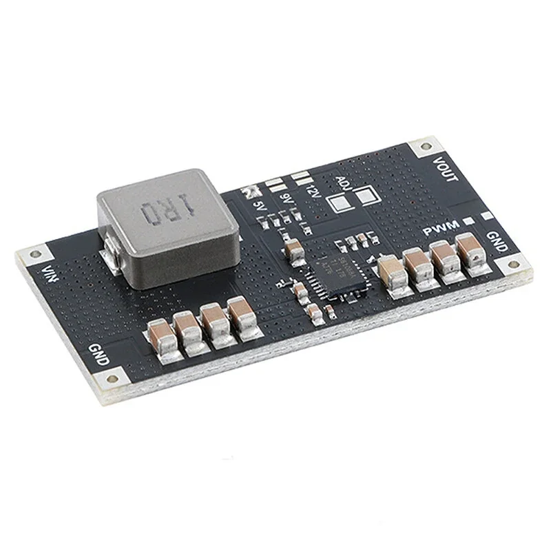

# Módulo elevador de tensión TPS61088 (10A)

Ficha de referencia del módulo boost basado en el chip **TPS61088**
(Texas Instruments), **elegido como riel de 5V de los servos** de la torreta
en lugar del [MT3608](mt3608-boost-converter.md) y el
[XL6009](xl6009-boost-converter.md) (ver
[`step-up-boost-comparativa.md`](step-up-boost-comparativa.md)). Módulo
previsto: "TPS61088 Boost Module 5V/9V/12V 10A 1MHz", por ejemplo
[este](https://es.aliexpress.com/item/1005010313046314.html) o
[este](https://es.aliexpress.com/item/1005009535413093.html) de AliExpress
(es la misma placa). **No saca el pin `EN`**: los servos se apagan cortando
la entrada con un [P-MOSFET](ipp120p04p4l-p-mosfet.md) (ver "Rol en el
proyecto").

## Identificación

- **Chip principal:** **TPS61088** (Texas Instruments) — convertidor
  **boost síncrono** totalmente integrado (MOSFET de potencia de 11mΩ y de
  rectificación de 13mΩ, sin diodo externo), hasta **10A de corriente de
  conmutación** ([datasheet TI, SLVSCM8A](https://www.ti.com/lit/ds/symlink/tps61088.pdf)).
- **Entrada:** 2.7-12V (encaja con la batería 1S 3.0-4.2V de este proyecto).
  **Salida:** 4.5-12.6V, ajustable por resistencias (los módulos comerciales
  suelen traer jumpers/soldaduras para 5V/9V/12V, igual que el TPS63020).
  En este proyecto se fija a **5V**: es el único paso válido para los servos,
  porque el siguiente (9V) ya supera el máximo de los MG90S (6V) y también el
  de los DS3218MG (6.8V) de [`servos-pan-tilt.md`](servos-pan-tilt.md).
- **Frecuencia de conmutación:** ajustable 200kHz-2.2MHz por resistencia
  externa (el módulo típico viene fijado a 1MHz de fábrica).
- **Modo de luz de carga:** seleccionable entre PFM (más eficiente, pin
  `MODE` flotante) y PWM forzado (`MODE` a GND) — igual filosofía que el
  MT3608 y el TPS63020, pero aquí es una elección explícita, no automática.
  En el módulo es el **pad "PWM"** junto a la borna de GND: abierto (de
  fábrica) = PFM, puenteado = PWM forzado. Según el vendedor, en vacío
  consume **200-600µA en PFM** y **15-65mA en PWM**: **no se puentea**.
- **`EN` en el módulo:** el chip lo tiene, con pull-down interno de 800kΩ,
  pero la placa lo lleva fijo a VIN y **no lo saca a ningún pad**. Los
  únicos pads son VIN, VOUT, dos GND, los puentes 5V/9V/12V/ADJ y el "PWM".
- **Además, `EN` no desconecta la salida.** Es un boost síncrono sin
  desconexión de carga: con `EN` bajo deja de conmutar, pero la batería pasa
  a VOUT por el diodo interno del MOSFET de salida (VOUT ≈ VBAT − Vf, unos
  3.3-3.8V). Lo confirma TI en sus foros
  ([E2E](https://e2e.ti.com/support/power-management-group/power-management/f/power-management-forum/1190693/tps61088-shutdown-current),
  [E2E China](https://e2echina.ti.com/support/power-management/f/power-management-forum/185489/tps61088rhlr-how-to-turn-off-vout-by-en-pin)).
  Aunque se sacara `EN` modificando la placa, los servos seguirían
  alimentados.

## Consumo en reposo (quiescent current)

Datos de la tabla "Electrical Characteristics" del datasheet TI (VIN =
3.6V, TJ = 25°C salvo indicación):

| Condición | Corriente | Nota |
| --- | --- | --- |
| Habilitado, sin carga, corriente por el pin `VIN` | **1µA típ / 3µA máx** | `VEN=2V`, sin carga |
| Habilitado, sin carga, corriente por el pin `VOUT` | **110µA típ / 250µA máx** | Con el divisor resistivo de feedback conectado a `VOUT` — sube algo el total real |
| Apagado (`EN=0V`) | **1µA típ / 3µA máx** | "Shutdown current into the VIN pin" |

**Lectura práctica:** sumando ambos términos, el consumo real habilitado y
sin carga ronda **~100-250µA** (dominado por la corriente que se pierde en
el propio divisor de feedback en `VOUT`, no por el núcleo del chip) — muy
por debajo de los 2.5-5mA del XL6009 y comparable o mejor que los 100-200µA
del MT3608 en PFM. El vendedor del módulo da 200-600µA en PFM, medido a 9V
de salida. El modo `EN=0V` (1-3µA) **no es alcanzable** con el módulo, que
no saca `EN`, y además no apagaría los servos (ver arriba). El apagado real
es cortar VIN con el [P-MOSFET](ipp120p04p4l-p-mosfet.md), que deja boost y
servos en la fuga del MOSFET (µA).

## Rol en el proyecto

Riel de **5V dedicado a los servos**, separado del riel de 3.3V que el
[TPS63020](tps63020-buck-boost.md) da a la ESP32-S3-CAM. Ambos módulos
cuelgan en paralelo de la misma batería 1S y comparten **`GND` con la
placa** — obligatorio, no opcional: la señal PWM de los servos sale de un
GPIO del ESP32 y necesita la misma referencia de masa que el riel que los
alimenta.

- **Presupuesto de corriente de entrada:** al ser boost, la corriente que
  pide a la batería es mayor que la que entrega. Dos MG90S en stall a la vez
  son ~1.4-1.8A a 5V (ver [`servos-pan-tilt.md`](servos-pan-tilt.md)); con
  ~85% de eficiencia y la celda a 3.3V eso son **~2.5-3A de entrada** en el
  peor caso. La batería y su cableado tienen que aguantarlo, no solo el
  módulo.
- **Apagado: cortando VIN por el positivo.** Un P-MOSFET
  [IPP120P04P4L-03](ipp120p04p4l-p-mosfet.md) entre BAT+ y VIN, con un
  PN2222A como driver, apaga a la vez el boost y los servos. No sirve
  cortar la GND de los servos con un [IRLZ44N](irlz44n-mosfet.md): buscan
  masa por la señal PWM (ver
  [`servos-pan-tilt.md`](servos-pan-tilt.md#cortar-la-alimentación-de-los-servos-ahorro-en-reposo)).
- **10A de corriente de switch** deja mucho margen por encima de los picos
  de stall documentados en [`servos-pan-tilt.md`](servos-pan-tilt.md)
  (hasta ~4.2A con dos DS3218MG/DS3225MG a la vez) — a diferencia del
  MT3608 y el XL6009, cuyo "2A"/"4A" de rótulo no se sostenía en la
  práctica con módulos genéricos.
- **Coste:** más caro que un MT3608/XL6009 de trimpot (esos módulos suelen
  costar menos de 1€ en más de 1 unidad), pero sigue siendo una pieza
  barata y ampliamente disponible, no un componente exótico.

## Notas de integración

- **Tensión de salida por puentes de soldadura:** junto al chip hay tres
  pads, **5V / 9V / 12V**, y un hueco marcado **ADJ**. Se cortocircuita con
  estaño **solo el de 5V**. ADJ es el sitio para soldar una resistencia
  propia (o un potenciómetro en la versión ajustable) si se quiere otra
  tensión; según el vendedor solo funciona si ningún puente está hecho, y
  no se pueden combinar. Aquí se deja vacío. **Medir VOUT con el
  multímetro antes de conectar los servos**, por si la placa viniera con
  otro puente hecho de fábrica.
- **No puentear el pad "PWM"**: de fábrica queda en PFM, que es el modo de
  bajo consumo en vacío.
- Poner un condensador electrolítico de **1000-2200µF** en la salida, lo más
  cerca posible de los servos, para amortiguar los picos cortos de stall (ya
  recomendado en [`servos-pan-tilt.md`](servos-pan-tilt.md)); no sustituye
  a dimensionar la fuente, pero evita que un golpe de corriente hunda el riel.
- Respetar el orden de apagado de [`servos-pan-tilt.md`](servos-pan-tilt.md#cortar-la-alimentación-de-los-servos-ahorro-en-reposo):
  primero dejar que ESPHome suelte la señal PWM (`auto_detach_time`), después
  bajar el GPIO que corta VIN.

---

*Documento de referencia de hardware, generado a partir del datasheet TI
SLVSCM8A y el listado de AliExpress citado arriba. Componente aún no
comprado ni cableado en ningún YAML del proyecto.*

*Documento generado con IA; revisar los valores antes de montar.*
